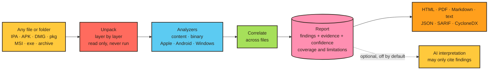
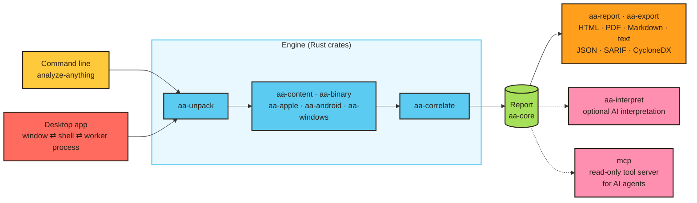

# Analyze Anything

**English** · [简体中文](README.zh-CN.md) · [繁體中文](docs/readme/README_zh-TW.md) · [日本語](docs/readme/README_ja.md) · [한국어](docs/readme/README_ko.md) · [Türkçe](docs/readme/README_tr.md) · [Русский](docs/readme/README_ru.md) · [Tiếng Việt](docs/readme/README_vi.md) · [ไทย](docs/readme/README_th.md) · [Deutsch](docs/readme/README_de.md) · [Español](docs/readme/README_es.md) · [Français](docs/readme/README_fr.md) · [Українська](docs/readme/README_uk.md) · [Polski](docs/readme/README_pl.md) · [Português (Brasil)](docs/readme/README_pt-BR.md) · [العربية](docs/readme/README_ar.md) · [فارسی](docs/readme/README_fa.md) · [Bahasa Indonesia](docs/readme/README_id.md) · [Italiano](docs/readme/README_it.md) · [Ελληνικά](docs/readme/README_el.md) · [മലയാളം](docs/readme/README_ml.md) · [Roman Urdu](docs/readme/README_ur-Latn.md) · [Română](docs/readme/README_ro.md) · [Български](docs/readme/README_bg.md)

[Website](https://atomsprout.com/analyze-anything/) · [Examples](https://atomsprout.com/analyze-anything/#examples) · [Roadmap](docs/ROADMAP.md)

Give it any artifact on your computer — an IPA, an APK, a macOS app, a DMG or pkg, a Windows installer or program folder, an archive, a folder, any file — and get a report you can trust and trace: every finding carries its evidence (which file, where in it, what was read there) and a confidence, and whatever could not be analyzed is listed under coverage and limitations.

```
analyze-anything App.ipa
```

That writes `App.ipa.report/` with the report as HTML, PDF, Markdown, plain text and JSON. SARIF and CycloneDX are available too.

- **Static only.** The input is read, never run, installed or loaded.
- **Offline.** The analysis connects to nothing and uses no language model.
- **Deterministic.** The same input gives the same report, byte for byte.
- **Written in Rust**, with no outside tools needed at run time.

There are two ways to use it, on the same engine, giving the same report for the same input:

- the **command line**, `analyze-anything` (short name `aaaa`);
- the **desktop app** for macOS, with unsigned Windows x64 packages: drop a file, watch the progress, read the report, click a piece of evidence to see its bytes, export, keep a history, and, if you set it up, have a model explain the report beside it.

## What it looks like

<table>
  <tr>
    <td width="50%"><br><sub>The desktop app: the report's summary</sub></td>
    <td width="50%"><br><sub>Findings, each with its evidence</sub></td>
  </tr>
  <tr>
    <td><br><sub>The optional AI interpretation beside the report; every statement cites findings</sub></td>
    <td><br><sub>Drop a file or folder to start</sub></td>
  </tr>
</table>

<p align="center"><br><sub>The same report as a PDF</sub></p>

The screenshots show the report about F-Droid 2.0.3, one of the [examples](https://atomsprout.com/analyze-anything/#examples).

## Install

macOS on Apple silicon, with Homebrew:

```
brew install atomsprout/tap/analyze-anything                  # the command line
brew install --cask atomsprout/tap/analyze-anything-desktop   # the desktop app
```

Each works without the other. Both are signed with a Developer ID certificate and notarized by Apple.

To build the command line from source (Rust 1.90 or newer):

```
cargo build --release
target/release/analyze-anything <file or folder>
```

The signed macOS/Homebrew distribution is 0.1.1 for Apple silicon Macs. [Release 0.2.2](https://github.com/atomsprout/analyze-anything/releases/tag/v0.2.2) provides unsigned CLI archives for Windows x64, Linux x64/ARM64 and Apple silicon macOS, plus Windows x64 desktop portable ZIP and offline NSIS installer. Download the archive for your platform, check its SHA-256 sidecar and extract it; run the CLI executable inside. The Windows CLI is statically linked to the C runtime and needs no separate Visual C++ runtime installation. Hosted Windows and Ubuntu 24.04 x64 desktop checks passed; the offline Windows 10 installation check used an earlier desktop candidate. See [platform qualification](docs/LIMITATIONS.md#published-preview-and-report-workflow) for exact package and runtime boundaries.

## Use

The 0.2.3 candidate adds Arch Linux package and ar archive readers, Linux entry declarations
and a shared format catalogue with explicit supported profiles. Its build and release
qualification are in progress; 0.2.2 remains the published download baseline. Packaged
workflow checks retain their [recorded source and artifact scope](docs/spikes/report-workflow.md).

```
analyze-anything <file or folder>                 # analyze; the report goes to <name>.report/
analyze-anything App.ipa -o out --lang zh         # choose the folder; write the report in Chinese
analyze-anything query out/report.json evidence --args '{}' # offline evidence queries, without AI
analyze-anything explain out/report.json <finding id>    # one finding with all its evidence
analyze-anything verify out/                      # are the files still what was written?
```

The full guide is [docs/USAGE.md](docs/USAGE.md).

## Examples

Reports about public releases of open-source software, as PDFs, are on the [website](https://atomsprout.com/analyze-anything/#examples): an IPA, an APK, a DMG, a macOS pkg, an NSIS and an MSI installer, and a Linux program. `tools/site/examples.py` makes them again from the same files.

## What it reads

The catalogue below describes the integrated 0.2.5 source candidate. Published 0.2.2 packages retain their recorded profiles; 0.2.3 is still building, and the later image and language readers require their own release qualification.

<!-- formats:begin -->
**32 primary format families + 4 compression formats (36 total)**, with 11 declaration families tracked separately. See the [supported profiles and limits](docs/FORMATS.md), or run `analyze-anything formats --json`.
<!-- formats:end -->

| | |
|---|---|
| Apple | `.app` and other bundles, IPA, DMG (HFS+ and APFS), pkg; Info.plist, code signatures and certificate chains, sealed resources, entitlements, provisioning profiles, privacy manifests, FairPlay encryption |
| Android | APK, AAB, XAPK / APKS / APKM; manifest, resources, signature schemes v1–v3.1, DEX, SDKs and packers |
| Windows | PE, Authenticode, .NET assemblies and bounded single-file bundles, PyInstaller CArchive contents, MSI (with its own signature), NSIS, Inno Setup, CAB, self-extractors, Electron (asar), MSIX, installed program folders |
| Linux packages | Bounded deb, RPM v4 and Arch profiles: package metadata, literal dependencies and installation scripts, TAR/CPIO payloads and link declarations; ar static libraries, systemd/Desktop Entry/AppStream declarations; no installation or package authentication |
| Linux applications | SquashFS v4 gzip/XZ file contents and metadata; AppImage Type 2 image boundaries, identity and AppRun evidence; snap identity, application/interface/hook declarations and supplied-file links; no mounting or runtime invocation |
| General | Mach-O, ELF and PE structure and hardening; zip, tar, 7z, gzip, bzip2, xz, zstd, nested within configured limits; URLs, likely credentials, entropy, duplicate files |

## How it works

One pass, read only: the input is opened layer by layer, each file is read by the analyzers that understand it, a last step relates the files to one another, and everything that was found is written down with its evidence. The report is the single source of every output format.



The command line and the desktop app are two faces of the same engine, so one input gives the same report in both. The desktop app never analyzes in its own process: a worker does, and can be stopped for certain.



## Optional: a deeper look with Ghidra or Hopper

Off unless you ask for it. The analysis can say that a program imports `dlopen` or holds an address; with `--deep` it also asks a disassembler you have installed **which functions** use them:

```
analyze-anything deep ghidra --path <Ghidra's folder>   # once; or: analyze-anything deep hopper
analyze-anything App.ipa --deep
```

The report gains findings such as "the address `https://…` is referred to by `-[AboutViewController tableView:didSelectRowAtIndexPath:]`", each with the place in the file. They name the tool and its version and are kept apart from the rest. Nothing of the input is run. See [docs/DEEP.md](docs/DEEP.md).

## Optional: an AI reading of the report

Off unless you turn it on. Once a report is written, a language model can explain it in plain words:

```
analyze-anything ai claude          # once: choose who does it (here Claude Code, no API key needed)
analyze-anything App.ipa --ai       # analyze, then write ai.md next to the report
```

You choose who does it: a model service you have an API key for (Claude, or anything that speaks OpenAI's protocol), Claude Code, Codex, or a model that Ollama runs on your own machine. A program of your own works too. The model sees the report, never the analyzed files, and looks things up in it through read-only tools. Every statement it makes must cite findings of the report; those that do not are dropped. See [docs/AI.md](docs/AI.md).

## Status and roadmap

The current published release is 0.2.2; the 0.2.3 candidate is still building. GitHub packages cover the CLI on four targets and the Windows desktop; these packages are unsigned. The signed macOS/Homebrew distribution remains 0.1.1. Five real-report workflows and packaged analysis/query/agent behavior have scoped acceptance records; [the roadmap](docs/ROADMAP.md) tracks the next work. Broader platform and format qualification remains open.

The 0.2.3 candidate implements Arch packages and ar archives, systemd/Desktop Entry/AppStream declarations and bounded supplied-library relationships. The later 0.2.4 candidate adds SquashFS, AppImage Type 2 and snap. The 0.2.5 source candidate also reads wheel, npm tarball and JAR declarations, with captured component identities and literal unresolved dependencies, bringing the source catalogue to 36 primary/compression families. [Image](docs/LIMITATIONS.md#linux-breadth-b-image-profiles) and [language package](docs/LIMITATIONS.md#language-package-breadth-c-profiles) records distinguish implemented profiles from qualification and publication. Next, in order:

1. **Linux application qualification**: complete the integrated native, cross-platform and packaged checks for the 0.2.4 candidate before publication; broaden the documented image profiles separately.
2. **Language package qualification**: deliver the implemented wheel, npm tarball and JAR profiles after the Linux application batch, with their own native, cross-platform and packaged checks. WAR/EAR remain unqualified profiles within the Java family.
3. **Further breadth**: qualify Alpine APK, Flatpak, one OCI/Docker family and LZ4, targeting 40 families. .NET IL and deeper component relationships follow; optional evidence retention remains separate.

What will not change: static only, offline analysis, the same report for the same input, evidence for every finding, and no verdict. The whole picture is in [docs/ROADMAP.md](docs/ROADMAP.md); the itemized list is [docs/TODO.md](docs/TODO.md).

## Good to know

- Severity is a fixed property of each rule, there to order your reading. The report does not say whether an input is safe.
- Findings marked heuristic (likely credentials, packers, SDK detection) can be false positives.
- Signatures are checked against the file itself: digests, signature values, certificate chains. Revocation, system trust settings and Apple's notarization status are not checked; that would need the network.
- An IPA downloaded from the App Store is encrypted: this is recognized, and metadata, signature and resources are analyzed as usual, but the encrypted code cannot be read.
- Use it only on things you have the right to analyze.

More in [docs/LIMITATIONS.md](docs/LIMITATIONS.md).

## Documentation

- [docs/USAGE.md](docs/USAGE.md) — the command line in full ([中文](docs/USAGE.zh-CN.md))
- [docs/QUERY.md](docs/QUERY.md), [docs/JSON.md](docs/JSON.md) — offline queries, pagination and report compatibility
- [docs/AGENT-SERVER.md](docs/AGENT-SERVER.md) — explicit rooted analysis requests over MCP
- [docs/DEEP.md](docs/DEEP.md) — the optional deep level: asking Ghidra or Hopper which code does what
- [docs/AI.md](docs/AI.md) — the optional AI interpretation
- [docs/DESKTOP.md](docs/DESKTOP.md) — the desktop app: structure, development, testing, release
- [docs/LIMITATIONS.md](docs/LIMITATIONS.md) — known limitations
- [docs/ANALYZERS.md](docs/ANALYZERS.md) — how to add a format
- [docs/ROADMAP.md](docs/ROADMAP.md) — where it stands and where it is going
- [docs/TODO.md](docs/TODO.md) — what is left to do, item by item
- [AGENTS.md](AGENTS.md) — how to work in this repository, for contributors and coding agents
- [docs/PLAN.md](docs/PLAN.md), [docs/PLAN-DESKTOP.md](docs/PLAN-DESKTOP.md), [docs/RESEARCH.md](docs/RESEARCH.md), [docs/spikes/](docs/spikes/) — how it was planned and what was tried

## Development

```
cargo fmt --all --check
cargo clippy --workspace --all-targets -- -D warnings
cargo test --workspace
```

[AGENTS.md](AGENTS.md) says how the repository is laid out and what a change must keep. The desktop app lives in `apps/desktop`; see [docs/DESKTOP.md](docs/DESKTOP.md). Issues and pull requests are welcome. Please do not attach files you have no right to share: the one finding from `report.json` that shows the problem is usually enough.

## License

Apache-2.0; see [LICENSE](LICENSE). What is bundled from others, the fonts in the reports among them, is listed in [NOTICE](NOTICE).
