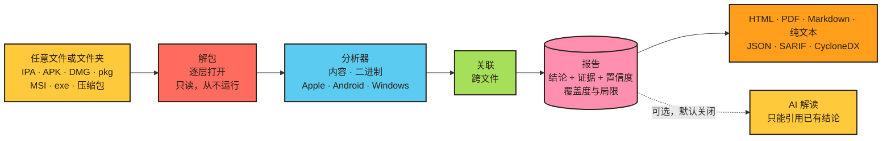
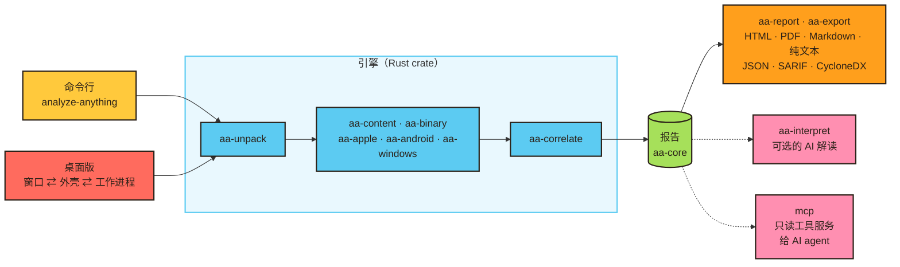

# Analyze Anything

[English](README.md) · [网站](https://atomsprout.com/analyze-anything/) · [例子](https://atomsprout.com/analyze-anything/#examples) · [路线图](docs/ROADMAP.md)

把电脑上的任意产物交给它——IPA、APK、macOS 应用、DMG 或 pkg、Windows 安装包或程序目录、压缩包、文件夹、任意文件——得到一份可靠、可溯源的报告：每条结论都带证据（来自哪个文件、哪个位置、读到了什么）和置信度，没能分析的部分如实列在“覆盖度与局限”里。

```
analyze-anything App.ipa
```

这会写出 `App.ipa.report/`，里面是 HTML、PDF、Markdown、纯文本和 JSON 格式的报告。另外还支持 SARIF 和 CycloneDX。

- **纯静态。** 输入只会被读取，不会被执行、安装或加载。
- **离线。** 分析过程不连接任何地方，也不使用语言模型。
- **确定。** 同一个输入得到字节相同的报告。
- **用 Rust 写成**，运行时不依赖外部工具。

有两种用法，共用同一套引擎，同一个输入得到相同的报告：

- **命令行** `analyze-anything`（短名字 `aaaa`）；
- macOS 的**桌面版**：拖入文件，看进度，读报告，点开证据看字节，导出，保留历史并对比两个版本；设置好之后，还可以让模型在报告旁边解读它。

报告默认是英文，加 `--lang zh` 写中文。

## 长什么样

<table>
  <tr>
    <td width="50%"><br><sub>桌面版：报告的概要</sub></td>
    <td width="50%"><br><sub>结论，每条都带证据</sub></td>
  </tr>
  <tr>
    <td><br><sub>报告旁边可选的 AI 解读，每句话都引用结论</sub></td>
    <td><br><sub>拖入文件或文件夹即可开始</sub></td>
  </tr>
</table>

<p align="center"><br><sub>同一份报告的 PDF</sub></p>

截图里是对 F-Droid 2.0.3 的分析报告，它是[例子](https://atomsprout.com/analyze-anything/#examples)之一。

## 安装

Apple 芯片的 Mac，用 Homebrew：

```
brew install atomsprout/tap/analyze-anything                  # 命令行
brew install --cask atomsprout/tap/analyze-anything-desktop   # 桌面版
```

两者互不依赖。都用 Developer ID 证书签名并经过 Apple 公证。

其他平台从源码构建命令行（需要 Rust 1.90 或更新版本）：

```
cargo build --release
target/release/analyze-anything <文件或文件夹>
```

目前只发布 Apple 芯片 Mac 的版本。在 Linux 和 Windows 上，代码能构建、测试在 CI 里通过，但还没有人在这两个平台上实际用过。

## 使用

```
analyze-anything <文件或文件夹>                    # 分析；报告写到 <名字>.report/
analyze-anything App.ipa -o out --lang zh         # 指定文件夹；用中文写报告
analyze-anything diff 旧/report.json 新/report.json     # 两个版本之间变了什么
analyze-anything explain out/report.json <结论 ID>      # 一条结论和它的全部证据
analyze-anything verify out/                      # 输出文件有没有被改动
```

完整说明见 [docs/USAGE.zh-CN.md](docs/USAGE.zh-CN.md)。

## 例子

[官网](https://atomsprout.com/analyze-anything/#examples)上有对开源软件公开发布版本的分析报告（PDF）：IPA、APK、DMG、macOS pkg、NSIS 和 MSI 安装程序，以及一个 Linux 程序。`tools/site/examples.py` 可以用同样的文件重新生成它们。

## 能读什么

| | |
|---|---|
| Apple | `.app` 等 bundle、IPA、DMG（HFS+ 和 APFS）、pkg；Info.plist、代码签名与证书链、封存资源、权利、描述文件、隐私清单、FairPlay 加密 |
| Android | APK、AAB、XAPK / APKS / APKM；清单、资源、签名方案 v1–v3.1、DEX、SDK 与加固壳 |
| Windows | PE、Authenticode、.NET 程序集、MSI（含它自身的签名）、NSIS、Inno Setup、CAB、自解压程序、Electron（asar）、MSIX、已安装程序目录 |
| 通用 | Mach-O、ELF、PE 的结构与加固选项；zip、tar、7z、gzip、bzip2、xz、zstd，任意嵌套；URL、疑似凭据、熵、相同文件 |

## 工作原理

只读地走一遍：输入被一层层打开，每个文件交给认识它的分析器去读，最后一步把文件之间的关系对起来，所有结论连同证据一起写下来。各种输出格式都出自同一份报告。



命令行和桌面版是同一套引擎的两个入口，所以同一个输入在两边得到相同的报告。桌面版从不在自己的进程里分析：由工作进程来做，并且一定停得下来。



## 可选：让 AI 解读报告

默认关闭，开启才有。报告写好之后，可以让语言模型用通俗的话解释它：

```
analyze-anything ai claude          # 设置一次：选择由谁来做（这里是 Claude Code，不需要 API key）
analyze-anything App.ipa --ai       # 分析，然后在报告旁边写出 ai.md
```

由谁来做由你选：你有 API key 的模型服务（Claude，或任何使用 OpenAI 协议的服务）、Claude Code、Codex，或者 Ollama 在你本机运行的模型。也可以是你自己的程序。模型看到的是报告，不是被分析的文件；它通过只读工具在报告里查东西。它说的每句话都必须引用报告里的结论，引用不成立的整句丢掉。见 [docs/AI.md](docs/AI.md)（英文）。

## 现状与规划

0.1.0 是第一个版本。今天任何文件或文件夹都能得到一份报告；Apple、Android、Windows 的格式能深入理解。目前只发布了 Apple 芯片 Mac 的版本，也只在一台这样的 Mac 上手工用过；在 Linux 和 Windows 上，代码能构建并通过 CI 里的测试。

“Anything”是对下限的承诺，也是上限的方向：什么都不拒绝，深度则一种格式一种格式地加，每种格式是一个小 crate。接下来按这个顺序做：

1. **各个系统上都一样可用**：发布 Linux、Windows、Intel Mac 的版本；桌面版走出 macOS。
2. **更多种输入**：Linux 软件包、容器镜像、各语言生态的包、更多应用平台、带代码的文档、固件镜像。
3. **在要紧的地方更深入**：用离线数据库匹配已知漏洞、函数级的事实、把规则和策略做成数据。
4. **更容易在它之上构建**：GitHub Action、把 AI 解读放进报告、更完整的 agent 接口、稳定的报告结构。

不会变的：纯静态、分析过程离线、同样的输入得到同样的报告、每条结论都有证据、不下判决。完整内容见 [docs/ROADMAP.md](docs/ROADMAP.md)（英文），逐条的待办见 [docs/TODO.md](docs/TODO.md)。

## 请知悉

- 严重度是每条规则固定的设定，用来排列阅读顺序。报告不对“输入是否安全”下结论。
- 标为“启发式”的结论（疑似凭据、加壳、SDK 识别）可能误报。
- 签名校验的是文件自身：摘要、签名值、证书链。不检查吊销状态、系统信任设置和 Apple 的公证状态，那需要联网。
- App Store 下载的 IPA 是加密的：能识别出来，元数据、签名、资源照常分析，但加密的代码读不了。
- 仅用于分析你有权分析的对象。

更多见 [docs/LIMITATIONS.md](docs/LIMITATIONS.md)（英文）。

## 文档

除本文件和使用说明外，文档都是英文。

- [docs/USAGE.zh-CN.md](docs/USAGE.zh-CN.md) — 命令行的完整说明
- [docs/AI.md](docs/AI.md) — 可选的 AI 解读
- [docs/DESKTOP.md](docs/DESKTOP.md) — 桌面版：结构、开发、测试、发布
- [docs/LIMITATIONS.md](docs/LIMITATIONS.md) — 已知局限
- [docs/ANALYZERS.md](docs/ANALYZERS.md) — 如何添加一种格式
- [docs/ROADMAP.md](docs/ROADMAP.md) — 现状与规划
- [docs/TODO.md](docs/TODO.md) — 逐条的剩余待办
- [AGENTS.md](AGENTS.md) — 如何在这个仓库里工作，写给贡献者和编码 agent

## 开发

```
cargo fmt --all --check
cargo clippy --workspace --all-targets -- -D warnings
cargo test --workspace
```

[AGENTS.md](AGENTS.md) 说明了仓库的结构，以及任何改动都必须保持的东西。桌面版在 `apps/desktop`，见 [docs/DESKTOP.md](docs/DESKTOP.md)。欢迎提 issue 和 pull request。请不要附上你无权公开的文件：通常 `report.json` 里相关的那一条结论就足以说明问题。

## 许可证

Apache-2.0，见 [LICENSE](LICENSE)。随程序分发的第三方内容（包括报告里用的字体）列在 [NOTICE](NOTICE) 里。
