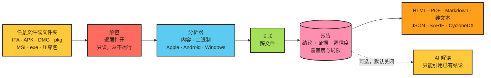
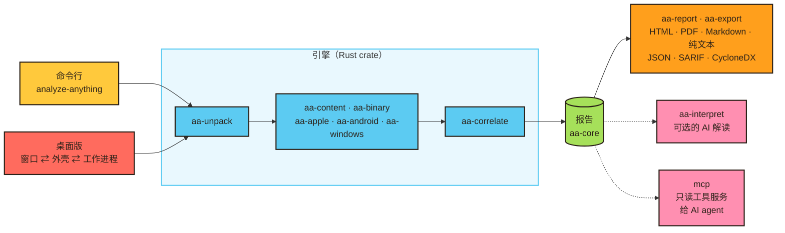

# Analyze Anything

[English](README.md) · **简体中文** · [繁體中文](docs/readme/README_zh-TW.md) · [日本語](docs/readme/README_ja.md) · [한국어](docs/readme/README_ko.md) · [Türkçe](docs/readme/README_tr.md) · [Русский](docs/readme/README_ru.md) · [Tiếng Việt](docs/readme/README_vi.md) · [ไทย](docs/readme/README_th.md) · [Deutsch](docs/readme/README_de.md) · [Español](docs/readme/README_es.md) · [Français](docs/readme/README_fr.md) · [Українська](docs/readme/README_uk.md) · [Polski](docs/readme/README_pl.md) · [Português (Brasil)](docs/readme/README_pt-BR.md) · [العربية](docs/readme/README_ar.md) · [فارسی](docs/readme/README_fa.md) · [Bahasa Indonesia](docs/readme/README_id.md) · [Italiano](docs/readme/README_it.md) · [Ελληνικά](docs/readme/README_el.md) · [മലയാളം](docs/readme/README_ml.md) · [Roman Urdu](docs/readme/README_ur-Latn.md) · [Română](docs/readme/README_ro.md) · [Български](docs/readme/README_bg.md)

[网站](https://atomsprout.com/analyze-anything/) · [例子](https://atomsprout.com/analyze-anything/#examples) · [路线图](docs/ROADMAP.md)

把电脑上的任意产物交给它——IPA、APK、macOS 应用、DMG 或 pkg、Windows 安装包或程序目录、压缩包、文件夹、任意文件——得到一份可靠、可溯源的报告：每条结论都带证据（来自哪个文件、哪个位置、读到了什么）和置信度，没能分析的部分如实列在“覆盖度与局限”里。

```
analyze-anything App.ipa
```

这会写出 `App.ipa.report/`，里面是 HTML、PDF、Markdown、纯文本和 JSON 格式的报告。另外还支持 SARIF 和 CycloneDX。

- **纯静态。** 输入只会被读取，不会被执行、安装或加载。
- **离线。** 分析过程不连接任何地方，也不使用语言模型。
- **确定。** 同一个输入得到字节相同的报告。
- **用 Rust 写成**，运行时不依赖外部工具。

有两种用法，共用同一套引擎，同一个输入得到相同的报告：

- **命令行** `analyze-anything`（短名字 `aaaa`）；
- macOS 的**桌面版**，另有 Windows x64 未签名安装包：拖入文件，看进度，读报告，点开证据看字节，导出，保留历史；设置好之后，还可以让模型在报告旁边解读它。

报告默认是英文，加 `--lang zh` 写中文。

## 长什么样

<table>
  <tr>
    <td width="50%"><br><sub>桌面版：报告的概要</sub></td>
    <td width="50%"><br><sub>结论，每条都带证据</sub></td>
  </tr>
  <tr>
    <td><br><sub>报告旁边可选的 AI 解读，每句话都引用结论</sub></td>
    <td><br><sub>拖入文件或文件夹即可开始</sub></td>
  </tr>
</table>

<p align="center"><br><sub>同一份报告的 PDF</sub></p>

截图里是对 F-Droid 2.0.3 的分析报告，它是[例子](https://atomsprout.com/analyze-anything/#examples)之一。

## 安装

Apple 芯片的 Mac，用 Homebrew：

```
brew install atomsprout/tap/analyze-anything                  # 命令行
brew install --cask atomsprout/tap/analyze-anything-desktop   # 桌面版
```

两者互不依赖。都用 Developer ID 证书签名并经过 Apple 公证。

从源码构建命令行（需要 Rust 1.90 或更新版本）：

```
cargo build --release
target/release/analyze-anything <文件或文件夹>
```

签名的 macOS/Homebrew 发行版仍是面向 Apple 芯片 Mac 的 0.1.1。[0.2.2 版本](https://github.com/atomsprout/analyze-anything/releases/tag/v0.2.2)提供 Windows x64、Linux x64/ARM64 和 Apple 芯片 macOS 的未签名 CLI 归档，以及 Windows x64 桌面便携 ZIP 和离线 NSIS 安装包。下载对应平台的归档，核对随附的 SHA-256 后解压，运行其中的 CLI。Windows CLI 静态链接 C 运行库，无需另装 Visual C++ 运行库。托管环境的 Windows 和 Ubuntu 24.04 x64 桌面检查已通过；Windows 10 离线安装检查使用的是较早的桌面候选包。具体安装包和运行环境范围见[平台验收记录](docs/LIMITATIONS.md#published-preview-and-report-workflow)。

## 使用

0.2.3 候选版增加了 Arch 软件包与 ar 归档解析、Linux 入口声明，
以及明确支持范围的共享格式目录。其构建与发行验收仍在进行；
已发布的下载基线仍是 0.2.2。发布包的流程检查仍以
[已记录的源码与制品范围](docs/spikes/report-workflow.md)为准。

```
analyze-anything <文件或文件夹>                    # 分析；报告写到 <名字>.report/
analyze-anything App.ipa -o out --lang zh         # 指定文件夹；用中文写报告
analyze-anything query out/report.json evidence --args '{}' # 离线查询证据，无需 AI
analyze-anything explain out/report.json <结论 ID>      # 一条结论和它的全部证据
analyze-anything verify out/                      # 输出文件有没有被改动
```

完整说明见 [docs/USAGE.zh-CN.md](docs/USAGE.zh-CN.md)。

## 例子

[官网](https://atomsprout.com/analyze-anything/#examples)上有对开源软件公开发布版本的分析报告（PDF）：IPA、APK、DMG、macOS pkg、NSIS 和 MSI 安装程序，以及一个 Linux 程序。`tools/site/examples.py` 可以用同样的文件重新生成它们。

## 能读什么

下面的目录描述 0.2.4 源码候选版。已发布的 0.2.2 安装包仍以其验收记录为准；0.2.3 仍在构建，新增映像读取器还需完成自己的发行验收。

<!-- formats:begin -->
**29 类主要格式＋4 种压缩格式（共 33 类）**，另列 11 类声明格式。详见[支持范围与限制](docs/FORMATS.md)，或运行 `analyze-anything formats --json`。
<!-- formats:end -->

| | |
|---|---|
| Apple | `.app` 等 bundle、IPA、DMG（HFS+ 和 APFS）、pkg；Info.plist、代码签名与证书链、封存资源、权利、描述文件、隐私清单、FairPlay 加密 |
| Android | APK、AAB、XAPK / APKS / APKM；清单、资源、签名方案 v1–v3.1、DEX、SDK 与加固壳 |
| Windows | PE、Authenticode、.NET 程序集与有边界的单文件包、PyInstaller CArchive 内容、MSI（含它自身的签名）、NSIS、Inno Setup、CAB、自解压程序、Electron（asar）、MSIX、已安装程序目录 |
| Linux 软件包 | 有边界的 deb、RPM v4 与 Arch 支持：包元数据、依赖与安装脚本的字面声明、TAR/CPIO 载荷及链接声明；ar 静态库、systemd/Desktop Entry/AppStream 声明；不安装或认证软件包 |
| Linux 应用 | SquashFS v4 gzip/XZ 文件内容与元数据；AppImage Type 2 映像边界、身份和 AppRun 证据；snap 身份、应用／接口／钩子声明与随附文件关联；不挂载或调用运行时 |
| 通用 | Mach-O、ELF、PE 的结构与加固选项；zip、tar、7z、gzip、bzip2、xz、zstd，在配置限制内嵌套；URL、疑似凭据、熵、相同文件 |

## 工作原理

只读地走一遍：输入被一层层打开，每个文件交给认识它的分析器去读，最后一步把文件之间的关系对起来，所有结论连同证据一起写下来。各种输出格式都出自同一份报告。



命令行和桌面版是同一套引擎的两个入口，所以同一个输入在两边得到相同的报告。桌面版从不在自己的进程里分析：由工作进程来做，并且一定停得下来。



## 可选：用 Ghidra 或 Hopper 看得更深

默认关闭。常规分析能说出一个程序导入了 `dlopen`、或者里面写着某个地址；加上 `--deep`，它还会去问你电脑上装的反汇编器：**是哪些函数**在用它们。

```
analyze-anything deep ghidra --path <Ghidra 所在文件夹>   # 设置一次；或者：analyze-anything deep hopper
analyze-anything App.ipa --deep
```

报告里会多出这样的结论：“地址 `https://…` 被 `-[AboutViewController tableView:didSelectRowAtIndexPath:]` 引用”，并给出它在文件里的位置。这些结论都注明出自哪个工具、哪个版本，和其余结论分开。输入不会被运行。详见 [docs/DEEP.md](docs/DEEP.md)（英文）。

## 可选：让 AI 解读报告

默认关闭，开启才有。报告写好之后，可以让语言模型用通俗的话解释它：

```
analyze-anything ai claude          # 设置一次：选择由谁来做（这里是 Claude Code，不需要 API key）
analyze-anything App.ipa --ai       # 分析，然后在报告旁边写出 ai.md
```

由谁来做由你选：你有 API key 的模型服务（Claude，或任何使用 OpenAI 协议的服务）、Claude Code、Codex，或者 Ollama 在你本机运行的模型。也可以是你自己的程序。模型看到的是报告，不是被分析的文件；它通过只读工具在报告里查东西。它说的每句话都必须引用报告里的结论，引用不成立的整句丢掉。见 [docs/AI.md](docs/AI.md)（英文）。

## 现状与规划

当前已发布版本是 0.2.2；0.2.3 候选版仍在构建。GitHub 安装包覆盖四个目标的 CLI 和 Windows 桌面版，这些安装包未签名。签名的 macOS/Homebrew 发行版仍为 0.1.1。五类真实报告及发布包的分析、查询和 agent 流程已有明确范围的验收记录；下一步见[路线图](docs/ROADMAP.md)。更广的平台和格式验收仍在推进。

0.2.3 候选版已实现 Arch 包与 ar 归档、systemd/Desktop Entry/AppStream 声明，以及有边界的随附库关系。后续的 0.2.4 源码候选版增加了有边界的 SquashFS、AppImage Type 2 与 snap 读取器，使源码目录中的主要格式与压缩格式合计达到 33 类。[样本与原生工具范围记录](docs/LIMITATIONS.md#linux-breadth-b-image-profiles)区分了实现、验收和发布。接下来按这个顺序做：

1. **Linux 应用验收**：发布前完成 0.2.4 候选版的集成原生工具、跨平台及发布包检查；更广的映像支持范围单独扩展。
2. **语言软件包**：增加 wheel、npm tarball 与 Java 归档范围，目标为 36 类。
3. **后续覆盖**：验收 Alpine APK、Flatpak、一个 OCI/Docker 格式家族与 LZ4，目标为 40 类。之后深入 .NET IL 与组件关系；可选证据保留单独推进。

不会变的：纯静态、分析过程离线、同样的输入得到同样的报告、每条结论都有证据、不下判决。完整内容见 [docs/ROADMAP.md](docs/ROADMAP.md)（英文），逐条的待办见 [docs/TODO.md](docs/TODO.md)。

## 请知悉

- 严重度是每条规则固定的设定，用来排列阅读顺序。报告不对“输入是否安全”下结论。
- 标为“启发式”的结论（疑似凭据、加壳、SDK 识别）可能误报。
- 签名校验的是文件自身：摘要、签名值、证书链。不检查吊销状态、系统信任设置和 Apple 的公证状态，那需要联网。
- App Store 下载的 IPA 是加密的：能识别出来，元数据、签名、资源照常分析，但加密的代码读不了。
- 仅用于分析你有权分析的对象。

更多见 [docs/LIMITATIONS.md](docs/LIMITATIONS.md)（英文）。

## 文档

除本文件和使用说明外，文档都是英文。

- [docs/USAGE.zh-CN.md](docs/USAGE.zh-CN.md) — 命令行的完整说明
- [docs/QUERY.md](docs/QUERY.md)、[docs/JSON.md](docs/JSON.md) — 离线查询、分页与报告兼容性
- [docs/AGENT-SERVER.md](docs/AGENT-SERVER.md) — 通过 MCP 显式请求分析指定根目录内的输入
- [docs/DEEP.md](docs/DEEP.md) — 可选的深入分析：让 Ghidra 或 Hopper 指出哪段代码做了什么
- [docs/AI.md](docs/AI.md) — 可选的 AI 解读
- [docs/DESKTOP.md](docs/DESKTOP.md) — 桌面版：结构、开发、测试、发布
- [docs/LIMITATIONS.md](docs/LIMITATIONS.md) — 已知局限
- [docs/ANALYZERS.md](docs/ANALYZERS.md) — 如何添加一种格式
- [docs/ROADMAP.md](docs/ROADMAP.md) — 现状与规划
- [docs/TODO.md](docs/TODO.md) — 逐条的剩余待办
- [AGENTS.md](AGENTS.md) — 如何在这个仓库里工作，写给贡献者和编码 agent

## 开发

```
cargo fmt --all --check
cargo clippy --workspace --all-targets -- -D warnings
cargo test --workspace
```

[AGENTS.md](AGENTS.md) 说明了仓库的结构，以及任何改动都必须保持的东西。桌面版在 `apps/desktop`，见 [docs/DESKTOP.md](docs/DESKTOP.md)。欢迎提 issue 和 pull request。请不要附上你无权公开的文件：通常 `report.json` 里相关的那一条结论就足以说明问题。

## 许可证

Apache-2.0，见 [LICENSE](LICENSE)。随程序分发的第三方内容（包括报告里用的字体）列在 [NOTICE](NOTICE) 里。
