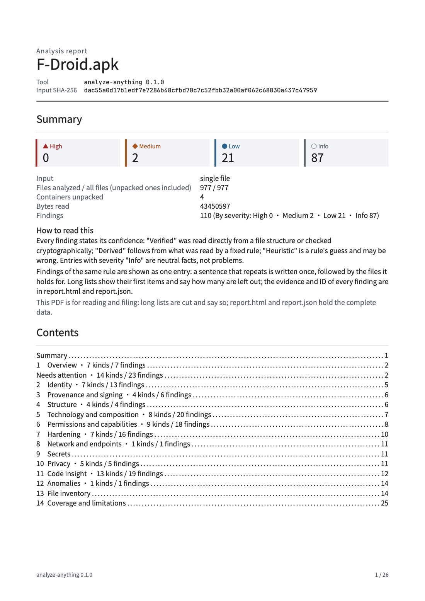
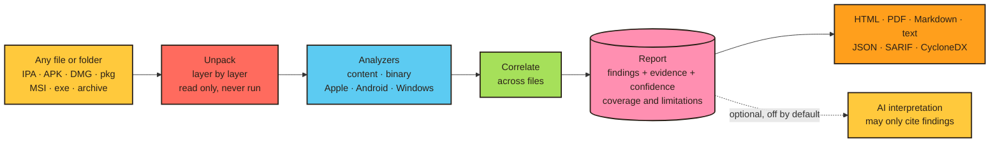
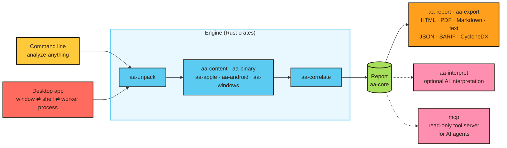

> Translation notice: the English README may be newer; see README.md for current delivery status and milestones.

# Analyze Anything

[English](../../README.md) · [简体中文](../../README.zh-CN.md) · [繁體中文](README_zh-TW.md) · [日本語](README_ja.md) · [한국어](README_ko.md) · [Türkçe](README_tr.md) · [Русский](README_ru.md) · [Tiếng Việt](README_vi.md) · [ไทย](README_th.md) · [Deutsch](README_de.md) · [Español](README_es.md) · [Français](README_fr.md) · [Українська](README_uk.md) · [Polski](README_pl.md) · [Português (Brasil)](README_pt-BR.md) · **العربية** · [فارسی](README_fa.md) · [Bahasa Indonesia](README_id.md) · [Italiano](README_it.md) · [Ελληνικά](README_el.md) · [മലയാളം](README_ml.md) · [Roman Urdu](README_ur-Latn.md) · [Română](README_ro.md) · [Български](README_bg.md)

[Website](https://atomsprout.com/analyze-anything/) · [Examples](https://atomsprout.com/analyze-anything/#examples) · [Roadmap](../ROADMAP.md)

> هذه ترجمة. [ملف README الإنجليزي](../../README.md) هو المرجع وقد يكون أحدث.

أعطِه أي شيء على حاسوبك — ملف IPA أو APK أو تطبيق macOS أو DMG أو pkg أو مُثبِّت Windows أو مجلد برنامج أو أرشيفًا أو مجلدًا أو أي ملف — وستحصل على تقرير يمكنك الوثوق به وتتبّعه: كل نتيجة تحمل دليلها (أي ملف، وأين فيه، وما الذي قُرئ هناك) ودرجة ثقة، وكل ما تعذّر تحليله يُدرَج تحت التغطية والقيود.

```
analyze-anything App.ipa
```

يكتب هذا الأمر المجلد `App.ipa.report/` وفيه التقرير بصيغ HTML و PDF و Markdown ونص عادي و JSON. وتتوفر كذلك صيغتا SARIF و CycloneDX.

- **تحليل ساكن فقط.** يُقرأ المُدخَل، ولا يُشغَّل ولا يُثبَّت ولا يُحمَّل أبدًا.
- **دون اتصال.** لا يتصل التحليل بأي شيء ولا يستخدم أي نموذج لغوي.
- **حتمي.** المُدخَل نفسه يعطي التقرير نفسه، بايتًا ببايت.
- **مكتوب بلغة Rust**، ولا يحتاج إلى أي أدوات خارجية وقت التشغيل.

هناك طريقتان لاستخدامه، تعملان على المحرك نفسه وتعطيان التقرير نفسه للمُدخَل نفسه:

- **سطر الأوامر**، `analyze-anything` (الاسم المختصر `aaaa`)؛
- **تطبيق سطح المكتب** لنظام macOS: أفلِت ملفًا، وتابع التقدّم، واقرأ التقرير، وانقر على أي دليل لترى بايتاته، وصدِّر، واحتفظ بسجلّ وقارن بين إصدارين، وإن أعددت ذلك فدَع نموذجًا يشرح التقرير بجانبه.

## كيف يبدو

<table>
  <tr>
    <td width="50%"><br><sub>تطبيق سطح المكتب: ملخّص التقرير</sub></td>
    <td width="50%"><br><sub>النتائج، كل واحدة مع دليلها</sub></td>
  </tr>
  <tr>
    <td><br><sub>تفسير الذكاء الاصطناعي الاختياري بجانب التقرير؛ كل عبارة تستشهد بنتائج</sub></td>
    <td><br><sub>أفلِت ملفًا أو مجلدًا للبدء</sub></td>
  </tr>
</table>

<p align="center"><br><sub>التقرير نفسه بصيغة PDF</sub></p>

تعرض لقطات الشاشة التقرير الخاص بـ F-Droid 2.0.3، وهو أحد [الأمثلة](https://atomsprout.com/analyze-anything/#examples).

## التثبيت

على macOS بمعالجات Apple silicon، باستخدام Homebrew:

```
brew install atomsprout/tap/analyze-anything                  # سطر الأوامر
brew install --cask atomsprout/tap/analyze-anything-desktop   # تطبيق سطح المكتب
```

كلٌّ منهما يعمل دون الآخر. وكلاهما موقَّع بشهادة Developer ID وموثَّق (notarized) من Apple.

على المنصات الأخرى، ابنِ سطر الأوامر من المصدر (Rust 1.90 أو أحدث):

```
cargo build --release
target/release/analyze-anything <file or folder>
```

الإصدارات الجاهزة متوفرة لأجهزة Mac بمعالجات Apple silicon فقط. على Linux و Windows تُبنى الشيفرة وتنجح اختباراتها في CI، لكن لم يستخدمه أحد يدويًا هناك بعد.

## الاستخدام

```
analyze-anything <file or folder>                 # حلِّل؛ يُكتب التقرير في <name>.report/
analyze-anything App.ipa -o out --lang zh         # اختر المجلد؛ اكتب التقرير بالصينية
analyze-anything diff old/report.json new/report.json    # ما الذي تغيّر بين إصدارين
analyze-anything explain out/report.json <finding id>    # نتيجة واحدة مع كل أدلتها
analyze-anything verify out/                      # هل ما زالت الملفات كما كُتبت؟
```

الدليل الكامل في [docs/USAGE.md](../USAGE.md).

## أمثلة

تقارير عن إصدارات عامة لبرمجيات مفتوحة المصدر، بصيغة PDF، موجودة على [الموقع](https://atomsprout.com/analyze-anything/#examples): ملف IPA، وملف APK، وملف DMG، وملف pkg لنظام macOS، ومُثبِّت NSIS ومُثبِّت MSI، وبرنامج Linux. يعيد `tools/site/examples.py` إنشاءها من الملفات نفسها.

## ما الذي يقرؤه

| | |
|---|---|
| Apple | `.app` وحزم (bundles) أخرى، IPA، DMG (HFS+ و APFS)، pkg؛ Info.plist، توقيعات الشيفرة وسلاسل الشهادات، الموارد المختومة، الاستحقاقات (entitlements)، ملفات تعريف التزويد (provisioning profiles)، بيانات الخصوصية (privacy manifests)، تشفير FairPlay |
| Android | APK، AAB، XAPK / APKS / APKM؛ ملف manifest، الموارد، مخططات التوقيع v1–v3.1، DEX، حزم SDK وأدوات الحزم (packers) |
| Windows | PE، Authenticode، تجميعات .NET، MSI (مع توقيعه الخاص)، NSIS، Inno Setup، CAB، الملفات ذاتية الاستخراج، Electron (asar)، MSIX، مجلدات البرامج المثبَّتة |
| عام | بنية Mach-O و ELF و PE ووسائل تحصينها (hardening)؛ zip، tar، 7z، gzip، bzip2، xz، zstd، متداخلة إلى أي عمق؛ عناوين URL، بيانات اعتماد محتملة، الإنتروبيا، الملفات المكررة |

## كيف يعمل

مرور واحد، للقراءة فقط: يُفتح المُدخَل طبقةً بعد طبقة، ويُقرأ كل ملف بالمحلِّلات التي تفهمه، ثم تربط خطوة أخيرة الملفات بعضها ببعض، ويُدوَّن كل ما عُثر عليه مع دليله. التقرير هو المصدر الوحيد لكل صيغ الإخراج.



سطر الأوامر وتطبيق سطح المكتب وجهان للمحرك نفسه، ولذلك يعطي المُدخَل الواحد التقرير نفسه في كليهما. تطبيق سطح المكتب لا يحلِّل أبدًا داخل عمليته الخاصة: تقوم بذلك عملية عاملة (worker)، ويمكن إيقافها بشكل مؤكد.



## اختياري: قراءة الذكاء الاصطناعي للتقرير

معطَّل ما لم تفعِّله. بعد كتابة التقرير، يمكن لنموذج لغوي أن يشرحه بكلمات بسيطة:

```
analyze-anything ai claude          # مرة واحدة: اختر من يقوم بذلك (هنا Claude Code، دون حاجة إلى مفتاح API)
analyze-anything App.ipa --ai       # حلِّل، ثم اكتب ai.md بجانب التقرير
```

أنت تختار من يقوم بذلك: خدمة نماذج لديك مفتاح API لها (Claude، أو أي خدمة تتحدث بروتوكول OpenAI)، أو Claude Code، أو Codex، أو نموذج يشغّله Ollama على جهازك. ويصلح كذلك برنامج من عندك. يرى النموذج التقرير ولا يرى الملفات المحلَّلة أبدًا، ويبحث فيه عبر أدوات للقراءة فقط. كل عبارة يقولها يجب أن تستشهد بنتائج من التقرير؛ والعبارات التي لا تفعل ذلك تُحذف. انظر [docs/AI.md](../AI.md).

## الحالة وخارطة الطريق

0.1.0 هو الإصدار الأول. أي ملف أو مجلد يحصل اليوم على تقرير؛ وصيغ Apple و Android و Windows مفهومة بعمق. وهو صادر لأجهزة Mac بمعالجات Apple silicon واستُخدم يدويًا على أحدها؛ وعلى Linux و Windows تُبنى الشيفرة وتنجح اختباراتها في CI.

كلمة "Anything" وعدٌ بخصوص الحد الأدنى واتجاهٌ بخصوص الحد الأعلى: لا يُرفض أي شيء، ويُضاف العمق صيغةً بعد صيغة، كلٌّ منها في crate صغير. التالي، بالترتيب:

1. **الشيء نفسه على كل نظام**: إصدارات جاهزة لأنظمة Linux و Windows؛ وتطبيق سطح المكتب خارج macOS.
2. **أنواع أكثر من المُدخَلات**: حزم Linux، صور الحاويات، حزم منظومات لغات البرمجة، منصات تطبيقات أخرى، المستندات التي تحمل شيفرة، صور البرامج الثابتة (firmware).
3. **عمق أكبر حيث يهمّ**: الثغرات المعروفة من قاعدة بيانات غير متصلة، حقائق على مستوى الدوال، القواعد والسياسات كبيانات.
4. **أسهل للبناء عليه**: GitHub Action، قراءة الذكاء الاصطناعي داخل التقرير، واجهة أكمل للوكلاء (agents)، مخطط (schema) ثابت للتقرير.

ما لن يتغيّر: تحليل ساكن فقط، تحليل دون اتصال، التقرير نفسه للمُدخَل نفسه، دليل لكل نتيجة، ولا حُكم نهائي. الصورة الكاملة في [docs/ROADMAP.md](../ROADMAP.md)؛ والقائمة المفصَّلة في [docs/TODO.md](../TODO.md).

## معلومات مفيدة

- الخطورة خاصية ثابتة لكل قاعدة، وُجدت لترتيب قراءتك. التقرير لا يقول هل المُدخَل آمن أم لا.
- النتائج الموسومة بأنها استدلالية (heuristic) (بيانات اعتماد محتملة، أدوات الحزم، اكتشاف حزم SDK) قد تكون إيجابيات كاذبة.
- تُفحص التوقيعات مقابل الملف نفسه: قيم التجزئة (digests)، وقيم التوقيع، وسلاسل الشهادات. أما إبطال الشهادات وإعدادات الثقة في النظام وحالة التوثيق (notarization) لدى Apple فلا تُفحص؛ فذلك يتطلب الشبكة.
- ملف IPA المنزَّل من App Store مشفَّر: يُتعرَّف على ذلك، وتُحلَّل البيانات الوصفية والتوقيع والموارد كالمعتاد، لكن الشيفرة المشفَّرة لا يمكن قراءتها.
- استخدمه فقط على ما يحق لك تحليله.

المزيد في [docs/LIMITATIONS.md](../LIMITATIONS.md).

## التوثيق

- [docs/USAGE.md](../USAGE.md) — سطر الأوامر بالكامل ([中文](../USAGE.zh-CN.md))
- [docs/AI.md](../AI.md) — تفسير الذكاء الاصطناعي الاختياري
- [docs/DESKTOP.md](../DESKTOP.md) — تطبيق سطح المكتب: البنية، التطوير، الاختبار، الإصدار
- [docs/LIMITATIONS.md](../LIMITATIONS.md) — القيود المعروفة
- [docs/ANALYZERS.md](../ANALYZERS.md) — كيف تضيف صيغة
- [docs/ROADMAP.md](../ROADMAP.md) — أين يقف المشروع وإلى أين يتجه
- [docs/TODO.md](../TODO.md) — ما بقي إنجازه، بندًا بندًا
- [AGENTS.md](../../AGENTS.md) — كيف تعمل في هذا المستودع، للمساهمين ولوكلاء البرمجة
- [docs/PLAN.md](../PLAN.md)، [docs/PLAN-DESKTOP.md](../PLAN-DESKTOP.md)، [docs/RESEARCH.md](../RESEARCH.md)، [docs/spikes/](../spikes/) — كيف جرى التخطيط له وما الذي جُرِّب

## التطوير

```
cargo fmt --all --check
cargo clippy --workspace --all-targets -- -D warnings
cargo test --workspace
```

يوضّح [AGENTS.md](../../AGENTS.md) كيف نُظِّم المستودع وما الذي يجب أن يحافظ عليه أي تغيير. تطبيق سطح المكتب موجود في `apps/desktop`؛ انظر [docs/DESKTOP.md](../DESKTOP.md). نرحّب بالبلاغات (issues) وطلبات السحب (pull requests). الرجاء عدم إرفاق ملفات لا يحق لك مشاركتها: النتيجة الواحدة من `report.json` التي تُظهر المشكلة تكفي في العادة.

## الترخيص

Apache-2.0؛ انظر [LICENSE](../../LICENSE). ما هو مضمَّن من أطراف أخرى، ومن ضمنه الخطوط المستخدمة في التقارير، مُدرَج في [NOTICE](../../NOTICE).
