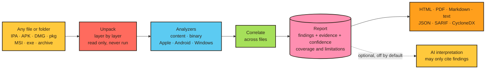
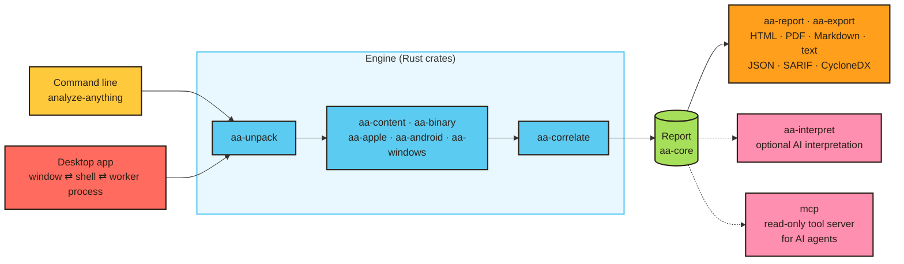

# Analyze Anything

[English](../../README.md) · [简体中文](../../README.zh-CN.md) · [繁體中文](README_zh-TW.md) · [日本語](README_ja.md) · [한국어](README_ko.md) · [Türkçe](README_tr.md) · [Русский](README_ru.md) · [Tiếng Việt](README_vi.md) · [ไทย](README_th.md) · [Deutsch](README_de.md) · [Español](README_es.md) · [Français](README_fr.md) · [Українська](README_uk.md) · [Polski](README_pl.md) · [Português (Brasil)](README_pt-BR.md) · [العربية](README_ar.md) · [فارسی](README_fa.md) · [Bahasa Indonesia](README_id.md) · [Italiano](README_it.md) · [Ελληνικά](README_el.md) · [മലയാളം](README_ml.md) · [Roman Urdu](README_ur-Latn.md) · [Română](README_ro.md) · **Български**

[Website](https://atomsprout.com/analyze-anything/) · [Examples](https://atomsprout.com/analyze-anything/#examples) · [Roadmap](../ROADMAP.md)

> Това е превод. Еталонът е [английският README](../../README.md) и той може да е по-нов.

Дайте му произволен артефакт от компютъра си — IPA, APK, приложение за macOS, DMG или pkg, инсталатор за Windows или папка с програма, архив, папка, какъвто и да е файл — и получавате отчет, на който може да се вярва и който може да се проследи: всяка находка има своето доказателство (кой файл, къде в него, какво е прочетено там) и степен на увереност, а всичко, което не е могло да бъде анализирано, е изброено в частта за покритие и ограничения.

```
analyze-anything App.ipa
```

Командата създава папката `App.ipa.report/` с отчета като HTML, PDF, Markdown, обикновен текст и JSON. Налични са също SARIF и CycloneDX.

- **Само статичен анализ.** Входът се чете, но никога не се изпълнява, инсталира или зарежда.
- **Офлайн.** Анализът не се свързва с нищо и не използва езиков модел.
- **Детерминирано.** Един и същ вход дава един и същ отчет, байт по байт.
- **Написано на Rust**, без нужда от външни инструменти по време на работа.

Използва се по два начина, върху един и същ двигател и с един и същ отчет за един и същ вход:

- **команден ред**, `analyze-anything` (кратко име `aaaa`);
- **настолно приложение** за macOS: пуснете файл, следете напредъка, четете отчета, щракнете върху доказателство, за да видите байтовете му, експортирайте, пазете история и сравнявайте две версии, а ако го настроите, модел обяснява отчета до него.

## Как изглежда

<table>
  <tr>
    <td width="50%"><br><sub>Настолното приложение: обобщението на отчета</sub></td>
    <td width="50%"><br><sub>Находки, всяка със своето доказателство</sub></td>
  </tr>
  <tr>
    <td><br><sub>Незадължителната интерпретация от ИИ до отчета; всяко твърдение се позовава на находки</sub></td>
    <td><br><sub>Пуснете файл или папка, за да започнете</sub></td>
  </tr>
</table>

<p align="center"><br><sub>Същият отчет като PDF</sub></p>

Екранните снимки показват отчета за F-Droid 2.0.3, един от [примерите](https://atomsprout.com/analyze-anything/#examples).

## Инсталиране

macOS на Apple silicon, с Homebrew:

```
brew install atomsprout/tap/analyze-anything                  # командният ред
brew install --cask atomsprout/tap/analyze-anything-desktop   # настолното приложение
```

Всяко работи без другото. И двете са подписани със сертификат Developer ID и нотаризирани от Apple.

На други платформи компилирайте командния ред от изходния код (Rust 1.90 или по-нов):

```
cargo build --release
target/release/analyze-anything <file or folder>
```

Издадени компилации има само за компютри Mac с Apple silicon. На Linux и Windows кодът се компилира и тестовете му минават в CI, но там още никой не го е използвал на ръка.

## Употреба

```
analyze-anything <file or folder>                 # анализ; отчетът отива в <name>.report/
analyze-anything App.ipa -o out --lang zh         # избор на папка; отчетът се пише на китайски
analyze-anything diff old/report.json new/report.json    # какво се е променило между две версии
analyze-anything explain out/report.json <finding id>    # една находка с всичките ѝ доказателства
analyze-anything verify out/                      # файловете още ли са това, което е записано?
```

Пълното ръководство е [docs/USAGE.md](../USAGE.md).

## Примери

Отчети за публични издания на софтуер с отворен код, като PDF файлове, има на [уебсайта](https://atomsprout.com/analyze-anything/#examples): IPA, APK, DMG, pkg за macOS, инсталатори NSIS и MSI и програма за Linux. `tools/site/examples.py` ги създава отново от същите файлове.

## Какво чете

| | |
|---|---|
| Apple | `.app` и други пакети (bundle), IPA, DMG (HFS+ и APFS), pkg; Info.plist, подписи на кода и вериги от сертификати, запечатани ресурси, entitlements, provisioning профили, манифести за поверителност, шифроване FairPlay |
| Android | APK, AAB, XAPK / APKS / APKM; манифест, ресурси, схеми за подписване v1–v3.1, DEX, SDK и пакери |
| Windows | PE, Authenticode, асемблита на .NET, MSI (със собствения му подпис), NSIS, Inno Setup, CAB, саморазархивиращи се архиви, Electron (asar), MSIX, папки на инсталирани програми |
| Общи | структура и защитни механизми на Mach-O, ELF и PE; zip, tar, 7z, gzip, bzip2, xz, zstd, вложени на произволна дълбочина; URL адреси, вероятни идентификационни данни, ентропия, дублирани файлове |

## Как работи

Едно преминаване, само четене: входът се отваря слой по слой, всеки файл се чете от анализаторите, които го разбират, последната стъпка свързва файловете един с друг и всичко намерено се записва заедно с доказателствата. Отчетът е единственият източник на всеки изходен формат.



Командният ред и настолното приложение са две лица на един и същ двигател, така че един вход дава един и същ отчет и в двете. Настолното приложение никога не анализира в собствения си процес: това прави работен процес, който със сигурност може да бъде спрян.



## По избор: прочит на отчета от ИИ

Изключено, докато не го включите. След като отчетът е записан, езиков модел може да го обясни с прости думи:

```
analyze-anything ai claude          # веднъж: избор кой го прави (тук Claude Code, не е нужен API ключ)
analyze-anything App.ipa --ai       # анализ, след това запис на ai.md до отчета
```

Вие избирате кой го прави: услуга за модели, за която имате API ключ (Claude или каквото и да е, което работи по протокола на OpenAI), Claude Code, Codex или модел, който Ollama изпълнява на вашата машина. Може и ваша собствена програма. Моделът вижда отчета, но никога анализираните файлове, и търси в него чрез инструменти само за четене. Всяко негово твърдение трябва да се позовава на находки от отчета; тези, които не го правят, се отхвърлят. Вижте [docs/AI.md](../AI.md).

## Състояние и пътна карта

0.1.0 е първото издание. Отчет се получава още днес за всеки файл или папка; форматите на Apple, Android и Windows се разбират в дълбочина. Изданието е за компютри Mac с Apple silicon и е използвано на ръка на един такъв; на Linux и Windows кодът се компилира и минава тестовете си в CI.

„Anything“ е обещание за долната граница и посока за горната: нищо не се отказва, а дълбочината се добавя формат по формат, всеки като малък crate. Следва, по ред:

1. **Същото на всяка система**: издадени компилации за Linux и Windows; настолното приложение извън macOS.
2. **Повече видове вход**: пакети за Linux, контейнерни образи, пакети от езикови екосистеми, още платформи за приложения, документи, които носят код, образи на фърмуер.
3. **По-дълбоко там, където има значение**: известни уязвимости от офлайн база данни, факти на ниво функция, правила и политики като данни.
4. **По-лесно за надграждане**: GitHub Action, прочитът от ИИ вътре в отчета, по-пълен интерфейс за агенти, стабилна схема на отчета.

Какво няма да се промени: само статичен анализ, офлайн анализ, един и същ отчет за един и същ вход, доказателства за всяка находка и никаква присъда. Цялата картина е в [docs/ROADMAP.md](../ROADMAP.md); списъкът по точки е [docs/TODO.md](../TODO.md).

## Добре е да знаете

- Сериозността е фиксирано свойство на всяко правило и служи да подреди четенето. Отчетът не казва дали даден вход е безопасен.
- Находките, отбелязани като евристични (вероятни идентификационни данни, пакери, откриване на SDK), може да са фалшиви положителни резултати.
- Подписите се проверяват спрямо самия файл: дайджести, стойности на подписите, вериги от сертификати. Отмяната на сертификати, системните настройки за доверие и статусът на нотаризация от Apple не се проверяват; за това би била нужна мрежа.
- IPA, изтеглен от App Store, е шифрован: това се разпознава, а метаданните, подписът и ресурсите се анализират както обикновено, но шифрованият код не може да бъде прочетен.
- Използвайте го само върху неща, които имате право да анализирате.

Повече в [docs/LIMITATIONS.md](../LIMITATIONS.md).

## Документация

- [docs/USAGE.md](../USAGE.md) — командният ред изцяло ([中文](../USAGE.zh-CN.md))
- [docs/AI.md](../AI.md) — незадължителната интерпретация от ИИ
- [docs/DESKTOP.md](../DESKTOP.md) — настолното приложение: структура, разработка, тестване, издаване
- [docs/LIMITATIONS.md](../LIMITATIONS.md) — известни ограничения
- [docs/ANALYZERS.md](../ANALYZERS.md) — как се добавя формат
- [docs/ROADMAP.md](../ROADMAP.md) — къде се намира проектът и накъде върви
- [docs/TODO.md](../TODO.md) — какво остава да се направи, точка по точка
- [AGENTS.md](../../AGENTS.md) — как се работи в това хранилище, за сътрудници и програмиращи агенти
- [docs/PLAN.md](../PLAN.md), [docs/PLAN-DESKTOP.md](../PLAN-DESKTOP.md), [docs/RESEARCH.md](../RESEARCH.md), [docs/spikes/](../spikes/) — как е планирано и какво е опитано

## Разработка

```
cargo fmt --all --check
cargo clippy --workspace --all-targets -- -D warnings
cargo test --workspace
```

[AGENTS.md](../../AGENTS.md) описва как е подредено хранилището и какво трябва да запази всяка промяна. Настолното приложение се намира в `apps/desktop`; вижте [docs/DESKTOP.md](../DESKTOP.md). Issues и pull requests са добре дошли. Моля, не прикачвайте файлове, които нямате право да споделяте: обикновено е достатъчна едната находка от `report.json`, която показва проблема.

## Лиценз

Apache-2.0; вижте [LICENSE](../../LICENSE). Включеното от други автори, сред което са шрифтовете в отчетите, е изброено в [NOTICE](../../NOTICE).
