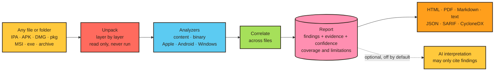
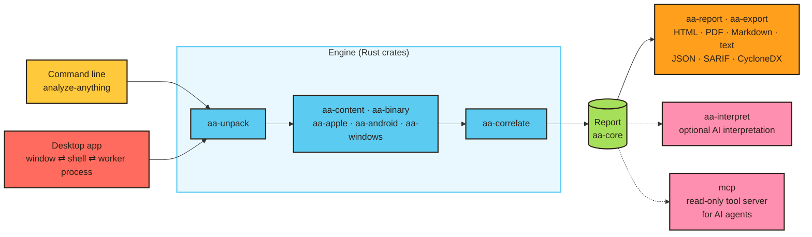

> Translation notice: the English README may be newer; see README.md for current delivery status and milestones.

# Analyze Anything

[English](../../README.md) · [简体中文](../../README.zh-CN.md) · [繁體中文](README_zh-TW.md) · [日本語](README_ja.md) · [한국어](README_ko.md) · [Türkçe](README_tr.md) · [Русский](README_ru.md) · [Tiếng Việt](README_vi.md) · [ไทย](README_th.md) · **Deutsch** · [Español](README_es.md) · [Français](README_fr.md) · [Українська](README_uk.md) · [Polski](README_pl.md) · [Português (Brasil)](README_pt-BR.md) · [العربية](README_ar.md) · [فارسی](README_fa.md) · [Bahasa Indonesia](README_id.md) · [Italiano](README_it.md) · [Ελληνικά](README_el.md) · [മലയാളം](README_ml.md) · [Roman Urdu](README_ur-Latn.md) · [Română](README_ro.md) · [Български](README_bg.md)

[Website](https://atomsprout.com/analyze-anything/) · [Examples](https://atomsprout.com/analyze-anything/#examples) · [Roadmap](../ROADMAP.md)

> Dies ist eine Übersetzung. Maßgeblich ist das [englische README](../../README.md); es kann neuer sein.

Gib ihm ein beliebiges Artefakt auf deinem Rechner – ein IPA, ein APK, eine macOS-App, ein DMG oder pkg, einen Windows-Installer oder Programmordner, ein Archiv, einen Ordner, irgendeine Datei – und du bekommst einen Bericht, dem du vertrauen und den du nachvollziehen kannst: Jeder Befund nennt seinen Beleg (welche Datei, an welcher Stelle, was dort gelesen wurde) und eine Konfidenz, und alles, was nicht analysiert werden konnte, steht unter Abdeckung und Einschränkungen.

```
analyze-anything App.ipa
```

Das schreibt `App.ipa.report/` mit dem Bericht als HTML, PDF, Markdown, reinem Text und JSON. SARIF und CycloneDX gibt es ebenfalls.

- **Nur statisch.** Die Eingabe wird gelesen, aber nie ausgeführt, installiert oder geladen.
- **Offline.** Die Analyse baut keine Verbindungen auf und verwendet kein Sprachmodell.
- **Deterministisch.** Dieselbe Eingabe ergibt denselben Bericht, Byte für Byte.
- **In Rust geschrieben**, zur Laufzeit werden keine externen Werkzeuge benötigt.

Es lässt sich auf zwei Arten nutzen, beide mit derselben Engine und mit demselben Bericht für dieselbe Eingabe:

- über die **Befehlszeile**, `analyze-anything` (Kurzname `aaaa`);
- über die **Desktop-App** für macOS: Datei hineinziehen, den Fortschritt verfolgen, den Bericht lesen, einen Beleg anklicken, um seine Bytes zu sehen, exportieren, einen Verlauf führen und zwei Versionen vergleichen und, wenn du es einrichtest, den Bericht daneben von einem Modell erklären lassen.

## So sieht es aus

<table>
  <tr>
    <td width="50%"><br><sub>Die Desktop-App: die Zusammenfassung des Berichts</sub></td>
    <td width="50%"><br><sub>Befunde, jeder mit seinem Beleg</sub></td>
  </tr>
  <tr>
    <td><br><sub>Die optionale KI-Interpretation neben dem Bericht; jede Aussage verweist auf Befunde</sub></td>
    <td><br><sub>Eine Datei oder einen Ordner hineinziehen, um zu beginnen</sub></td>
  </tr>
</table>

<p align="center"><br><sub>Derselbe Bericht als PDF</sub></p>

Die Screenshots zeigen den Bericht über F-Droid 2.0.3, eines der [Beispiele](https://atomsprout.com/analyze-anything/#examples).

## Installation

macOS auf Apple Silicon, mit Homebrew:

```
brew install atomsprout/tap/analyze-anything                  # die Befehlszeile
brew install --cask atomsprout/tap/analyze-anything-desktop   # die Desktop-App
```

Beide funktionieren unabhängig voneinander. Beide sind mit einem Developer-ID-Zertifikat signiert und von Apple notarisiert.

Auf anderen Plattformen baust du die Befehlszeile aus dem Quellcode (Rust 1.90 oder neuer):

```
cargo build --release
target/release/analyze-anything <file or folder>
```

Veröffentlichte Builds gibt es nur für Macs mit Apple Silicon. Unter Linux und Windows lässt sich der Code bauen und seine Tests laufen in der CI durch, aber von Hand hat es dort noch niemand benutzt.

## Verwendung

```
analyze-anything <file or folder>                 # analysieren; der Bericht landet in <name>.report/
analyze-anything App.ipa -o out --lang zh         # den Ordner wählen; den Bericht auf Chinesisch schreiben
analyze-anything diff old/report.json new/report.json    # was sich zwischen zwei Versionen geändert hat
analyze-anything explain out/report.json <finding id>    # ein Befund mit allen seinen Belegen
analyze-anything verify out/                      # sind die Dateien noch so, wie sie geschrieben wurden?
```

Die vollständige Anleitung steht in [docs/USAGE.md](../USAGE.md).

## Beispiele

Berichte über öffentliche Releases von Open-Source-Software stehen als PDFs auf der [Website](https://atomsprout.com/analyze-anything/#examples): ein IPA, ein APK, ein DMG, ein macOS-pkg, ein NSIS- und ein MSI-Installer sowie ein Linux-Programm. `tools/site/examples.py` erzeugt sie aus denselben Dateien erneut.

## Was es liest

| | |
|---|---|
| Apple | `.app` und andere Bundles, IPA, DMG (HFS+ und APFS), pkg; Info.plist, Codesignaturen und Zertifikatsketten, versiegelte Ressourcen, Entitlements, Provisioning-Profile, Privacy Manifests, FairPlay-Verschlüsselung |
| Android | APK, AAB, XAPK / APKS / APKM; Manifest, Ressourcen, Signaturschemata v1–v3.1, DEX, SDKs und Packer |
| Windows | PE, Authenticode, .NET-Assemblies, MSI (mit eigener Signatur), NSIS, Inno Setup, CAB, selbstentpackende Archive, Electron (asar), MSIX, Ordner installierter Programme |
| Allgemein | Struktur und Härtung von Mach-O, ELF und PE; zip, tar, 7z, gzip, bzip2, xz, zstd, beliebig tief verschachtelt; URLs, mutmaßliche Zugangsdaten, Entropie, doppelte Dateien |

## Wie es funktioniert

Ein Durchlauf, nur lesend: Die Eingabe wird Schicht für Schicht geöffnet, jede Datei wird von den Analyzern gelesen, die sie verstehen, ein letzter Schritt setzt die Dateien zueinander in Beziehung, und alles, was gefunden wurde, wird mit seinem Beleg festgehalten. Der Bericht ist die einzige Quelle für jedes Ausgabeformat.



Die Befehlszeile und die Desktop-App sind zwei Oberflächen derselben Engine, sodass eine Eingabe in beiden denselben Bericht ergibt. Die Desktop-App analysiert nie im eigenen Prozess: Das übernimmt ein Worker, der sich zuverlässig stoppen lässt.



## Optional: eine KI-Lesart des Berichts

Ausgeschaltet, solange du es nicht einschaltest. Sobald ein Bericht geschrieben ist, kann ein Sprachmodell ihn in einfachen Worten erklären:

```
analyze-anything ai claude          # einmalig: wählen, wer es übernimmt (hier Claude Code, kein API-Schlüssel nötig)
analyze-anything App.ipa --ai       # analysieren, dann ai.md neben den Bericht schreiben
```

Du entscheidest, wer das übernimmt: ein Modelldienst, für den du einen API-Schlüssel hast (Claude oder alles, was das Protokoll von OpenAI spricht), Claude Code, Codex oder ein Modell, das Ollama auf deinem eigenen Rechner ausführt. Ein eigenes Programm funktioniert auch. Das Modell sieht den Bericht, nie die analysierten Dateien, und schlägt darin über Nur-Lese-Werkzeuge nach. Jede Aussage, die es trifft, muss Befunde des Berichts zitieren; Aussagen, die das nicht tun, werden verworfen. Siehe [docs/AI.md](../AI.md).

## Stand und Roadmap

0.1.0 ist das erste Release. Schon heute bekommt jede Datei und jeder Ordner einen Bericht; die Formate von Apple, Android und Windows werden in der Tiefe verstanden. Veröffentlicht ist es für Macs mit Apple Silicon und wurde auf einem solchen von Hand benutzt; unter Linux und Windows lässt sich der Code bauen und besteht seine Tests in der CI.

„Anything“ ist ein Versprechen für die Untergrenze und eine Richtung für die Obergrenze: Nichts wird abgewiesen, und die Tiefe kommt Format für Format hinzu, jedes als kleines Crate. Als Nächstes, in dieser Reihenfolge:

1. **Dasselbe auf jedem System**: veröffentlichte Builds für Linux und Windows; die Desktop-App über macOS hinaus.
2. **Mehr Arten von Eingaben**: Linux-Pakete, Container-Images, Pakete aus Sprachökosystemen, weitere App-Plattformen, Dokumente, die Code enthalten, Firmware-Images.
3. **Mehr Tiefe, wo es darauf ankommt**: bekannte Schwachstellen aus einer Offline-Datenbank, Fakten auf Funktionsebene, Regeln und Richtlinien als Daten.
4. **Leichter darauf aufzubauen**: eine GitHub Action, die KI-Lesart im Bericht selbst, eine umfassendere Schnittstelle für Agenten, ein stabiles Berichtsschema.

Was sich nicht ändern wird: nur statisch, Analyse offline, derselbe Bericht für dieselbe Eingabe, ein Beleg für jeden Befund und kein Urteil. Das Gesamtbild steht in [docs/ROADMAP.md](../ROADMAP.md); die Liste der einzelnen Punkte ist [docs/TODO.md](../TODO.md).

## Gut zu wissen

- Der Schweregrad ist eine feste Eigenschaft jeder Regel und dient dazu, die Lektüre zu ordnen. Der Bericht sagt nicht, ob eine Eingabe sicher ist.
- Als heuristisch markierte Befunde (mutmaßliche Zugangsdaten, Packer, SDK-Erkennung) können Fehlalarme sein.
- Signaturen werden gegen die Datei selbst geprüft: Digests, Signaturwerte, Zertifikatsketten. Widerruf, die Vertrauenseinstellungen des Systems und der Notarisierungsstatus bei Apple werden nicht geprüft; dafür wäre das Netzwerk nötig.
- Ein aus dem App Store geladenes IPA ist verschlüsselt: Das wird erkannt, und Metadaten, Signatur und Ressourcen werden wie üblich analysiert, aber der verschlüsselte Code kann nicht gelesen werden.
- Verwende es nur für Dinge, die du analysieren darfst.

Mehr dazu in [docs/LIMITATIONS.md](../LIMITATIONS.md).

## Dokumentation

- [docs/USAGE.md](../USAGE.md) — die Befehlszeile vollständig ([中文](../USAGE.zh-CN.md))
- [docs/AI.md](../AI.md) — die optionale KI-Interpretation
- [docs/DESKTOP.md](../DESKTOP.md) — die Desktop-App: Aufbau, Entwicklung, Tests, Release
- [docs/LIMITATIONS.md](../LIMITATIONS.md) — bekannte Einschränkungen
- [docs/ANALYZERS.md](../ANALYZERS.md) — wie man ein Format hinzufügt
- [docs/ROADMAP.md](../ROADMAP.md) — wo es steht und wohin es geht
- [docs/TODO.md](../TODO.md) — was noch zu tun ist, Punkt für Punkt
- [AGENTS.md](../../AGENTS.md) — wie man in diesem Repository arbeitet, für Mitwirkende und Coding-Agenten
- [docs/PLAN.md](../PLAN.md), [docs/PLAN-DESKTOP.md](../PLAN-DESKTOP.md), [docs/RESEARCH.md](../RESEARCH.md), [docs/spikes/](../spikes/) — wie es geplant und was ausprobiert wurde

## Entwicklung

```
cargo fmt --all --check
cargo clippy --workspace --all-targets -- -D warnings
cargo test --workspace
```

[AGENTS.md](../../AGENTS.md) beschreibt, wie das Repository aufgebaut ist und was eine Änderung bewahren muss. Die Desktop-App liegt in `apps/desktop`; siehe [docs/DESKTOP.md](../DESKTOP.md). Issues und Pull Requests sind willkommen. Bitte hänge keine Dateien an, die du nicht weitergeben darfst: Der eine Befund aus `report.json`, der das Problem zeigt, reicht in der Regel aus.

## Lizenz

Apache-2.0; siehe [LICENSE](../../LICENSE). Was von anderen mitgeliefert wird, darunter die Schriften in den Berichten, ist in [NOTICE](../../NOTICE) aufgeführt.
