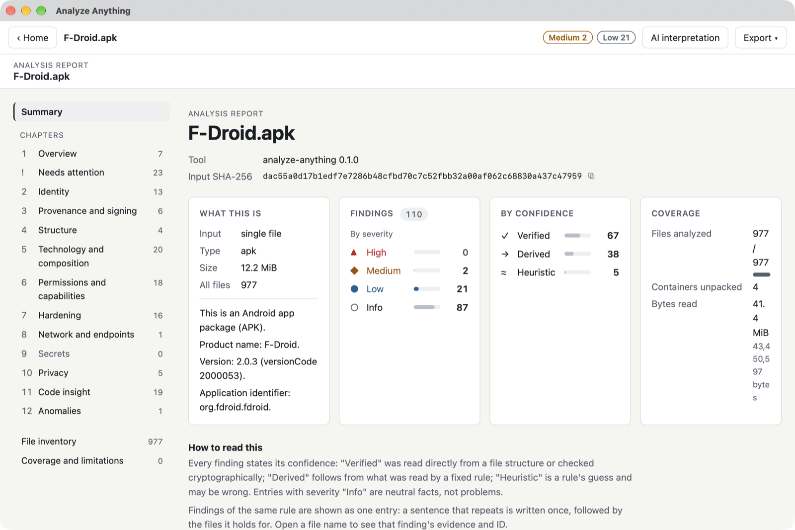
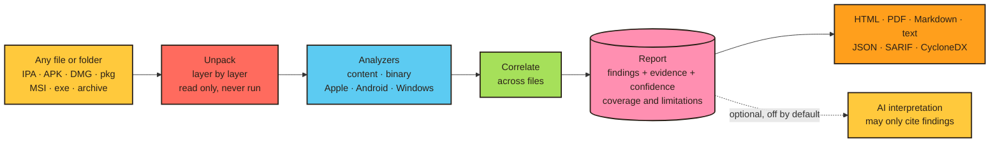
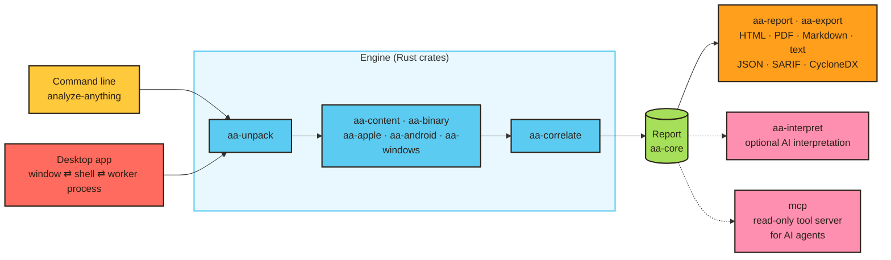

> Translation notice: the English README may be newer; see README.md for current delivery status and milestones.

# Analyze Anything

[English](../../README.md) · [简体中文](../../README.zh-CN.md) · [繁體中文](README_zh-TW.md) · [日本語](README_ja.md) · [한국어](README_ko.md) · [Türkçe](README_tr.md) · [Русский](README_ru.md) · [Tiếng Việt](README_vi.md) · [ไทย](README_th.md) · [Deutsch](README_de.md) · [Español](README_es.md) · [Français](README_fr.md) · [Українська](README_uk.md) · [Polski](README_pl.md) · [Português (Brasil)](README_pt-BR.md) · [العربية](README_ar.md) · [فارسی](README_fa.md) · [Bahasa Indonesia](README_id.md) · [Italiano](README_it.md) · **Ελληνικά** · [മലയാളം](README_ml.md) · [Roman Urdu](README_ur-Latn.md) · [Română](README_ro.md) · [Български](README_bg.md)

[Website](https://atomsprout.com/analyze-anything/) · [Examples](https://atomsprout.com/analyze-anything/#examples) · [Roadmap](../ROADMAP.md)

> Αυτό είναι μετάφραση. Το [αγγλικό README](../../README.md) είναι το κείμενο αναφοράς και μπορεί να είναι νεότερο.

Δώστε του οποιοδήποτε αντικείμενο από τον υπολογιστή σας — ένα IPA, ένα APK, μια εφαρμογή macOS, ένα DMG ή pkg, ένα πρόγραμμα εγκατάστασης Windows ή έναν φάκελο προγράμματος, ένα αρχείο συμπίεσης, έναν φάκελο, οποιοδήποτε αρχείο — και θα πάρετε μια αναφορά που μπορείτε να εμπιστευτείτε και να ελέγξετε: κάθε εύρημα συνοδεύεται από το τεκμήριό του (ποιο αρχείο, σε ποιο σημείο του, τι διαβάστηκε εκεί) και από έναν βαθμό βεβαιότητας, ενώ ό,τι δεν μπόρεσε να αναλυθεί αναγράφεται στην ενότητα για την κάλυψη και τους περιορισμούς.

```
analyze-anything App.ipa
```

Η εντολή δημιουργεί τον φάκελο `App.ipa.report/` με την αναφορά σε HTML, PDF, Markdown, απλό κείμενο και JSON. Διατίθενται επίσης SARIF και CycloneDX.

- **Μόνο στατική ανάλυση.** Η είσοδος διαβάζεται, ποτέ δεν εκτελείται, δεν εγκαθίσταται και δεν φορτώνεται.
- **Εκτός σύνδεσης.** Η ανάλυση δεν συνδέεται πουθενά και δεν χρησιμοποιεί γλωσσικό μοντέλο.
- **Ντετερμινιστικό.** Η ίδια είσοδος δίνει την ίδια αναφορά, byte προς byte.
- **Γραμμένο σε Rust**, χωρίς να χρειάζονται εξωτερικά εργαλεία κατά την εκτέλεση.

Χρησιμοποιείται με δύο τρόπους, πάνω στην ίδια μηχανή και με την ίδια αναφορά για την ίδια είσοδο:

- η **γραμμή εντολών**, `analyze-anything` (σύντομο όνομα `aaaa`)·
- η **εφαρμογή επιφάνειας εργασίας** για macOS: αφήστε ένα αρχείο, παρακολουθήστε την πρόοδο, διαβάστε την αναφορά, κάντε κλικ σε ένα τεκμήριο για να δείτε τα byte του, κάντε εξαγωγή, κρατήστε ιστορικό και συγκρίνετε δύο εκδόσεις και, αν το ρυθμίσετε, ένα μοντέλο εξηγεί την αναφορά δίπλα της.

## Πώς φαίνεται

<table>
  <tr>
    <td width="50%"><br><sub>Η εφαρμογή επιφάνειας εργασίας: η σύνοψη της αναφοράς</sub></td>
    <td width="50%"><br><sub>Ευρήματα, το καθένα με το τεκμήριό του</sub></td>
  </tr>
  <tr>
    <td><br><sub>Η προαιρετική ερμηνεία από ΤΝ δίπλα στην αναφορά· κάθε δήλωση παραπέμπει σε ευρήματα</sub></td>
    <td><br><sub>Αφήστε ένα αρχείο ή έναν φάκελο για να ξεκινήσετε</sub></td>
  </tr>
</table>

<p align="center"><br><sub>Η ίδια αναφορά ως PDF</sub></p>

Τα στιγμιότυπα οθόνης δείχνουν την αναφορά για το F-Droid 2.0.3, ένα από τα [παραδείγματα](https://atomsprout.com/analyze-anything/#examples).

## Εγκατάσταση

macOS σε Apple silicon, με το Homebrew:

```
brew install atomsprout/tap/analyze-anything                  # η γραμμή εντολών
brew install --cask atomsprout/tap/analyze-anything-desktop   # η εφαρμογή επιφάνειας εργασίας
```

Το καθένα λειτουργεί χωρίς το άλλο. Και τα δύο είναι υπογεγραμμένα με πιστοποιητικό Developer ID και επικυρωμένα (notarized) από την Apple.

Σε άλλες πλατφόρμες, μεταγλωττίστε τη γραμμή εντολών από τον πηγαίο κώδικα (Rust 1.90 ή νεότερη):

```
cargo build --release
target/release/analyze-anything <file or folder>
```

Εκδόσεις έτοιμες προς χρήση υπάρχουν μόνο για Mac με Apple silicon. Σε Linux και Windows ο κώδικας μεταγλωττίζεται και οι δοκιμές του περνούν στο CI, αλλά κανείς δεν τον έχει χρησιμοποιήσει ακόμη με το χέρι εκεί.

## Χρήση

```
analyze-anything <file or folder>                 # ανάλυση· η αναφορά πηγαίνει στο <name>.report/
analyze-anything App.ipa -o out --lang zh         # επιλογή φακέλου· η αναφορά γράφεται στα κινεζικά
analyze-anything diff old/report.json new/report.json    # τι άλλαξε ανάμεσα σε δύο εκδόσεις
analyze-anything explain out/report.json <finding id>    # ένα εύρημα με όλα τα τεκμήριά του
analyze-anything verify out/                      # είναι τα αρχεία ακόμη όπως γράφτηκαν;
```

Ο πλήρης οδηγός είναι το [docs/USAGE.md](../USAGE.md).

## Παραδείγματα

Αναφορές για δημόσιες εκδόσεις λογισμικού ανοιχτού κώδικα, σε μορφή PDF, υπάρχουν στον [ιστότοπο](https://atomsprout.com/analyze-anything/#examples): ένα IPA, ένα APK, ένα DMG, ένα pkg για macOS, ένα πρόγραμμα εγκατάστασης NSIS και ένα MSI, και ένα πρόγραμμα για Linux. Το `tools/site/examples.py` τις παράγει ξανά από τα ίδια αρχεία.

## Τι διαβάζει

| | |
|---|---|
| Apple | `.app` και άλλα bundle, IPA, DMG (HFS+ και APFS), pkg· Info.plist, υπογραφές κώδικα και αλυσίδες πιστοποιητικών, σφραγισμένοι πόροι, entitlements, provisioning profiles, δηλώσεις απορρήτου (privacy manifests), κρυπτογράφηση FairPlay |
| Android | APK, AAB, XAPK / APKS / APKM· manifest, πόροι, σχήματα υπογραφής v1–v3.1, DEX, SDK και packers |
| Windows | PE, Authenticode, assemblies του .NET, MSI (με τη δική του υπογραφή), NSIS, Inno Setup, CAB, αυτοεξαγόμενα αρχεία, Electron (asar), MSIX, φάκελοι εγκατεστημένων προγραμμάτων |
| Γενικά | δομή και μηχανισμοί προστασίας των Mach-O, ELF και PE· zip, tar, 7z, gzip, bzip2, xz, zstd, εμφωλευμένα σε οποιοδήποτε βάθος· URL, πιθανά διαπιστευτήρια, εντροπία, διπλότυπα αρχεία |

## Πώς λειτουργεί

Ένα πέρασμα, μόνο ανάγνωση: η είσοδος ανοίγεται στρώμα προς στρώμα, κάθε αρχείο διαβάζεται από τους αναλυτές που το καταλαβαίνουν, ένα τελευταίο βήμα συσχετίζει τα αρχεία μεταξύ τους, και ό,τι βρέθηκε καταγράφεται μαζί με τα τεκμήριά του. Η αναφορά είναι η μοναδική πηγή κάθε μορφής εξόδου.



Η γραμμή εντολών και η εφαρμογή επιφάνειας εργασίας είναι δύο όψεις της ίδιας μηχανής, οπότε μία είσοδος δίνει την ίδια αναφορά και στις δύο. Η εφαρμογή επιφάνειας εργασίας δεν αναλύει ποτέ στη δική της διεργασία: το κάνει μια διεργασία-εργάτης, που μπορεί να σταματήσει με βεβαιότητα.



## Προαιρετικά: ανάγνωση της αναφοράς από ΤΝ

Απενεργοποιημένο, εκτός αν το ενεργοποιήσετε. Αφού γραφτεί μια αναφορά, ένα γλωσσικό μοντέλο μπορεί να την εξηγήσει με απλά λόγια:

```
analyze-anything ai claude          # μία φορά: επιλογή του ποιος το κάνει (εδώ το Claude Code, δεν χρειάζεται κλειδί API)
analyze-anything App.ipa --ai       # ανάλυση και μετά εγγραφή του ai.md δίπλα στην αναφορά
```

Εσείς επιλέγετε ποιος το κάνει: μια υπηρεσία μοντέλων για την οποία έχετε κλειδί API (το Claude ή οτιδήποτε μιλά το πρωτόκολλο της OpenAI), το Claude Code, το Codex ή ένα μοντέλο που τρέχει το Ollama στο δικό σας μηχάνημα. Κάνει και ένα δικό σας πρόγραμμα. Το μοντέλο βλέπει την αναφορά, ποτέ τα αναλυμένα αρχεία, και αναζητά στοιχεία μέσα της με εργαλεία μόνο για ανάγνωση. Κάθε δήλωσή του πρέπει να παραπέμπει σε ευρήματα της αναφοράς· όσες δεν το κάνουν απορρίπτονται. Δείτε το [docs/AI.md](../AI.md).

## Κατάσταση και οδικός χάρτης

Η 0.1.0 είναι η πρώτη έκδοση. Οποιοδήποτε αρχείο ή φάκελος παίρνει αναφορά ήδη σήμερα· οι μορφές των Apple, Android και Windows κατανοούνται σε βάθος. Κυκλοφορεί για Mac με Apple silicon και έχει χρησιμοποιηθεί με το χέρι σε έναν τέτοιο· σε Linux και Windows ο κώδικας μεταγλωττίζεται και περνά τις δοκιμές του στο CI.

Το «Anything» είναι υπόσχεση για το κατώτατο όριο και κατεύθυνση για το ανώτατο: τίποτα δεν απορρίπτεται, και το βάθος προστίθεται μία μορφή τη φορά, η καθεμία ως ένα μικρό crate. Στη συνέχεια, με τη σειρά:

1. **Το ίδιο πράγμα σε κάθε σύστημα**: έτοιμες εκδόσεις για Linux και Windows· η εφαρμογή επιφάνειας εργασίας πέρα από το macOS.
2. **Περισσότερα είδη εισόδου**: πακέτα Linux, εικόνες container, πακέτα οικοσυστημάτων γλωσσών, περισσότερες πλατφόρμες εφαρμογών, έγγραφα που περιέχουν κώδικα, εικόνες firmware.
3. **Βαθύτερα εκεί που έχει σημασία**: γνωστές ευπάθειες από μια βάση δεδομένων εκτός σύνδεσης, στοιχεία σε επίπεδο συνάρτησης, κανόνες και πολιτικές ως δεδομένα.
4. **Ευκολότερο να χτίσει κανείς πάνω του**: ένα GitHub Action, η ανάγνωση από ΤΝ μέσα στην αναφορά, μια πληρέστερη διεπαφή για agents, ένα σταθερό σχήμα αναφοράς.

Τι δεν θα αλλάξει: μόνο στατική ανάλυση, ανάλυση εκτός σύνδεσης, η ίδια αναφορά για την ίδια είσοδο, τεκμήρια για κάθε εύρημα και καμία ετυμηγορία. Η συνολική εικόνα βρίσκεται στο [docs/ROADMAP.md](../ROADMAP.md)· η αναλυτική λίστα είναι το [docs/TODO.md](../TODO.md).

## Καλό είναι να γνωρίζετε

- Η σοβαρότητα είναι σταθερή ιδιότητα κάθε κανόνα και υπάρχει για να βάζει σε σειρά την ανάγνωσή σας. Η αναφορά δεν λέει αν μια είσοδος είναι ασφαλής.
- Τα ευρήματα που επισημαίνονται ως ευρετικά (πιθανά διαπιστευτήρια, packers, ανίχνευση SDK) μπορεί να είναι ψευδώς θετικά.
- Οι υπογραφές ελέγχονται με βάση το ίδιο το αρχείο: συνόψεις (digests), τιμές υπογραφών, αλυσίδες πιστοποιητικών. Η ανάκληση πιστοποιητικών, οι ρυθμίσεις εμπιστοσύνης του συστήματος και η κατάσταση notarization της Apple δεν ελέγχονται· αυτό θα απαιτούσε δίκτυο.
- Ένα IPA που έχει ληφθεί από το App Store είναι κρυπτογραφημένο: αυτό αναγνωρίζεται, και τα μεταδεδομένα, η υπογραφή και οι πόροι αναλύονται κανονικά, αλλά ο κρυπτογραφημένος κώδικας δεν μπορεί να διαβαστεί.
- Χρησιμοποιήστε το μόνο σε πράγματα που έχετε δικαίωμα να αναλύσετε.

Περισσότερα στο [docs/LIMITATIONS.md](../LIMITATIONS.md).

## Τεκμηρίωση

- [docs/USAGE.md](../USAGE.md) — η γραμμή εντολών αναλυτικά ([中文](../USAGE.zh-CN.md))
- [docs/AI.md](../AI.md) — η προαιρετική ερμηνεία από ΤΝ
- [docs/DESKTOP.md](../DESKTOP.md) — η εφαρμογή επιφάνειας εργασίας: δομή, ανάπτυξη, δοκιμές, κυκλοφορία
- [docs/LIMITATIONS.md](../LIMITATIONS.md) — γνωστοί περιορισμοί
- [docs/ANALYZERS.md](../ANALYZERS.md) — πώς προστίθεται μια μορφή
- [docs/ROADMAP.md](../ROADMAP.md) — πού βρίσκεται και πού πηγαίνει
- [docs/TODO.md](../TODO.md) — τι απομένει να γίνει, ένα προς ένα
- [AGENTS.md](../../AGENTS.md) — πώς δουλεύει κανείς σε αυτό το αποθετήριο, για συνεισφέροντες και για agents που γράφουν κώδικα
- [docs/PLAN.md](../PLAN.md), [docs/PLAN-DESKTOP.md](../PLAN-DESKTOP.md), [docs/RESEARCH.md](../RESEARCH.md), [docs/spikes/](../spikes/) — πώς σχεδιάστηκε και τι δοκιμάστηκε

## Ανάπτυξη

```
cargo fmt --all --check
cargo clippy --workspace --all-targets -- -D warnings
cargo test --workspace
```

Το [AGENTS.md](../../AGENTS.md) περιγράφει πώς είναι οργανωμένο το αποθετήριο και τι πρέπει να διατηρεί κάθε αλλαγή. Η εφαρμογή επιφάνειας εργασίας βρίσκεται στο `apps/desktop`· δείτε το [docs/DESKTOP.md](../DESKTOP.md). Τα issues και τα pull requests είναι ευπρόσδεκτα. Παρακαλούμε μην επισυνάπτετε αρχεία που δεν έχετε δικαίωμα να κοινοποιήσετε: το ένα εύρημα από το `report.json` που δείχνει το πρόβλημα συνήθως αρκεί.

## Άδεια χρήσης

Apache-2.0· δείτε το [LICENSE](../../LICENSE). Ό,τι περιλαμβάνεται από τρίτους, μεταξύ άλλων και οι γραμματοσειρές των αναφορών, αναγράφεται στο [NOTICE](../../NOTICE).
