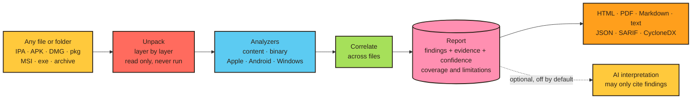
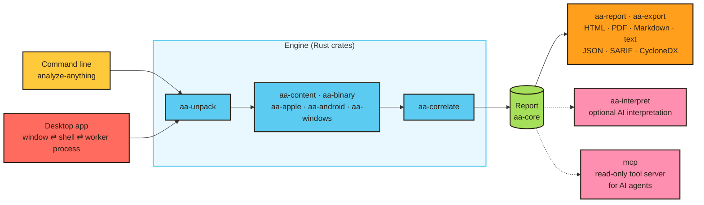

> Translation notice: the English README may be newer; see README.md for current delivery status and milestones.

# Analyze Anything

[English](../../README.md) · [简体中文](../../README.zh-CN.md) · [繁體中文](README_zh-TW.md) · [日本語](README_ja.md) · [한국어](README_ko.md) · [Türkçe](README_tr.md) · [Русский](README_ru.md) · [Tiếng Việt](README_vi.md) · [ไทย](README_th.md) · [Deutsch](README_de.md) · **Español** · [Français](README_fr.md) · [Українська](README_uk.md) · [Polski](README_pl.md) · [Português (Brasil)](README_pt-BR.md) · [العربية](README_ar.md) · [فارسی](README_fa.md) · [Bahasa Indonesia](README_id.md) · [Italiano](README_it.md) · [Ελληνικά](README_el.md) · [മലയാളം](README_ml.md) · [Roman Urdu](README_ur-Latn.md) · [Română](README_ro.md) · [Български](README_bg.md)

[Website](https://atomsprout.com/analyze-anything/) · [Examples](https://atomsprout.com/analyze-anything/#examples) · [Roadmap](../ROADMAP.md)

> Esto es una traducción. El [README en inglés](../../README.md) es la referencia y puede estar más actualizado.

Dale cualquier artefacto de tu ordenador —un IPA, un APK, una app de macOS, un DMG o pkg, un instalador de Windows o una carpeta de programa, un archivo comprimido, una carpeta, cualquier fichero— y obtén un informe en el que puedes confiar y que puedes rastrear: cada hallazgo lleva su evidencia (qué fichero, en qué parte, qué se leyó allí) y un nivel de confianza, y todo lo que no se pudo analizar aparece en cobertura y limitaciones.

```
analyze-anything App.ipa
```

Eso escribe `App.ipa.report/` con el informe en HTML, PDF, Markdown, texto plano y JSON. También están disponibles SARIF y CycloneDX.

- **Solo estático.** La entrada se lee; nunca se ejecuta, se instala ni se carga.
- **Sin conexión.** El análisis no se conecta a nada y no usa ningún modelo de lenguaje.
- **Determinista.** La misma entrada da el mismo informe, byte por byte.
- **Escrito en Rust**, sin necesidad de herramientas externas en tiempo de ejecución.

Hay dos formas de usarlo, sobre el mismo motor y con el mismo informe para la misma entrada:

- la **línea de comandos**, `analyze-anything` (nombre corto `aaaa`);
- la **aplicación de escritorio** para macOS: suelta un fichero, sigue el progreso, lee el informe, haz clic en una evidencia para ver sus bytes, exporta, guarda un historial y compara dos versiones y, si lo configuras, haz que un modelo explique el informe a su lado.

## Qué aspecto tiene

<table>
  <tr>
    <td width="50%"><br><sub>La aplicación de escritorio: el resumen del informe</sub></td>
    <td width="50%"><br><sub>Hallazgos, cada uno con su evidencia</sub></td>
  </tr>
  <tr>
    <td><br><sub>La interpretación opcional por IA junto al informe; cada afirmación cita hallazgos</sub></td>
    <td><br><sub>Suelta un fichero o una carpeta para empezar</sub></td>
  </tr>
</table>

<p align="center"><br><sub>El mismo informe en PDF</sub></p>

Las capturas de pantalla muestran el informe sobre F-Droid 2.0.3, uno de los [ejemplos](https://atomsprout.com/analyze-anything/#examples).

## Instalación

macOS en Apple silicon, con Homebrew:

```
brew install atomsprout/tap/analyze-anything                  # la línea de comandos
brew install --cask atomsprout/tap/analyze-anything-desktop   # la aplicación de escritorio
```

Cada una funciona sin la otra. Ambas están firmadas con un certificado Developer ID y notarizadas por Apple.

En otras plataformas, compila la línea de comandos desde el código fuente (Rust 1.90 o posterior):

```
cargo build --release
target/release/analyze-anything <file or folder>
```

Solo hay compilaciones publicadas para Mac con Apple silicon. En Linux y Windows el código compila y sus pruebas pasan en CI, pero nadie lo ha usado todavía a mano allí.

## Uso

```
analyze-anything <file or folder>                 # analizar; el informe va a <name>.report/
analyze-anything App.ipa -o out --lang zh         # elegir la carpeta; escribir el informe en chino
analyze-anything diff old/report.json new/report.json    # qué ha cambiado entre dos versiones
analyze-anything explain out/report.json <finding id>    # un hallazgo con toda su evidencia
analyze-anything verify out/                      # ¿siguen los ficheros tal como se escribieron?
```

La guía completa está en [docs/USAGE.md](../USAGE.md).

## Ejemplos

En el [sitio web](https://atomsprout.com/analyze-anything/#examples) hay informes, en PDF, sobre versiones públicas de software de código abierto: un IPA, un APK, un DMG, un pkg de macOS, un instalador NSIS y otro MSI, y un programa de Linux. `tools/site/examples.py` los vuelve a generar a partir de los mismos ficheros.

## Qué lee

| | |
|---|---|
| Apple | `.app` y otros bundles, IPA, DMG (HFS+ y APFS), pkg; Info.plist, firmas de código y cadenas de certificados, recursos sellados, entitlements, perfiles de aprovisionamiento, manifiestos de privacidad, cifrado FairPlay |
| Android | APK, AAB, XAPK / APKS / APKM; manifiesto, recursos, esquemas de firma v1–v3.1, DEX, SDK y empaquetadores |
| Windows | PE, Authenticode, ensamblados .NET, MSI (con su propia firma), NSIS, Inno Setup, CAB, autoextraíbles, Electron (asar), MSIX, carpetas de programas instalados |
| General | Estructura y endurecimiento de Mach-O, ELF y PE; zip, tar, 7z, gzip, bzip2, xz, zstd, anidados a cualquier profundidad; URL, posibles credenciales, entropía, ficheros duplicados |

## Cómo funciona

Una sola pasada, solo lectura: la entrada se abre capa por capa, cada fichero lo leen los analizadores que lo entienden, un último paso relaciona los ficheros entre sí, y todo lo que se encontró queda anotado con su evidencia. El informe es la única fuente de todos los formatos de salida.



La línea de comandos y la aplicación de escritorio son dos caras del mismo motor, así que una entrada da el mismo informe en ambas. La aplicación de escritorio nunca analiza en su propio proceso: lo hace un worker, que se puede detener con total seguridad.



## Opcional: una lectura del informe por IA

Desactivada salvo que la actives. Una vez escrito un informe, un modelo de lenguaje puede explicarlo con palabras sencillas:

```
analyze-anything ai claude          # una sola vez: elegir quién lo hace (aquí Claude Code, sin clave de API)
analyze-anything App.ipa --ai       # analizar y luego escribir ai.md junto al informe
```

Tú eliges quién lo hace: un servicio de modelos para el que tengas una clave de API (Claude, o cualquiera que hable el protocolo de OpenAI), Claude Code, Codex o un modelo que Ollama ejecute en tu propia máquina. También sirve un programa tuyo. El modelo ve el informe, nunca los ficheros analizados, y consulta en él mediante herramientas de solo lectura. Cada afirmación que haga debe citar hallazgos del informe; las que no lo hacen se descartan. Consulta [docs/AI.md](../AI.md).

## Estado y hoja de ruta

0.1.0 es la primera versión. Hoy cualquier fichero o carpeta obtiene un informe; los formatos de Apple, Android y Windows se entienden en profundidad. Está publicado para Mac con Apple silicon y se ha usado a mano en uno; en Linux y Windows el código compila y pasa sus pruebas en CI.

«Anything» es una promesa sobre el suelo y una dirección para el techo: no se rechaza nada, y la profundidad se añade formato a formato, cada uno como un crate pequeño. Lo siguiente, por orden:

1. **Lo mismo en todos los sistemas**: compilaciones publicadas para Linux y Windows; la aplicación de escritorio más allá de macOS.
2. **Más tipos de entrada**: paquetes de Linux, imágenes de contenedor, paquetes de ecosistemas de lenguajes, más plataformas de aplicaciones, documentos que llevan código, imágenes de firmware.
3. **Más profundidad donde importa**: vulnerabilidades conocidas a partir de una base de datos sin conexión, datos a nivel de función, reglas y políticas como datos.
4. **Más fácil construir sobre él**: una GitHub Action, la lectura por IA dentro del informe, una interfaz más completa para agentes, un esquema de informe estable.

Lo que no cambiará: solo estático, análisis sin conexión, el mismo informe para la misma entrada, evidencia para cada hallazgo y ningún veredicto. El panorama completo está en [docs/ROADMAP.md](../ROADMAP.md); la lista detallada es [docs/TODO.md](../TODO.md).

## Conviene saber

- La gravedad es una propiedad fija de cada regla y sirve para ordenar la lectura. El informe no dice si una entrada es segura.
- Los hallazgos marcados como heurísticos (posibles credenciales, empaquetadores, detección de SDK) pueden ser falsos positivos.
- Las firmas se comprueban contra el propio fichero: digests, valores de firma, cadenas de certificados. No se comprueban la revocación, los ajustes de confianza del sistema ni el estado de notarización de Apple; para eso haría falta la red.
- Un IPA descargado del App Store está cifrado: esto se reconoce, y los metadatos, la firma y los recursos se analizan como de costumbre, pero el código cifrado no se puede leer.
- Úsalo solo con cosas que tengas derecho a analizar.

Más en [docs/LIMITATIONS.md](../LIMITATIONS.md).

## Documentación

- [docs/USAGE.md](../USAGE.md) — la línea de comandos al completo ([中文](../USAGE.zh-CN.md))
- [docs/AI.md](../AI.md) — la interpretación opcional por IA
- [docs/DESKTOP.md](../DESKTOP.md) — la aplicación de escritorio: estructura, desarrollo, pruebas, publicación
- [docs/LIMITATIONS.md](../LIMITATIONS.md) — limitaciones conocidas
- [docs/ANALYZERS.md](../ANALYZERS.md) — cómo añadir un formato
- [docs/ROADMAP.md](../ROADMAP.md) — dónde está y hacia dónde va
- [docs/TODO.md](../TODO.md) — lo que queda por hacer, punto por punto
- [AGENTS.md](../../AGENTS.md) — cómo trabajar en este repositorio, para colaboradores y agentes de programación
- [docs/PLAN.md](../PLAN.md), [docs/PLAN-DESKTOP.md](../PLAN-DESKTOP.md), [docs/RESEARCH.md](../RESEARCH.md), [docs/spikes/](../spikes/) — cómo se planificó y qué se probó

## Desarrollo

```
cargo fmt --all --check
cargo clippy --workspace --all-targets -- -D warnings
cargo test --workspace
```

[AGENTS.md](../../AGENTS.md) explica cómo está organizado el repositorio y qué debe respetar un cambio. La aplicación de escritorio está en `apps/desktop`; consulta [docs/DESKTOP.md](../DESKTOP.md). Las issues y los pull requests son bienvenidos. Por favor, no adjuntes ficheros que no tengas derecho a compartir: el hallazgo de `report.json` que muestra el problema suele bastar.

## Licencia

Apache-2.0; consulta [LICENSE](../../LICENSE). Lo que se incluye de terceros, entre ello las fuentes tipográficas de los informes, figura en [NOTICE](../../NOTICE).
