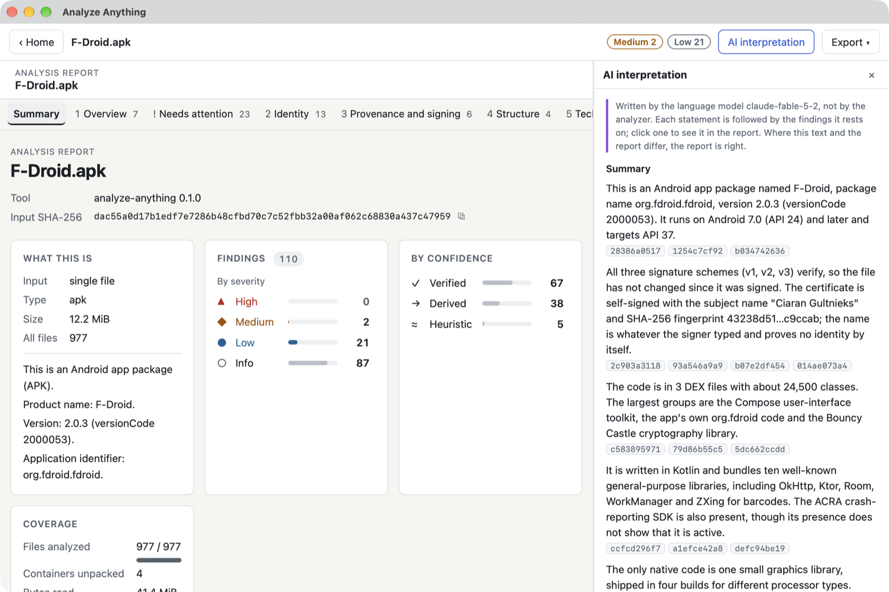
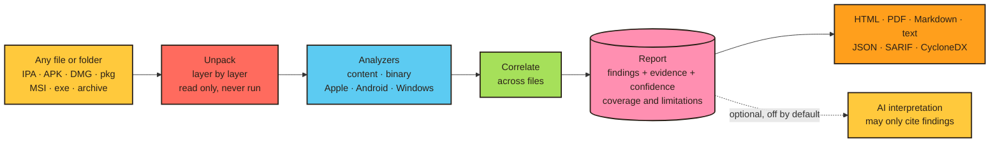
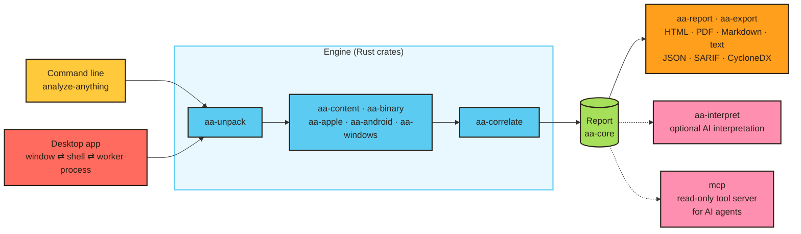

# Analyze Anything

[English](../../README.md) · [简体中文](../../README.zh-CN.md) · [繁體中文](README_zh-TW.md) · [日本語](README_ja.md) · [한국어](README_ko.md) · [Türkçe](README_tr.md) · [Русский](README_ru.md) · [Tiếng Việt](README_vi.md) · [ไทย](README_th.md) · [Deutsch](README_de.md) · [Español](README_es.md) · [Français](README_fr.md) · [Українська](README_uk.md) · [Polski](README_pl.md) · [Português (Brasil)](README_pt-BR.md) · [العربية](README_ar.md) · **فارسی** · [Bahasa Indonesia](README_id.md) · [Italiano](README_it.md) · [Ελληνικά](README_el.md) · [മലയാളം](README_ml.md) · [Roman Urdu](README_ur-Latn.md) · [Română](README_ro.md) · [Български](README_bg.md)

[Website](https://atomsprout.com/analyze-anything/) · [Examples](https://atomsprout.com/analyze-anything/#examples) · [Roadmap](../ROADMAP.md)

> این یک ترجمه است. [README انگلیسی](../../README.md) مرجع است و ممکن است جدیدتر باشد.

هر چیزی را که روی رایانه‌تان دارید به آن بدهید — یک IPA، یک APK، یک برنامهٔ macOS، یک DMG یا pkg، یک نصب‌کنندهٔ Windows یا پوشهٔ برنامه، یک آرشیو، یک پوشه، هر فایلی — و گزارشی بگیرید که بتوانید به آن اعتماد کنید و ردش را بگیرید: هر یافته شواهد خودش را دارد (کدام فایل، کجای آن، و چه چیزی آنجا خوانده شده) به‌همراه یک میزان اطمینان، و هر چیزی که تحلیل‌شدنی نبوده زیر پوشش و محدودیت‌ها فهرست می‌شود.

```
analyze-anything App.ipa
```

این دستور پوشهٔ `App.ipa.report/` را می‌نویسد که گزارش را به‌صورت HTML، PDF، Markdown، متن ساده و JSON در خود دارد. SARIF و CycloneDX هم در دسترس‌اند.

- **فقط ایستا.** ورودی خوانده می‌شود و هرگز اجرا، نصب یا بارگذاری نمی‌شود.
- **آفلاین.** تحلیل به هیچ‌جا وصل نمی‌شود و از هیچ مدل زبانی استفاده نمی‌کند.
- **قطعی.** ورودی یکسان همان گزارش را می‌دهد، بایت به بایت.
- **نوشته‌شده با Rust**، بدون نیاز به ابزار بیرونی در زمان اجرا.

دو راه برای استفاده از آن هست؛ هر دو روی یک موتور کار می‌کنند و برای ورودی یکسان همان گزارش را می‌دهند:

- **خط فرمان**، `analyze-anything` (نام کوتاه `aaaa`)؛
- **برنامهٔ دسکتاپ** برای macOS: فایلی را رها کنید، پیشرفت کار را ببینید، گزارش را بخوانید، روی هر شاهد کلیک کنید تا بایت‌هایش را ببینید، خروجی بگیرید، تاریخچه نگه دارید و دو نسخه را با هم مقایسه کنید، و اگر تنظیمش کرده باشید، بگذارید یک مدل گزارش را در کنار آن توضیح دهد.

## چه شکلی است

<table>
  <tr>
    <td width="50%"><br><sub>برنامهٔ دسکتاپ: خلاصهٔ گزارش</sub></td>
    <td width="50%"><br><sub>یافته‌ها، هر کدام با شواهد خودش</sub></td>
  </tr>
  <tr>
    <td><br><sub>تفسیر اختیاری هوش مصنوعی در کنار گزارش؛ هر جمله به یافته‌ها استناد می‌کند</sub></td>
    <td><br><sub>برای شروع، یک فایل یا پوشه را رها کنید</sub></td>
  </tr>
</table>

<p align="center"><br><sub>همان گزارش به‌صورت PDF</sub></p>

این تصویرها گزارش مربوط به F-Droid 2.0.3 را نشان می‌دهند که یکی از [نمونه‌ها](https://atomsprout.com/analyze-anything/#examples) است.

## نصب

macOS روی Apple silicon، با Homebrew:

```
brew install atomsprout/tap/analyze-anything                  # خط فرمان
brew install --cask atomsprout/tap/analyze-anything-desktop   # برنامهٔ دسکتاپ
```

هر کدام بدون دیگری کار می‌کند. هر دو با گواهی Developer ID امضا شده‌اند و Apple آن‌ها را notarize کرده است.

روی سکوهای دیگر، خط فرمان را از کد منبع بسازید (Rust 1.90 یا جدیدتر):

```
cargo build --release
target/release/analyze-anything <file or folder>
```

نسخه‌های منتشرشده فقط برای Macهای Apple silicon وجود دارند. روی Linux و Windows کد ساخته می‌شود و آزمون‌هایش در CI قبول می‌شوند، ولی هنوز کسی آنجا به‌صورت دستی از آن استفاده نکرده است.

## استفاده

```
analyze-anything <file or folder>                 # تحلیل؛ گزارش در <name>.report/ نوشته می‌شود
analyze-anything App.ipa -o out --lang zh         # پوشه را انتخاب کنید؛ گزارش را به چینی بنویسید
analyze-anything diff old/report.json new/report.json    # چه چیزی بین دو نسخه تغییر کرده
analyze-anything explain out/report.json <finding id>    # یک یافته با همهٔ شواهدش
analyze-anything verify out/                      # آیا فایل‌ها هنوز همانی‌اند که نوشته شده بود؟
```

راهنمای کامل در [docs/USAGE.md](../USAGE.md) است.

## نمونه‌ها

گزارش‌هایی دربارهٔ نسخه‌های عمومی نرم‌افزارهای متن‌باز، به‌صورت PDF، روی [وب‌سایت](https://atomsprout.com/analyze-anything/#examples) هستند: یک IPA، یک APK، یک DMG، یک pkg برای macOS، یک نصب‌کنندهٔ NSIS و یک نصب‌کنندهٔ MSI، و یک برنامهٔ Linux. `tools/site/examples.py` آن‌ها را از همان فایل‌ها دوباره می‌سازد.

## چه چیزهایی را می‌خواند

| | |
|---|---|
| Apple | `.app` و bundleهای دیگر، IPA، DMG (HFS+ و APFS)، pkg؛ Info.plist، امضاهای کد و زنجیره‌های گواهی، منابع مهروموم‌شده، entitlementها، provisioning profileها، privacy manifestها، رمزگذاری FairPlay |
| Android | APK، AAB، XAPK / APKS / APKM؛ manifest، منابع، طرح‌های امضای v1–v3.1، DEX، SDKها و packerها |
| Windows | PE، Authenticode، اسمبلی‌های .NET، MSI (با امضای خودش)، NSIS، Inno Setup، CAB، فایل‌های خوداستخراج، Electron (asar)، MSIX، پوشه‌های برنامهٔ نصب‌شده |
| عمومی | ساختار و مقاوم‌سازی (hardening) در Mach-O، ELF و PE؛ zip، tar، 7z، gzip، bzip2، xz، zstd، تودرتو تا هر عمقی؛ URLها، اطلاعات ورودِ احتمالی، آنتروپی، فایل‌های تکراری |

## چطور کار می‌کند

یک گذر، فقط خواندنی: ورودی لایه به لایه باز می‌شود، هر فایل را تحلیلگرهایی می‌خوانند که آن را می‌فهمند، گام آخر فایل‌ها را به یکدیگر ربط می‌دهد، و هر چه پیدا شده همراه با شواهدش ثبت می‌شود. گزارش تنها منبع همهٔ قالب‌های خروجی است.



خط فرمان و برنامهٔ دسکتاپ دو چهره از یک موتورند، پس یک ورودی در هر دو همان گزارش را می‌دهد. برنامهٔ دسکتاپ هرگز در پردازهٔ خودش تحلیل نمی‌کند: این کار را یک پردازهٔ worker انجام می‌دهد که می‌توان آن را به‌طور قطعی متوقف کرد.



## اختیاری: خوانش هوش مصنوعی از گزارش

خاموش است مگر اینکه روشنش کنید. وقتی گزارش نوشته شد، یک مدل زبانی می‌تواند آن را به زبان ساده توضیح دهد:

```
analyze-anything ai claude          # یک بار: انتخاب کنید چه کسی این کار را بکند (اینجا Claude Code، بدون نیاز به کلید API)
analyze-anything App.ipa --ai       # تحلیل، سپس نوشتن ai.md در کنار گزارش
```

شما انتخاب می‌کنید چه کسی این کار را بکند: یک سرویس مدل که کلید API آن را دارید (Claude، یا هر چیزی که با پروتکل OpenAI کار کند)، Claude Code، Codex، یا مدلی که Ollama روی دستگاه خودتان اجرا می‌کند. برنامه‌ای از خودتان هم جواب می‌دهد. مدل گزارش را می‌بیند و هرگز فایل‌های تحلیل‌شده را نمی‌بیند، و با ابزارهای فقط‌خواندنی در آن جست‌وجو می‌کند. هر جمله‌ای که می‌گوید باید به یافته‌های گزارش استناد کند؛ جمله‌هایی که استناد ندارند حذف می‌شوند. [docs/AI.md](../AI.md) را ببینید.

## وضعیت و نقشهٔ راه

0.1.0 نخستین انتشار است. امروز هر فایل یا پوشه‌ای گزارش می‌گیرد؛ قالب‌های Apple، Android و Windows به‌طور عمیق فهمیده می‌شوند. برای Macهای Apple silicon منتشر شده و روی یکی از آن‌ها به‌صورت دستی استفاده شده است؛ روی Linux و Windows کد ساخته می‌شود و آزمون‌هایش در CI قبول می‌شوند.

«Anything» قولی است دربارهٔ کف و جهتی است برای سقف: هیچ چیزی رد نمی‌شود، و عمق، قالب به قالب اضافه می‌شود، هر کدام به‌صورت یک crate کوچک. گام‌های بعدی، به ترتیب:

1. **همین کار روی همهٔ سیستم‌ها**: نسخه‌های منتشرشده برای Linux، Windows و Macهای Intel؛ برنامهٔ دسکتاپ فراتر از macOS.
2. **ورودی‌های بیشتر**: بسته‌های Linux، ایمیج‌های کانتینر، بسته‌های زیست‌بوم‌های زبان‌های برنامه‌نویسی، سکوهای برنامهٔ بیشتر، سندهایی که کد در خود دارند، ایمیج‌های firmware.
3. **عمیق‌تر در جایی که اهمیت دارد**: آسیب‌پذیری‌های شناخته‌شده از یک پایگاه‌دادهٔ آفلاین، واقعیت‌هایی در سطح تابع، قاعده‌ها و سیاست‌ها به‌صورت داده.
4. **آسان‌تر برای ساختن روی آن**: یک GitHub Action، خوانش هوش مصنوعی درون خود گزارش، رابطی کامل‌تر برای agentها، یک schema پایدار برای گزارش.

آنچه تغییر نخواهد کرد: فقط ایستا، تحلیل آفلاین، همان گزارش برای ورودی یکسان، شواهد برای هر یافته، و بدون حکم نهایی. تصویر کامل در [docs/ROADMAP.md](../ROADMAP.md) است؛ فهرست مورد به مورد در [docs/TODO.md](../TODO.md) است.

## خوب است بدانید

- شدت، ویژگی ثابت هر قاعده است و برای این است که ترتیب خواندن شما را مشخص کند. گزارش نمی‌گوید که یک ورودی امن است یا نه.
- یافته‌هایی که heuristic علامت خورده‌اند (اطلاعات ورودِ احتمالی، packerها، تشخیص SDK) ممکن است مثبت کاذب باشند.
- امضاها در برابر خودِ فایل بررسی می‌شوند: digestها، مقدارهای امضا، زنجیره‌های گواهی. ابطال گواهی، تنظیمات اعتماد سیستم و وضعیت notarization در Apple بررسی نمی‌شوند؛ این کار به شبکه نیاز دارد.
- یک IPA که از App Store دانلود شده رمزگذاری شده است: این تشخیص داده می‌شود، و فراداده، امضا و منابع مثل همیشه تحلیل می‌شوند، ولی کد رمزگذاری‌شده خواندنی نیست.
- فقط روی چیزهایی از آن استفاده کنید که حق تحلیلشان را دارید.

بیشتر در [docs/LIMITATIONS.md](../LIMITATIONS.md).

## مستندات

- [docs/USAGE.md](../USAGE.md) — خط فرمان به‌طور کامل ([中文](../USAGE.zh-CN.md))
- [docs/AI.md](../AI.md) — تفسیر اختیاری هوش مصنوعی
- [docs/DESKTOP.md](../DESKTOP.md) — برنامهٔ دسکتاپ: ساختار، توسعه، آزمون، انتشار
- [docs/LIMITATIONS.md](../LIMITATIONS.md) — محدودیت‌های شناخته‌شده
- [docs/ANALYZERS.md](../ANALYZERS.md) — چطور یک قالب اضافه کنیم
- [docs/ROADMAP.md](../ROADMAP.md) — الان کجاست و به کجا می‌رود
- [docs/TODO.md](../TODO.md) — آنچه مانده است، مورد به مورد
- [AGENTS.md](../../AGENTS.md) — شیوهٔ کار در این مخزن، برای مشارکت‌کنندگان و agentهای کدنویسی
- [docs/PLAN.md](../PLAN.md)، [docs/PLAN-DESKTOP.md](../PLAN-DESKTOP.md)، [docs/RESEARCH.md](../RESEARCH.md)، [docs/spikes/](../spikes/) — چطور برنامه‌ریزی شد و چه چیزهایی امتحان شد

## توسعه

```
cargo fmt --all --check
cargo clippy --workspace --all-targets -- -D warnings
cargo test --workspace
```

[AGENTS.md](../../AGENTS.md) می‌گوید مخزن چطور چیده شده و هر تغییر چه چیزهایی را باید حفظ کند. برنامهٔ دسکتاپ در `apps/desktop` قرار دارد؛ [docs/DESKTOP.md](../DESKTOP.md) را ببینید. از issueها و pull requestها استقبال می‌شود. لطفاً فایل‌هایی را که حق هم‌رسانی‌شان را ندارید پیوست نکنید: معمولاً همان یک یافته از `report.json` که مشکل را نشان می‌دهد کافی است.

## مجوز

Apache-2.0؛ [LICENSE](../../LICENSE) را ببینید. آنچه از دیگران همراه برنامه آمده، از جمله فونت‌های داخل گزارش‌ها، در [NOTICE](../../NOTICE) فهرست شده است.
