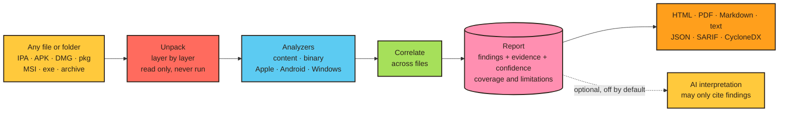
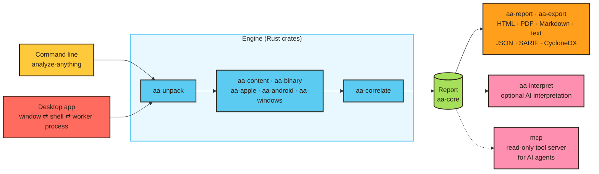

> Translation notice: the English README may be newer; see README.md for current delivery status and milestones.

# Analyze Anything

[English](../../README.md) · [简体中文](../../README.zh-CN.md) · [繁體中文](README_zh-TW.md) · [日本語](README_ja.md) · [한국어](README_ko.md) · [Türkçe](README_tr.md) · [Русский](README_ru.md) · [Tiếng Việt](README_vi.md) · [ไทย](README_th.md) · [Deutsch](README_de.md) · [Español](README_es.md) · **Français** · [Українська](README_uk.md) · [Polski](README_pl.md) · [Português (Brasil)](README_pt-BR.md) · [العربية](README_ar.md) · [فارسی](README_fa.md) · [Bahasa Indonesia](README_id.md) · [Italiano](README_it.md) · [Ελληνικά](README_el.md) · [മലയാളം](README_ml.md) · [Roman Urdu](README_ur-Latn.md) · [Română](README_ro.md) · [Български](README_bg.md)

[Website](https://atomsprout.com/analyze-anything/) · [Examples](https://atomsprout.com/analyze-anything/#examples) · [Roadmap](../ROADMAP.md)

> Ceci est une traduction. Le [README en anglais](../../README.md) fait référence et peut être plus récent.

Donnez-lui n'importe quel artefact présent sur votre ordinateur — un IPA, un APK, une app macOS, un DMG ou un pkg, un installateur Windows ou un dossier de programme, une archive, un dossier, n'importe quel fichier — et obtenez un rapport fiable et traçable : chaque constat est accompagné de sa preuve (quel fichier, à quel endroit, ce qui y a été lu) et d'un niveau de confiance, et tout ce qui n'a pas pu être analysé est listé dans la couverture et les limites.

```
analyze-anything App.ipa
```

Cela écrit `App.ipa.report/` avec le rapport en HTML, PDF, Markdown, texte brut et JSON. SARIF et CycloneDX sont également disponibles.

- **Statique uniquement.** L'entrée est lue, jamais exécutée, installée ni chargée.
- **Hors ligne.** L'analyse ne se connecte à rien et n'utilise aucun modèle de langage.
- **Déterministe.** La même entrée donne le même rapport, octet pour octet.
- **Écrit en Rust**, sans outil externe nécessaire à l'exécution.

Il s'utilise de deux façons, avec le même moteur et le même rapport pour la même entrée :

- la **ligne de commande**, `analyze-anything` (nom court `aaaa`) ;
- l'**application de bureau** pour macOS : déposez un fichier, suivez la progression, lisez le rapport, cliquez sur une preuve pour voir ses octets, exportez, conservez un historique et comparez deux versions et, si vous le configurez, faites expliquer le rapport par un modèle, à côté de celui-ci.

## À quoi cela ressemble

<table>
  <tr>
    <td width="50%"><br><sub>L'application de bureau : le résumé du rapport</sub></td>
    <td width="50%"><br><sub>Les constats, chacun avec sa preuve</sub></td>
  </tr>
  <tr>
    <td><br><sub>L'interprétation par IA, facultative, à côté du rapport ; chaque affirmation cite des constats</sub></td>
    <td><br><sub>Déposez un fichier ou un dossier pour commencer</sub></td>
  </tr>
</table>

<p align="center"><br><sub>Le même rapport en PDF</sub></p>

Les captures d'écran montrent le rapport sur F-Droid 2.0.3, l'un des [exemples](https://atomsprout.com/analyze-anything/#examples).

## Installation

macOS sur Apple silicon, avec Homebrew :

```
brew install atomsprout/tap/analyze-anything                  # la ligne de commande
brew install --cask atomsprout/tap/analyze-anything-desktop   # l'application de bureau
```

Chacune fonctionne sans l'autre. Les deux sont signées avec un certificat Developer ID et notarisées par Apple.

Sur les autres plateformes, compilez la ligne de commande à partir des sources (Rust 1.90 ou plus récent) :

```
cargo build --release
target/release/analyze-anything <file or folder>
```

Les builds publiés n'existent que pour les Mac Apple silicon. Sous Linux et Windows, le code compile et ses tests passent en CI, mais personne ne l'y a encore utilisé à la main.

## Utilisation

```
analyze-anything <file or folder>                 # analyser ; le rapport va dans <name>.report/
analyze-anything App.ipa -o out --lang zh         # choisir le dossier ; écrire le rapport en chinois
analyze-anything diff old/report.json new/report.json    # ce qui a changé entre deux versions
analyze-anything explain out/report.json <finding id>    # un constat avec toutes ses preuves
analyze-anything verify out/                      # les fichiers sont-ils toujours tels qu'ils ont été écrits ?
```

Le guide complet se trouve dans [docs/USAGE.md](../USAGE.md).

## Exemples

Des rapports sur des versions publiques de logiciels open source, au format PDF, sont disponibles sur le [site web](https://atomsprout.com/analyze-anything/#examples) : un IPA, un APK, un DMG, un pkg macOS, un installateur NSIS et un installateur MSI, et un programme Linux. `tools/site/examples.py` les régénère à partir des mêmes fichiers.

## Ce qu'il lit

| | |
|---|---|
| Apple | `.app` et autres bundles, IPA, DMG (HFS+ et APFS), pkg ; Info.plist, signatures de code et chaînes de certificats, ressources scellées, entitlements, profils de provisionnement, manifestes de confidentialité, chiffrement FairPlay |
| Android | APK, AAB, XAPK / APKS / APKM ; manifeste, ressources, schémas de signature v1–v3.1, DEX, SDK et packers |
| Windows | PE, Authenticode, assemblies .NET, MSI (avec sa propre signature), NSIS, Inno Setup, CAB, auto-extractibles, Electron (asar), MSIX, dossiers de programmes installés |
| Général | Structure et durcissement de Mach-O, ELF et PE ; zip, tar, 7z, gzip, bzip2, xz, zstd, imbriqués à n'importe quelle profondeur ; URL, identifiants probables, entropie, fichiers en double |

## Comment ça marche

Une seule passe, en lecture seule : l'entrée est ouverte couche par couche, chaque fichier est lu par les analyseurs qui le comprennent, une dernière étape met les fichiers en relation les uns avec les autres, et tout ce qui a été trouvé est consigné avec sa preuve. Le rapport est la source unique de tous les formats de sortie.



La ligne de commande et l'application de bureau sont deux faces du même moteur : une même entrée donne donc le même rapport dans les deux. L'application de bureau n'analyse jamais dans son propre processus : un worker s'en charge, et il peut être arrêté à coup sûr.



## Facultatif : une lecture du rapport par IA

Désactivée tant que vous ne l'activez pas. Une fois un rapport écrit, un modèle de langage peut l'expliquer en termes simples :

```
analyze-anything ai claude          # une seule fois : choisir qui s'en charge (ici Claude Code, sans clé d'API)
analyze-anything App.ipa --ai       # analyser, puis écrire ai.md à côté du rapport
```

Vous choisissez qui s'en charge : un service de modèles pour lequel vous avez une clé d'API (Claude, ou tout ce qui parle le protocole d'OpenAI), Claude Code, Codex, ou un modèle qu'Ollama exécute sur votre propre machine. Un programme à vous convient aussi. Le modèle voit le rapport, jamais les fichiers analysés, et y fait ses recherches au moyen d'outils en lecture seule. Chaque affirmation qu'il fait doit citer des constats du rapport ; celles qui ne le font pas sont écartées. Voir [docs/AI.md](../AI.md).

## État et feuille de route

0.1.0 est la première version. N'importe quel fichier ou dossier obtient un rapport dès aujourd'hui ; les formats Apple, Android et Windows sont compris en profondeur. Il est publié pour les Mac Apple silicon et a été utilisé à la main sur l'un d'eux ; sous Linux et Windows, le code compile et passe ses tests en CI.

« Anything » est une promesse pour le plancher et une direction pour le plafond : rien n'est refusé, et la profondeur s'ajoute un format à la fois, chacun sous la forme d'un petit crate. Ensuite, dans l'ordre :

1. **La même chose sur tous les systèmes** : des builds publiés pour Linux et Windows ; l'application de bureau au-delà de macOS.
2. **Plus de types d'entrée** : paquets Linux, images de conteneur, paquets des écosystèmes de langages, davantage de plateformes d'applications, documents qui contiennent du code, images de firmware.
3. **Plus de profondeur là où cela compte** : vulnérabilités connues à partir d'une base de données hors ligne, faits au niveau des fonctions, règles et politiques sous forme de données.
4. **Plus facile à réutiliser** : une GitHub Action, la lecture par IA à l'intérieur du rapport, une interface plus complète pour les agents, un schéma de rapport stable.

Ce qui ne changera pas : statique uniquement, analyse hors ligne, le même rapport pour la même entrée, une preuve pour chaque constat, et aucun verdict. La vue d'ensemble se trouve dans [docs/ROADMAP.md](../ROADMAP.md) ; la liste détaillée est [docs/TODO.md](../TODO.md).

## Bon à savoir

- La gravité est une propriété fixe de chaque règle, là pour ordonner votre lecture. Le rapport ne dit pas si une entrée est sûre.
- Les constats marqués comme heuristiques (identifiants probables, packers, détection de SDK) peuvent être des faux positifs.
- Les signatures sont vérifiées par rapport au fichier lui-même : condensats, valeurs de signature, chaînes de certificats. La révocation, les réglages de confiance du système et l'état de notarisation auprès d'Apple ne sont pas vérifiés ; il faudrait pour cela le réseau.
- Un IPA téléchargé depuis l'App Store est chiffré : cela est reconnu, et les métadonnées, la signature et les ressources sont analysées comme d'habitude, mais le code chiffré ne peut pas être lu.
- Ne l'utilisez que sur ce que vous avez le droit d'analyser.

Pour en savoir plus : [docs/LIMITATIONS.md](../LIMITATIONS.md).

## Documentation

- [docs/USAGE.md](../USAGE.md) — la ligne de commande en détail ([中文](../USAGE.zh-CN.md))
- [docs/AI.md](../AI.md) — l'interprétation par IA, facultative
- [docs/DESKTOP.md](../DESKTOP.md) — l'application de bureau : structure, développement, tests, publication
- [docs/LIMITATIONS.md](../LIMITATIONS.md) — les limites connues
- [docs/ANALYZERS.md](../ANALYZERS.md) — comment ajouter un format
- [docs/ROADMAP.md](../ROADMAP.md) — où en est le projet et où il va
- [docs/TODO.md](../TODO.md) — ce qu'il reste à faire, point par point
- [AGENTS.md](../../AGENTS.md) — comment travailler dans ce dépôt, pour les contributeurs et les agents de programmation
- [docs/PLAN.md](../PLAN.md), [docs/PLAN-DESKTOP.md](../PLAN-DESKTOP.md), [docs/RESEARCH.md](../RESEARCH.md), [docs/spikes/](../spikes/) — comment il a été planifié et ce qui a été essayé

## Développement

```
cargo fmt --all --check
cargo clippy --workspace --all-targets -- -D warnings
cargo test --workspace
```

[AGENTS.md](../../AGENTS.md) explique comment le dépôt est organisé et ce qu'une modification doit préserver. L'application de bureau se trouve dans `apps/desktop` ; voir [docs/DESKTOP.md](../DESKTOP.md). Les issues et les pull requests sont les bienvenues. Merci de ne pas joindre de fichiers que vous n'avez pas le droit de partager : le seul constat de `report.json` qui montre le problème suffit généralement.

## Licence

Apache-2.0 ; voir [LICENSE](../../LICENSE). Ce qui provient de tiers et est distribué avec le projet, notamment les polices des rapports, est listé dans [NOTICE](../../NOTICE).
