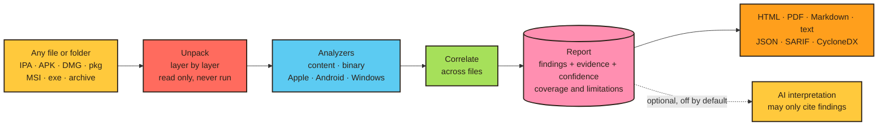
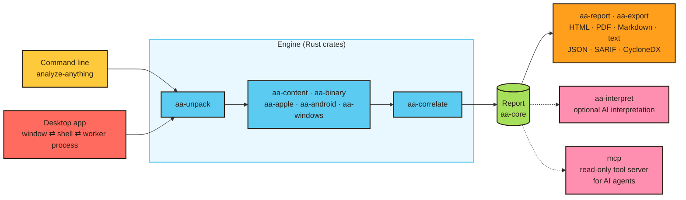

# Analyze Anything

[English](../../README.md) · [简体中文](../../README.zh-CN.md) · [繁體中文](README_zh-TW.md) · [日本語](README_ja.md) · [한국어](README_ko.md) · [Türkçe](README_tr.md) · [Русский](README_ru.md) · [Tiếng Việt](README_vi.md) · [ไทย](README_th.md) · [Deutsch](README_de.md) · [Español](README_es.md) · [Français](README_fr.md) · [Українська](README_uk.md) · [Polski](README_pl.md) · [Português (Brasil)](README_pt-BR.md) · [العربية](README_ar.md) · [فارسی](README_fa.md) · **Bahasa Indonesia** · [Italiano](README_it.md) · [Ελληνικά](README_el.md) · [മലയാളം](README_ml.md) · [Roman Urdu](README_ur-Latn.md) · [Română](README_ro.md) · [Български](README_bg.md)

[Website](https://atomsprout.com/analyze-anything/) · [Examples](https://atomsprout.com/analyze-anything/#examples) · [Roadmap](../ROADMAP.md)

> Ini adalah terjemahan. [README bahasa Inggris](../../README.md) adalah acuannya dan mungkin lebih baru.

Berikan artefak apa pun yang ada di komputer Anda — IPA, APK, aplikasi macOS, DMG atau pkg, installer Windows atau folder program, arsip, folder, berkas apa saja — dan dapatkan laporan yang bisa Anda percaya dan telusuri: setiap temuan disertai buktinya (berkas mana, di bagian mana, apa yang terbaca di sana) dan tingkat keyakinan, dan apa pun yang tidak dapat dianalisis dicantumkan di bagian cakupan dan keterbatasan.

```
analyze-anything App.ipa
```

Perintah itu menulis `App.ipa.report/` berisi laporan dalam bentuk HTML, PDF, Markdown, teks biasa, dan JSON. SARIF dan CycloneDX juga tersedia.

- **Hanya statis.** Masukan hanya dibaca, tidak pernah dijalankan, dipasang, atau dimuat.
- **Luring.** Analisis tidak terhubung ke mana pun dan tidak memakai model bahasa.
- **Deterministik.** Masukan yang sama menghasilkan laporan yang sama, byte demi byte.
- **Ditulis dalam Rust**, tanpa memerlukan alat luar saat dijalankan.

Ada dua cara memakainya, di atas mesin yang sama, dengan laporan yang sama untuk masukan yang sama:

- **baris perintah**, `analyze-anything` (nama pendek `aaaa`);
- **aplikasi desktop** untuk macOS: jatuhkan berkas, pantau kemajuannya, baca laporannya, klik sebuah bukti untuk melihat byte-nya, ekspor, simpan riwayat dan bandingkan dua versi, dan, jika Anda mengaturnya, minta sebuah model menjelaskan laporan itu di sampingnya.

## Seperti apa tampilannya

<table>
  <tr>
    <td width="50%"><br><sub>Aplikasi desktop: ringkasan laporan</sub></td>
    <td width="50%"><br><sub>Temuan, masing-masing dengan buktinya</sub></td>
  </tr>
  <tr>
    <td><br><sub>Interpretasi AI opsional di samping laporan; setiap pernyataan merujuk temuan</sub></td>
    <td><br><sub>Jatuhkan berkas atau folder untuk memulai</sub></td>
  </tr>
</table>

<p align="center"><br><sub>Laporan yang sama sebagai PDF</sub></p>

Tangkapan layar di atas menampilkan laporan tentang F-Droid 2.0.3, salah satu [contoh](https://atomsprout.com/analyze-anything/#examples).

## Pemasangan

macOS pada Apple silicon, dengan Homebrew:

```
brew install atomsprout/tap/analyze-anything                  # baris perintah
brew install --cask atomsprout/tap/analyze-anything-desktop   # aplikasi desktop
```

Masing-masing berfungsi tanpa yang lain. Keduanya ditandatangani dengan sertifikat Developer ID dan dinotarisasi oleh Apple.

Di platform lain, bangun baris perintahnya dari kode sumber (Rust 1.90 atau lebih baru):

```
cargo build --release
target/release/analyze-anything <file or folder>
```

Build rilis hanya tersedia untuk Mac dengan Apple silicon. Di Linux dan Windows kodenya dapat dibangun dan pengujiannya lolos di CI, tetapi belum ada yang memakainya secara langsung di sana.

## Penggunaan

```
analyze-anything <file or folder>                 # analisis; laporan ditulis ke <name>.report/
analyze-anything App.ipa -o out --lang zh         # pilih foldernya; tulis laporan dalam bahasa Mandarin
analyze-anything diff old/report.json new/report.json    # apa yang berubah di antara dua versi
analyze-anything explain out/report.json <finding id>    # satu temuan beserta semua buktinya
analyze-anything verify out/                      # apakah berkasnya masih sama seperti saat ditulis?
```

Panduan lengkapnya ada di [docs/USAGE.md](../USAGE.md).

## Contoh

Laporan tentang rilis publik perangkat lunak sumber terbuka, dalam bentuk PDF, ada di [situs web](https://atomsprout.com/analyze-anything/#examples): sebuah IPA, sebuah APK, sebuah DMG, sebuah pkg macOS, sebuah installer NSIS dan sebuah installer MSI, serta sebuah program Linux. `tools/site/examples.py` membuatnya kembali dari berkas-berkas yang sama.

## Apa yang dibacanya

| | |
|---|---|
| Apple | `.app` dan bundle lainnya, IPA, DMG (HFS+ dan APFS), pkg; Info.plist, tanda tangan kode dan rantai sertifikat, sumber daya tersegel (sealed resources), entitlements, provisioning profile, privacy manifest, enkripsi FairPlay |
| Android | APK, AAB, XAPK / APKS / APKM; manifest, sumber daya, skema tanda tangan v1–v3.1, DEX, SDK dan packer |
| Windows | PE, Authenticode, assembly .NET, MSI (dengan tanda tangannya sendiri), NSIS, Inno Setup, CAB, arsip yang mengekstrak sendiri, Electron (asar), MSIX, folder program yang terpasang |
| Umum | Struktur dan hardening Mach-O, ELF, dan PE; zip, tar, 7z, gzip, bzip2, xz, zstd, bersarang hingga kedalaman berapa pun; URL, string yang kemungkinan kredensial, entropi, berkas duplikat |

## Cara kerjanya

Satu lintasan, hanya baca: masukan dibuka lapis demi lapis, setiap berkas dibaca oleh penganalisis yang memahaminya, langkah terakhir menghubungkan berkas-berkas itu satu sama lain, dan semua yang ditemukan dicatat beserta buktinya. Laporan adalah satu-satunya sumber bagi setiap format keluaran.



Baris perintah dan aplikasi desktop adalah dua wajah dari mesin yang sama, sehingga satu masukan menghasilkan laporan yang sama di keduanya. Aplikasi desktop tidak pernah menganalisis di dalam prosesnya sendiri: sebuah worker yang melakukannya, dan worker itu pasti dapat dihentikan.



## Opsional: pembacaan laporan oleh AI

Nonaktif kecuali Anda menyalakannya. Setelah laporan ditulis, sebuah model bahasa dapat menjelaskannya dengan kata-kata sederhana:

```
analyze-anything ai claude          # sekali saja: pilih siapa yang mengerjakannya (di sini Claude Code, tanpa API key)
analyze-anything App.ipa --ai       # analisis, lalu tulis ai.md di samping laporan
```

Anda yang memilih siapa yang mengerjakannya: layanan model yang API key-nya Anda miliki (Claude, atau apa pun yang memakai protokol OpenAI), Claude Code, Codex, atau model yang dijalankan Ollama di mesin Anda sendiri. Program buatan Anda sendiri juga bisa. Model itu melihat laporan, tidak pernah berkas yang dianalisis, dan mencari informasi di dalamnya melalui alat yang hanya bisa membaca. Setiap pernyataan yang dibuatnya harus merujuk temuan dalam laporan; pernyataan yang tidak merujuk temuan dibuang. Lihat [docs/AI.md](../AI.md).

## Status dan peta jalan

0.1.0 adalah rilis pertama. Saat ini berkas atau folder apa pun mendapat laporan; format Apple, Android, dan Windows dipahami secara mendalam. Rilisnya tersedia untuk Mac dengan Apple silicon dan sudah dipakai secara langsung di satu mesin; di Linux dan Windows kodenya dapat dibangun dan lolos pengujian di CI.

"Anything" adalah janji tentang batas bawah dan arah untuk batas atas: tidak ada yang ditolak, dan kedalaman ditambahkan satu format demi satu format, masing-masing sebagai crate kecil. Berikutnya, secara berurutan:

1. **Hal yang sama di setiap sistem**: build rilis untuk Linux, Windows, dan Mac Intel; aplikasi desktop di luar macOS.
2. **Lebih banyak jenis masukan**: paket Linux, image kontainer, paket dari ekosistem bahasa pemrograman, lebih banyak platform aplikasi, dokumen yang memuat kode, image firmware.
3. **Lebih dalam di tempat yang penting**: kerentanan yang sudah diketahui dari basis data luring, fakta di tingkat fungsi, aturan dan kebijakan sebagai data.
4. **Lebih mudah dijadikan dasar**: sebuah GitHub Action, pembacaan AI di dalam laporan, antarmuka yang lebih lengkap untuk agen, skema laporan yang stabil.

Yang tidak akan berubah: hanya statis, analisis luring, laporan yang sama untuk masukan yang sama, bukti untuk setiap temuan, dan tanpa vonis. Gambaran lengkapnya ada di [docs/ROADMAP.md](../ROADMAP.md); daftar terperincinya ada di [docs/TODO.md](../TODO.md).

## Perlu diketahui

- Tingkat keparahan adalah properti tetap dari setiap aturan, gunanya untuk mengurutkan bacaan Anda. Laporan tidak menyatakan apakah suatu masukan aman.
- Temuan yang ditandai heuristik (string yang kemungkinan kredensial, packer, deteksi SDK) bisa berupa positif palsu.
- Tanda tangan diperiksa terhadap berkas itu sendiri: digest, nilai tanda tangan, rantai sertifikat. Pencabutan, pengaturan kepercayaan sistem, dan status notarisasi Apple tidak diperiksa; itu memerlukan jaringan.
- IPA yang diunduh dari App Store terenkripsi: hal ini dikenali, dan metadata, tanda tangan, serta sumber dayanya dianalisis seperti biasa, tetapi kode yang terenkripsi tidak dapat dibaca.
- Gunakan hanya pada hal-hal yang berhak Anda analisis.

Selengkapnya di [docs/LIMITATIONS.md](../LIMITATIONS.md).

## Dokumentasi

- [docs/USAGE.md](../USAGE.md) — baris perintah selengkapnya ([中文](../USAGE.zh-CN.md))
- [docs/AI.md](../AI.md) — interpretasi AI yang opsional
- [docs/DESKTOP.md](../DESKTOP.md) — aplikasi desktop: struktur, pengembangan, pengujian, rilis
- [docs/LIMITATIONS.md](../LIMITATIONS.md) — keterbatasan yang diketahui
- [docs/ANALYZERS.md](../ANALYZERS.md) — cara menambahkan sebuah format
- [docs/ROADMAP.md](../ROADMAP.md) — posisinya sekarang dan arah tujuannya
- [docs/TODO.md](../TODO.md) — apa yang masih harus dikerjakan, butir demi butir
- [AGENTS.md](../../AGENTS.md) — cara bekerja di repositori ini, untuk kontributor dan agen pemrograman
- [docs/PLAN.md](../PLAN.md), [docs/PLAN-DESKTOP.md](../PLAN-DESKTOP.md), [docs/RESEARCH.md](../RESEARCH.md), [docs/spikes/](../spikes/) — bagaimana proyek ini direncanakan dan apa saja yang dicoba

## Pengembangan

```
cargo fmt --all --check
cargo clippy --workspace --all-targets -- -D warnings
cargo test --workspace
```

[AGENTS.md](../../AGENTS.md) menjelaskan bagaimana repositori ini disusun dan apa yang harus dijaga oleh setiap perubahan. Aplikasi desktop berada di `apps/desktop`; lihat [docs/DESKTOP.md](../DESKTOP.md). Issue dan pull request dipersilakan. Mohon jangan melampirkan berkas yang tidak berhak Anda bagikan: satu temuan dari `report.json` yang menunjukkan masalahnya biasanya sudah cukup.

## Lisensi

Apache-2.0; lihat [LICENSE](../../LICENSE). Apa yang dibundel dari pihak lain, termasuk fon dalam laporan, tercantum di [NOTICE](../../NOTICE).
