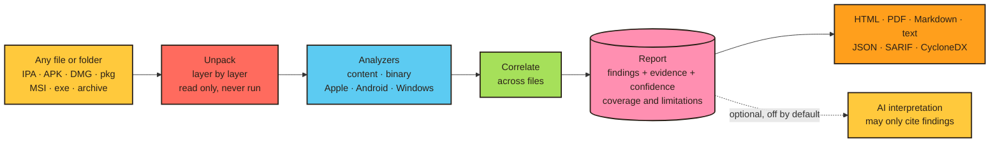
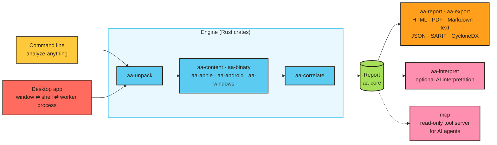

# Analyze Anything

[English](../../README.md) · [简体中文](../../README.zh-CN.md) · [繁體中文](README_zh-TW.md) · [日本語](README_ja.md) · [한국어](README_ko.md) · [Türkçe](README_tr.md) · [Русский](README_ru.md) · [Tiếng Việt](README_vi.md) · [ไทย](README_th.md) · [Deutsch](README_de.md) · [Español](README_es.md) · [Français](README_fr.md) · [Українська](README_uk.md) · [Polski](README_pl.md) · [Português (Brasil)](README_pt-BR.md) · [العربية](README_ar.md) · [فارسی](README_fa.md) · [Bahasa Indonesia](README_id.md) · **Italiano** · [Ελληνικά](README_el.md) · [മലയാളം](README_ml.md) · [Roman Urdu](README_ur-Latn.md) · [Română](README_ro.md) · [Български](README_bg.md)

[Website](https://atomsprout.com/analyze-anything/) · [Examples](https://atomsprout.com/analyze-anything/#examples) · [Roadmap](../ROADMAP.md)

> Questa è una traduzione. Il [README in inglese](../../README.md) è il riferimento e potrebbe essere più aggiornato.

Dagli un qualsiasi artefatto presente sul tuo computer — un IPA, un APK, un'app macOS, un DMG o un pkg, un installer Windows o una cartella di programma, un archivio, una cartella, un file qualunque — e ottieni un report di cui ti puoi fidare e che puoi tracciare: ogni rilevamento riporta la sua evidenza (quale file, in quale punto, che cosa vi è stato letto) e un livello di confidenza, e tutto ciò che non è stato possibile analizzare è elencato in copertura e limitazioni.

```
analyze-anything App.ipa
```

Questo scrive `App.ipa.report/` con il report in HTML, PDF, Markdown, testo semplice e JSON. Sono disponibili anche SARIF e CycloneDX.

- **Solo statico.** L'input viene letto, mai eseguito, installato o caricato.
- **Offline.** L'analisi non si connette a nulla e non usa alcun modello linguistico.
- **Deterministico.** Lo stesso input dà lo stesso report, byte per byte.
- **Scritto in Rust**, senza bisogno di strumenti esterni in fase di esecuzione.

Si può usare in due modi, sullo stesso motore e con lo stesso report per lo stesso input:

- la **riga di comando**, `analyze-anything` (nome breve `aaaa`);
- l'**app desktop** per macOS: trascina un file, segui l'avanzamento, leggi il report, fai clic su un'evidenza per vederne i byte, esporta, tieni una cronologia e confronta due versioni e, se lo configuri, fatti spiegare il report da un modello, accanto al report stesso.

## Come si presenta

<table>
  <tr>
    <td width="50%"><br><sub>L'app desktop: il riepilogo del report</sub></td>
    <td width="50%"><br><sub>I rilevamenti, ciascuno con la sua evidenza</sub></td>
  </tr>
  <tr>
    <td><br><sub>L'interpretazione IA facoltativa accanto al report; ogni affermazione cita dei rilevamenti</sub></td>
    <td><br><sub>Trascina un file o una cartella per iniziare</sub></td>
  </tr>
</table>

<p align="center"><br><sub>Lo stesso report in PDF</sub></p>

Gli screenshot mostrano il report su F-Droid 2.0.3, uno degli [esempi](https://atomsprout.com/analyze-anything/#examples).

## Installazione

macOS su Apple silicon, con Homebrew:

```
brew install atomsprout/tap/analyze-anything                  # la riga di comando
brew install --cask atomsprout/tap/analyze-anything-desktop   # l'app desktop
```

Ciascuna funziona senza l'altra. Entrambe sono firmate con un certificato Developer ID e notarizzate da Apple.

Sulle altre piattaforme, compila la riga di comando dai sorgenti (Rust 1.90 o successivo):

```
cargo build --release
target/release/analyze-anything <file or folder>
```

Le build rilasciate esistono solo per i Mac con Apple silicon. Su Linux e Windows il codice compila e i suoi test passano in CI, ma lì nessuno lo ha ancora usato a mano.

## Uso

```
analyze-anything <file or folder>                 # analizza; il report va in <name>.report/
analyze-anything App.ipa -o out --lang zh         # scegli la cartella; scrivi il report in cinese
analyze-anything diff old/report.json new/report.json    # che cosa è cambiato tra due versioni
analyze-anything explain out/report.json <finding id>    # un rilevamento con tutte le sue evidenze
analyze-anything verify out/                      # i file sono ancora come sono stati scritti?
```

La guida completa è in [docs/USAGE.md](../USAGE.md).

## Esempi

Sul [sito web](https://atomsprout.com/analyze-anything/#examples) ci sono report, in PDF, su release pubbliche di software open source: un IPA, un APK, un DMG, un pkg macOS, un installer NSIS e uno MSI, e un programma Linux. `tools/site/examples.py` li rigenera a partire dagli stessi file.

## Che cosa legge

| | |
|---|---|
| Apple | `.app` e altri bundle, IPA, DMG (HFS+ e APFS), pkg; Info.plist, firme del codice e catene di certificati, risorse sigillate, entitlement, profili di provisioning, manifest della privacy, cifratura FairPlay |
| Android | APK, AAB, XAPK / APKS / APKM; manifest, risorse, schemi di firma v1–v3.1, DEX, SDK e packer |
| Windows | PE, Authenticode, assembly .NET, MSI (con la propria firma), NSIS, Inno Setup, CAB, archivi autoestraenti, Electron (asar), MSIX, cartelle di programmi installati |
| Generale | Struttura e hardening di Mach-O, ELF e PE; zip, tar, 7z, gzip, bzip2, xz, zstd, annidati a qualsiasi profondità; URL, probabili credenziali, entropia, file duplicati |

## Come funziona

Un solo passaggio, in sola lettura: l'input viene aperto strato per strato, ogni file viene letto dagli analizzatori che lo capiscono, un ultimo passo mette in relazione i file tra loro, e tutto ciò che è stato trovato viene annotato con la sua evidenza. Il report è l'unica fonte di ogni formato di output.



La riga di comando e l'app desktop sono due facce dello stesso motore, quindi un input dà lo stesso report in entrambe. L'app desktop non analizza mai nel proprio processo: lo fa un worker, che può essere fermato con certezza.



## Facoltativo: una lettura IA del report

Disattivata finché non la attivi. Una volta scritto un report, un modello linguistico può spiegarlo con parole semplici:

```
analyze-anything ai claude          # una volta sola: scegli chi lo fa (qui Claude Code, senza chiave API)
analyze-anything App.ipa --ai       # analizza, poi scrivi ai.md accanto al report
```

Scegli tu chi lo fa: un servizio di modelli per cui hai una chiave API (Claude, o qualunque cosa parli il protocollo di OpenAI), Claude Code, Codex, oppure un modello che Ollama esegue sulla tua macchina. Va bene anche un tuo programma. Il modello vede il report, mai i file analizzati, e lo consulta tramite strumenti di sola lettura. Ogni affermazione che fa deve citare rilevamenti del report; quelle che non lo fanno vengono scartate. Vedi [docs/AI.md](../AI.md).

## Stato e roadmap

0.1.0 è la prima release. Già oggi qualsiasi file o cartella ottiene un report; i formati Apple, Android e Windows sono compresi in profondità. È rilasciato per i Mac con Apple silicon ed è stato usato a mano su uno di essi; su Linux e Windows il codice compila e supera i suoi test in CI.

«Anything» è una promessa sul pavimento e una direzione per il soffitto: nulla viene rifiutato, e la profondità si aggiunge un formato alla volta, ciascuno come un piccolo crate. I prossimi passi, in ordine:

1. **La stessa cosa su ogni sistema**: build rilasciate per Linux, Windows e Mac Intel; l'app desktop oltre macOS.
2. **Più tipi di input**: pacchetti Linux, immagini di container, pacchetti degli ecosistemi dei linguaggi, altre piattaforme di app, documenti che contengono codice, immagini firmware.
3. **Più profondità dove conta**: vulnerabilità note da un database offline, fatti a livello di funzione, regole e policy come dati.
4. **Più facile costruirci sopra**: una GitHub Action, la lettura IA dentro il report, un'interfaccia più completa per gli agenti, uno schema del report stabile.

Che cosa non cambierà: solo statico, analisi offline, lo stesso report per lo stesso input, un'evidenza per ogni rilevamento e nessun verdetto. Il quadro completo è in [docs/ROADMAP.md](../ROADMAP.md); l'elenco dettagliato è [docs/TODO.md](../TODO.md).

## Buono a sapersi

- La gravità è una proprietà fissa di ogni regola e serve a ordinare la lettura. Il report non dice se un input è sicuro.
- I rilevamenti contrassegnati come euristici (probabili credenziali, packer, rilevamento di SDK) possono essere falsi positivi.
- Le firme vengono verificate rispetto al file stesso: digest, valori di firma, catene di certificati. La revoca, le impostazioni di attendibilità del sistema e lo stato di notarizzazione di Apple non vengono verificati; servirebbe la rete.
- Un IPA scaricato dall'App Store è cifrato: questo viene riconosciuto, e metadati, firma e risorse sono analizzati come al solito, ma il codice cifrato non può essere letto.
- Usalo solo su ciò che hai il diritto di analizzare.

Altro in [docs/LIMITATIONS.md](../LIMITATIONS.md).

## Documentazione

- [docs/USAGE.md](../USAGE.md) — la riga di comando per intero ([中文](../USAGE.zh-CN.md))
- [docs/AI.md](../AI.md) — l'interpretazione IA facoltativa
- [docs/DESKTOP.md](../DESKTOP.md) — l'app desktop: struttura, sviluppo, test, rilascio
- [docs/LIMITATIONS.md](../LIMITATIONS.md) — limitazioni note
- [docs/ANALYZERS.md](../ANALYZERS.md) — come aggiungere un formato
- [docs/ROADMAP.md](../ROADMAP.md) — a che punto è e dove sta andando
- [docs/TODO.md](../TODO.md) — che cosa resta da fare, voce per voce
- [AGENTS.md](../../AGENTS.md) — come lavorare in questo repository, per contributori e agenti di programmazione
- [docs/PLAN.md](../PLAN.md), [docs/PLAN-DESKTOP.md](../PLAN-DESKTOP.md), [docs/RESEARCH.md](../RESEARCH.md), [docs/spikes/](../spikes/) — come è stato pianificato e che cosa è stato provato

## Sviluppo

```
cargo fmt --all --check
cargo clippy --workspace --all-targets -- -D warnings
cargo test --workspace
```

[AGENTS.md](../../AGENTS.md) spiega com'è organizzato il repository e che cosa una modifica deve preservare. L'app desktop si trova in `apps/desktop`; vedi [docs/DESKTOP.md](../DESKTOP.md). Issue e pull request sono benvenute. Per favore non allegare file che non hai il diritto di condividere: di solito basta il singolo rilevamento di `report.json` che mostra il problema.

## Licenza

Apache-2.0; vedi [LICENSE](../../LICENSE). Ciò che è incluso da terzi, tra cui i font dei report, è elencato in [NOTICE](../../NOTICE).
