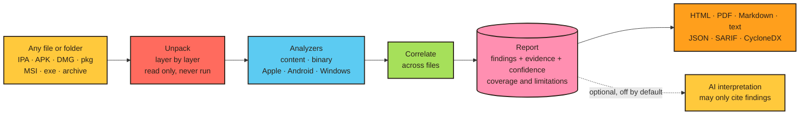
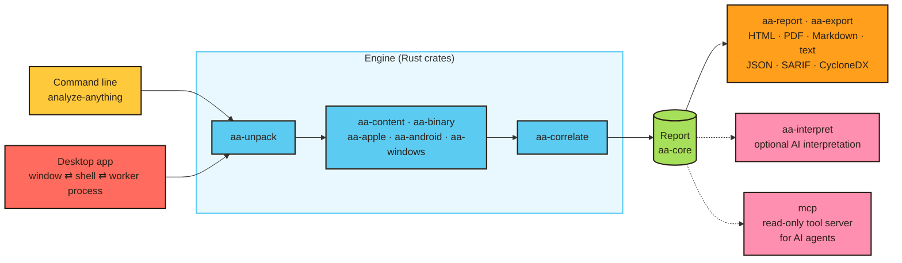

> Translation notice: the English README may be newer; see README.md for current delivery status and milestones.

# Analyze Anything

[English](../../README.md) · [简体中文](../../README.zh-CN.md) · [繁體中文](README_zh-TW.md) · **日本語** · [한국어](README_ko.md) · [Türkçe](README_tr.md) · [Русский](README_ru.md) · [Tiếng Việt](README_vi.md) · [ไทย](README_th.md) · [Deutsch](README_de.md) · [Español](README_es.md) · [Français](README_fr.md) · [Українська](README_uk.md) · [Polski](README_pl.md) · [Português (Brasil)](README_pt-BR.md) · [العربية](README_ar.md) · [فارسی](README_fa.md) · [Bahasa Indonesia](README_id.md) · [Italiano](README_it.md) · [Ελληνικά](README_el.md) · [മലയാളം](README_ml.md) · [Roman Urdu](README_ur-Latn.md) · [Română](README_ro.md) · [Български](README_bg.md)

[Website](https://atomsprout.com/analyze-anything/) · [Examples](https://atomsprout.com/analyze-anything/#examples) · [Roadmap](../ROADMAP.md)

> これは翻訳版です。[英語版 README](../../README.md) が基準であり、そちらのほうが新しい場合があります。

コンピューター上にあるものなら何でも渡してください。IPA、APK、macOS アプリ、DMG や pkg、Windows のインストーラーやプログラムフォルダー、アーカイブ、フォルダー、あらゆるファイルが対象です。信頼でき、根拠をたどれるレポートが得られます。すべての検出結果には証拠（どのファイルの、どの位置で、何を読み取ったか）と確度が付き、解析できなかったものは「カバレッジと制限事項」に列挙されます。

```
analyze-anything App.ipa
```

これで `App.ipa.report/` が作成され、レポートが HTML、PDF、Markdown、プレーンテキスト、JSON で書き出されます。SARIF と CycloneDX も利用できます。

- **静的解析のみ**。入力は読み取るだけで、実行もインストールもロードもしません。
- **オフライン**。解析はどこにも接続せず、言語モデルも使いません。
- **決定的**。同じ入力からは、バイト単位で同じレポートが得られます。
- **Rust で実装**。実行時に外部ツールは必要ありません。

使い方は 2 通りあります。どちらも同じエンジンを使い、同じ入力に対して同じレポートを出します。

- **コマンドライン**: `analyze-anything`（短縮名 `aaaa`）
- macOS 向けの**デスクトップアプリ**: ファイルをドロップし、進捗を見て、レポートを読み、証拠をクリックしてそのバイト列を確認し、エクスポートし、履歴を残して 2 つのバージョンを比較できます。設定すれば、レポートの横でモデルに解説させることもできます。

## 外観

<table>
  <tr>
    <td width="50%"><br><sub>デスクトップアプリ: レポートの概要</sub></td>
    <td width="50%"><br><sub>検出結果。それぞれに証拠が付く</sub></td>
  </tr>
  <tr>
    <td><br><sub>レポートの横に表示されるオプションの AI 解釈。すべての記述が検出結果を引用する</sub></td>
    <td><br><sub>ファイルかフォルダーをドロップして開始</sub></td>
  </tr>
</table>

<p align="center"><br><sub>同じレポートの PDF 版</sub></p>

スクリーンショットは、[サンプル](https://atomsprout.com/analyze-anything/#examples)の 1 つである F-Droid 2.0.3 のレポートです。

## インストール

Apple シリコン搭載の macOS では、Homebrew を使います。

```
brew install atomsprout/tap/analyze-anything                  # コマンドライン
brew install --cask atomsprout/tap/analyze-anything-desktop   # デスクトップアプリ
```

どちらも単独で動作します。いずれも Developer ID 証明書で署名され、Apple の公証を受けています。

その他のプラットフォームでは、コマンドラインをソースからビルドしてください（Rust 1.90 以降）。

```
cargo build --release
target/release/analyze-anything <file or folder>
```

リリースビルドがあるのは Apple シリコン搭載の Mac 向けだけです。Linux と Windows ではコードがビルドでき、テストも CI で通っていますが、実際に手で使った人はまだいません。

## 使い方

```
analyze-anything <file or folder>                 # 解析する。レポートは <name>.report/ に出力される
analyze-anything App.ipa -o out --lang zh         # 出力先フォルダーを指定し、レポートを中国語で書き出す
analyze-anything diff old/report.json new/report.json    # 2 つのバージョン間の変更点
analyze-anything explain out/report.json <finding id>    # 1 つの検出結果とそのすべての証拠
analyze-anything verify out/                      # ファイルは書き出されたときのままか
```

詳しいガイドは [docs/USAGE.md](../USAGE.md) にあります。

## サンプル

オープンソースソフトウェアの公開リリースを対象にしたレポートを、PDF で[ウェブサイト](https://atomsprout.com/analyze-anything/#examples)に掲載しています。IPA、APK、DMG、macOS の pkg、NSIS と MSI のインストーラー、Linux のプログラムがそれぞれ 1 つずつあります。`tools/site/examples.py` を使えば、同じファイルから再生成できます。

## 読み取れるもの

| | |
|---|---|
| Apple | `.app` などのバンドル、IPA、DMG（HFS+ と APFS）、pkg。Info.plist、コード署名と証明書チェーン、シールされたリソース、エンタイトルメント、プロビジョニングプロファイル、プライバシーマニフェスト、FairPlay 暗号化 |
| Android | APK、AAB、XAPK / APKS / APKM。マニフェスト、リソース、署名スキーム v1–v3.1、DEX、SDK とパッカー |
| Windows | PE、Authenticode、.NET アセンブリ、MSI（MSI 自体の署名を含む）、NSIS、Inno Setup、CAB、自己解凍形式、Electron（asar）、MSIX、インストール済みのプログラムフォルダー |
| 共通 | Mach-O、ELF、PE の構造とハードニング。zip、tar、7z、gzip、bzip2、xz、zstd（入れ子の深さは無制限）。URL、認証情報とみられる文字列、エントロピー、重複ファイル |

## 仕組み

読み取り専用の 1 パスです。入力を 1 層ずつ開き、各ファイルをそれを理解できるアナライザーが読み、最後のステップでファイル同士を関連付け、見つかったものをすべて証拠とともに記録します。すべての出力形式は、このレポートだけを元に生成されます。



コマンドラインとデスクトップアプリは同じエンジンの 2 つの顔なので、1 つの入力からはどちらでも同じレポートが得られます。デスクトップアプリは自身のプロセス内では決して解析しません。解析はワーカーが行い、確実に停止できます。



## オプション: AI によるレポートの解説

有効にしないかぎりオフです。レポートが書き出されたあと、言語モデルに平易な言葉で解説させることができます。

```
analyze-anything ai claude          # 最初に 1 回: 誰に任せるかを選ぶ（ここでは Claude Code。API キーは不要）
analyze-anything App.ipa --ai       # 解析し、レポートの隣に ai.md を書き出す
```

誰に任せるかは自分で選びます。API キーを持っているモデルサービス（Claude、または OpenAI のプロトコルに対応するもの）、Claude Code、Codex、あるいは Ollama が手元のマシンで動かすモデルです。自作のプログラムでもかまいません。モデルが見るのはレポートであり、解析対象のファイルを見ることはありません。レポートの内容は読み取り専用のツールを通じて調べます。モデルの記述はすべてレポートの検出結果を引用していなければならず、引用のない記述は削除されます。[docs/AI.md](../AI.md) を参照してください。

## 現状とロードマップ

0.1.0 が最初のリリースです。現時点で、どんなファイルやフォルダーからもレポートが得られます。Apple、Android、Windows の形式は深く理解します。Apple シリコン搭載の Mac 向けにリリースされており、そのうちの 1 台で実際に手で使われています。Linux と Windows ではコードがビルドでき、CI でテストに通っています。

「Anything」は、下限についての約束であり、上限についての方向性です。何も拒否せず、深さは 1 形式ずつ、それぞれ小さなクレートとして追加していきます。今後の予定は順に次のとおりです。

1. **どのシステムでも同じものを**: Linux、Windows 向けのリリースビルド。macOS 以外でのデスクトップアプリ。
2. **より多くの種類の入力**: Linux パッケージ、コンテナイメージ、各言語エコシステムのパッケージ、より多くのアプリプラットフォーム、コードを含む文書、ファームウェアイメージ。
3. **重要なところをより深く**: オフラインデータベースによる既知の脆弱性、関数レベルの事実、データとして記述するルールとポリシー。
4. **その上に構築しやすく**: GitHub Action、レポート内での AI 解説、エージェント向けのより充実したインターフェース、安定したレポートスキーマ。

変わらないもの: 静的解析のみ、オフラインでの解析、同じ入力に対する同じレポート、すべての検出結果に付く証拠、そして判定を下さないこと。全体像は [docs/ROADMAP.md](../ROADMAP.md) に、項目別の一覧は [docs/TODO.md](../TODO.md) にあります。

## 知っておくとよいこと

- 重大度は各ルールに固定された属性で、読む順番を決めるためのものです。レポートは入力が安全かどうかを述べません。
- ヒューリスティックと表示された検出結果（認証情報とみられる文字列、パッカー、SDK の検出）は誤検知の可能性があります。
- 署名はファイルそのものに対して検証します。対象はダイジェスト、署名値、証明書チェーンです。失効、システムの信頼設定、Apple の公証ステータスは確認しません。それにはネットワークが必要になるためです。
- App Store からダウンロードした IPA は暗号化されています。これは認識され、メタデータ、署名、リソースは通常どおり解析されますが、暗号化されたコードは読み取れません。
- 解析する権利のあるものにだけ使ってください。

詳しくは [docs/LIMITATIONS.md](../LIMITATIONS.md) を参照してください。

## ドキュメント

- [docs/USAGE.md](../USAGE.md) — コマンドラインの詳細（[中文](../USAGE.zh-CN.md)）
- [docs/AI.md](../AI.md) — オプションの AI 解釈
- [docs/DESKTOP.md](../DESKTOP.md) — デスクトップアプリ: 構成、開発、テスト、リリース
- [docs/LIMITATIONS.md](../LIMITATIONS.md) — 既知の制限事項
- [docs/ANALYZERS.md](../ANALYZERS.md) — 形式を追加する方法
- [docs/ROADMAP.md](../ROADMAP.md) — 現在の状況と今後の方向
- [docs/TODO.md](../TODO.md) — 残っている作業の項目別一覧
- [AGENTS.md](../../AGENTS.md) — このリポジトリでの作業方法。コントリビューターとコーディングエージェント向け
- [docs/PLAN.md](../PLAN.md)、[docs/PLAN-DESKTOP.md](../PLAN-DESKTOP.md)、[docs/RESEARCH.md](../RESEARCH.md)、[docs/spikes/](../spikes/) — どのように計画し、何を試したか

## 開発

```
cargo fmt --all --check
cargo clippy --workspace --all-targets -- -D warnings
cargo test --workspace
```

リポジトリの構成と、変更の際に守るべきことは [AGENTS.md](../../AGENTS.md) に書かれています。デスクトップアプリは `apps/desktop` にあります。[docs/DESKTOP.md](../DESKTOP.md) を参照してください。issue と pull request を歓迎します。共有する権利のないファイルは添付しないでください。たいていは、問題を示す `report.json` 内の検出結果 1 件で十分です。

## ライセンス

Apache-2.0。[LICENSE](../../LICENSE) を参照してください。レポートで使うフォントなど、同梱している第三者の成果物は [NOTICE](../../NOTICE) に記載しています。
