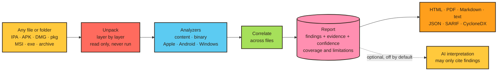
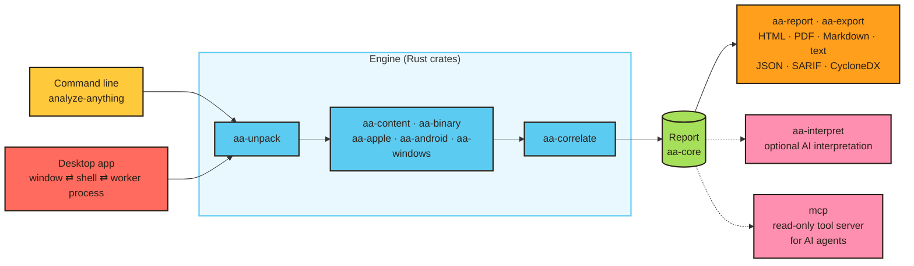

# Analyze Anything

[English](../../README.md) · [简体中文](../../README.zh-CN.md) · [繁體中文](README_zh-TW.md) · [日本語](README_ja.md) · **한국어** · [Türkçe](README_tr.md) · [Русский](README_ru.md) · [Tiếng Việt](README_vi.md) · [ไทย](README_th.md) · [Deutsch](README_de.md) · [Español](README_es.md) · [Français](README_fr.md) · [Українська](README_uk.md) · [Polski](README_pl.md) · [Português (Brasil)](README_pt-BR.md) · [العربية](README_ar.md) · [فارسی](README_fa.md) · [Bahasa Indonesia](README_id.md) · [Italiano](README_it.md) · [Ελληνικά](README_el.md) · [മലയാളം](README_ml.md) · [Roman Urdu](README_ur-Latn.md) · [Română](README_ro.md) · [Български](README_bg.md)

[Website](https://atomsprout.com/analyze-anything/) · [Examples](https://atomsprout.com/analyze-anything/#examples) · [Roadmap](../ROADMAP.md)

> 이 문서는 번역본입니다. [영어 README](../../README.md)가 기준이며, 그쪽이 더 최신일 수 있습니다.

컴퓨터에 있는 것이라면 무엇이든 넘겨주세요. IPA, APK, macOS 앱, DMG나 pkg, Windows 설치 프로그램이나 프로그램 폴더, 압축 파일, 폴더, 어떤 파일이든 됩니다. 그러면 믿을 수 있고 근거를 추적할 수 있는 보고서를 받습니다. 모든 발견 항목에는 증거(어느 파일의 어느 위치에서 무엇을 읽었는지)와 신뢰도가 붙고, 분석하지 못한 부분은 "커버리지와 한계"에 나열됩니다.

```
analyze-anything App.ipa
```

이 명령은 `App.ipa.report/`를 만들고 보고서를 HTML, PDF, Markdown, 일반 텍스트, JSON으로 기록합니다. SARIF와 CycloneDX도 사용할 수 있습니다.

- **정적 분석만 합니다.** 입력은 읽기만 하며, 실행하거나 설치하거나 로드하지 않습니다.
- **오프라인입니다.** 분석 중에는 어디에도 접속하지 않고 언어 모델도 쓰지 않습니다.
- **결정적입니다.** 같은 입력은 바이트 단위까지 같은 보고서를 냅니다.
- **Rust로 작성**되었으며, 실행 시 외부 도구가 필요하지 않습니다.

사용 방법은 두 가지입니다. 둘 다 같은 엔진을 쓰며, 같은 입력에 대해 같은 보고서를 냅니다.

- **명령줄**: `analyze-anything` (짧은 이름 `aaaa`)
- macOS용 **데스크톱 앱**: 파일을 끌어다 놓고, 진행 상황을 지켜보고, 보고서를 읽고, 증거를 클릭해 해당 바이트를 확인하고, 내보내고, 기록을 남겨 두 버전을 비교할 수 있습니다. 설정해 두면 보고서 옆에서 모델이 보고서를 설명해 주기도 합니다.

## 화면 구성

<table>
  <tr>
    <td width="50%"><br><sub>데스크톱 앱: 보고서 요약</sub></td>
    <td width="50%"><br><sub>발견 항목과 각 항목의 증거</sub></td>
  </tr>
  <tr>
    <td><br><sub>보고서 옆에 표시되는 선택 사항인 AI 해석. 모든 진술은 발견 항목을 인용합니다</sub></td>
    <td><br><sub>파일이나 폴더를 끌어다 놓아 시작합니다</sub></td>
  </tr>
</table>

<p align="center"><br><sub>같은 보고서의 PDF 버전</sub></p>

스크린샷은 [예제](https://atomsprout.com/analyze-anything/#examples) 중 하나인 F-Droid 2.0.3에 대한 보고서입니다.

## 설치

Apple 실리콘 macOS에서 Homebrew로 설치합니다.

```
brew install atomsprout/tap/analyze-anything                  # 명령줄
brew install --cask atomsprout/tap/analyze-anything-desktop   # 데스크톱 앱
```

둘은 서로 없이도 동작합니다. 둘 다 Developer ID 인증서로 서명되었고 Apple의 공증을 받았습니다.

다른 플랫폼에서는 명령줄 도구를 소스에서 빌드하세요(Rust 1.90 이상).

```
cargo build --release
target/release/analyze-anything <file or folder>
```

릴리스 빌드는 Apple 실리콘 Mac용만 있습니다. Linux와 Windows에서는 코드가 빌드되고 CI에서 테스트도 통과하지만, 아직 누구도 직접 사용해 보지는 않았습니다.

## 사용법

```
analyze-anything <file or folder>                 # 분석합니다. 보고서는 <name>.report/에 기록됩니다
analyze-anything App.ipa -o out --lang zh         # 폴더를 지정하고 보고서를 중국어로 작성합니다
analyze-anything diff old/report.json new/report.json    # 두 버전 사이에 무엇이 바뀌었는지
analyze-anything explain out/report.json <finding id>    # 발견 항목 하나와 그 증거 전체
analyze-anything verify out/                      # 파일이 기록된 그대로인지 확인합니다
```

전체 안내는 [docs/USAGE.md](../USAGE.md)에 있습니다.

## 예제

오픈 소스 소프트웨어의 공개 릴리스에 대한 보고서를 PDF로 [웹사이트](https://atomsprout.com/analyze-anything/#examples)에 올려 두었습니다. IPA, APK, DMG, macOS pkg, NSIS 설치 프로그램과 MSI 설치 프로그램, Linux 프로그램이 하나씩 있습니다. `tools/site/examples.py`가 같은 파일로 이 보고서들을 다시 만듭니다.

## 읽을 수 있는 것

| | |
|---|---|
| Apple | `.app` 및 기타 번들, IPA, DMG(HFS+ 및 APFS), pkg. Info.plist, 코드 서명과 인증서 체인, 봉인된 리소스, 인타이틀먼트, 프로비저닝 프로파일, 개인정보 매니페스트, FairPlay 암호화 |
| Android | APK, AAB, XAPK / APKS / APKM. 매니페스트, 리소스, 서명 체계 v1–v3.1, DEX, SDK와 패커 |
| Windows | PE, Authenticode, .NET 어셈블리, MSI(자체 서명 포함), NSIS, Inno Setup, CAB, 자동 압축 풀림 파일, Electron(asar), MSIX, 설치된 프로그램 폴더 |
| 공통 | Mach-O, ELF, PE의 구조와 보안 강화 설정. zip, tar, 7z, gzip, bzip2, xz, zstd(중첩 깊이 제한 없음). URL, 자격 증명으로 보이는 문자열, 엔트로피, 중복 파일 |

## 동작 방식

읽기 전용으로 한 번에 처리합니다. 입력을 한 계층씩 열고, 각 파일은 그것을 이해하는 분석기가 읽으며, 마지막 단계에서 파일들을 서로 연관 짓고, 발견한 모든 것을 증거와 함께 기록합니다. 모든 출력 형식은 이 보고서 하나에서 만들어집니다.



명령줄과 데스크톱 앱은 같은 엔진의 두 얼굴이므로, 하나의 입력은 양쪽에서 같은 보고서를 냅니다. 데스크톱 앱은 자신의 프로세스 안에서는 절대 분석하지 않습니다. 분석은 워커가 하며, 확실하게 중지할 수 있습니다.



## 선택 사항: AI의 보고서 해설

직접 켜지 않는 한 꺼져 있습니다. 보고서가 기록된 뒤에 언어 모델이 쉬운 말로 설명해 줄 수 있습니다.

```
analyze-anything ai claude          # 한 번만: 누가 할지 고릅니다(여기서는 Claude Code, API 키 불필요)
analyze-anything App.ipa --ai       # 분석한 뒤 보고서 옆에 ai.md를 씁니다
```

누가 할지는 직접 고릅니다. API 키를 가지고 있는 모델 서비스(Claude 또는 OpenAI 프로토콜을 지원하는 모든 서비스), Claude Code, Codex, 또는 Ollama가 내 컴퓨터에서 실행하는 모델을 쓸 수 있습니다. 직접 만든 프로그램도 됩니다. 모델은 보고서만 볼 뿐 분석 대상 파일은 절대 보지 않으며, 읽기 전용 도구를 통해 보고서 안의 내용을 찾아봅니다. 모델의 모든 진술은 보고서의 발견 항목을 인용해야 하며, 인용이 없는 진술은 삭제됩니다. [docs/AI.md](../AI.md)를 참고하세요.

## 현재 상태와 로드맵

0.1.0이 첫 릴리스입니다. 지금도 어떤 파일이나 폴더든 보고서를 받을 수 있으며, Apple, Android, Windows 형식은 깊이 있게 이해합니다. Apple 실리콘 Mac용으로 릴리스되었고 그중 한 대에서 직접 사용해 보았습니다. Linux와 Windows에서는 코드가 빌드되고 CI에서 테스트를 통과합니다.

"Anything"은 하한에 대한 약속이자 상한에 대한 방향입니다. 어떤 것도 거부하지 않으며, 깊이는 한 번에 한 형식씩, 각각 작은 크레이트로 더해 갑니다. 다음 계획은 순서대로 이렇습니다.

1. **모든 시스템에서 같은 것을**: Linux, Windows, Intel Mac용 릴리스 빌드. macOS 이외의 데스크톱 앱.
2. **더 많은 종류의 입력**: Linux 패키지, 컨테이너 이미지, 언어 생태계의 패키지, 더 많은 앱 플랫폼, 코드를 담은 문서, 펌웨어 이미지.
3. **중요한 곳은 더 깊게**: 오프라인 데이터베이스에 기반한 알려진 취약점, 함수 수준의 사실, 데이터로 표현한 규칙과 정책.
4. **그 위에 만들기 쉽게**: GitHub Action, 보고서 안에 들어가는 AI 해설, 에이전트를 위한 더 충실한 인터페이스, 안정적인 보고서 스키마.

바뀌지 않을 것: 정적 분석만 한다는 점, 오프라인 분석, 같은 입력에 같은 보고서, 모든 발견 항목에 붙는 증거, 그리고 판정을 내리지 않는다는 점입니다. 전체 그림은 [docs/ROADMAP.md](../ROADMAP.md)에, 항목별 목록은 [docs/TODO.md](../TODO.md)에 있습니다.

## 알아 둘 점

- 심각도는 각 규칙에 고정된 속성이며, 읽는 순서를 정하기 위한 것입니다. 보고서는 입력이 안전한지 여부를 말하지 않습니다.
- 휴리스틱으로 표시된 발견 항목(자격 증명으로 보이는 문자열, 패커, SDK 탐지)은 오탐일 수 있습니다.
- 서명은 파일 자체를 기준으로 검사합니다. 다이제스트, 서명 값, 인증서 체인이 대상입니다. 인증서 폐기 여부, 시스템 신뢰 설정, Apple의 공증 상태는 검사하지 않습니다. 그러려면 네트워크가 필요하기 때문입니다.
- App Store에서 내려받은 IPA는 암호화되어 있습니다. 이 사실은 인식되며 메타데이터, 서명, 리소스는 평소대로 분석하지만, 암호화된 코드는 읽을 수 없습니다.
- 분석할 권리가 있는 대상에만 사용하세요.

자세한 내용은 [docs/LIMITATIONS.md](../LIMITATIONS.md)에 있습니다.

## 문서

- [docs/USAGE.md](../USAGE.md) — 명령줄 전체 설명 ([中文](../USAGE.zh-CN.md))
- [docs/AI.md](../AI.md) — 선택 사항인 AI 해석
- [docs/DESKTOP.md](../DESKTOP.md) — 데스크톱 앱: 구조, 개발, 테스트, 릴리스
- [docs/LIMITATIONS.md](../LIMITATIONS.md) — 알려진 한계
- [docs/ANALYZERS.md](../ANALYZERS.md) — 형식을 추가하는 방법
- [docs/ROADMAP.md](../ROADMAP.md) — 현재 위치와 나아갈 방향
- [docs/TODO.md](../TODO.md) — 남은 작업의 항목별 목록
- [AGENTS.md](../../AGENTS.md) — 이 저장소에서 작업하는 방법. 기여자와 코딩 에이전트를 위한 문서
- [docs/PLAN.md](../PLAN.md), [docs/PLAN-DESKTOP.md](../PLAN-DESKTOP.md), [docs/RESEARCH.md](../RESEARCH.md), [docs/spikes/](../spikes/) — 어떻게 계획했고 무엇을 시도했는지

## 개발

```
cargo fmt --all --check
cargo clippy --workspace --all-targets -- -D warnings
cargo test --workspace
```

저장소가 어떻게 구성되어 있고 변경할 때 무엇을 지켜야 하는지는 [AGENTS.md](../../AGENTS.md)에 적혀 있습니다. 데스크톱 앱은 `apps/desktop`에 있습니다. [docs/DESKTOP.md](../DESKTOP.md)를 참고하세요. 이슈와 풀 리퀘스트를 환영합니다. 공유할 권리가 없는 파일은 첨부하지 마세요. 대개는 문제를 보여 주는 `report.json`의 발견 항목 하나면 충분합니다.

## 라이선스

Apache-2.0. [LICENSE](../../LICENSE)를 참고하세요. 보고서에 쓰이는 글꼴을 비롯해 함께 배포하는 타사 구성 요소는 [NOTICE](../../NOTICE)에 나열되어 있습니다.
