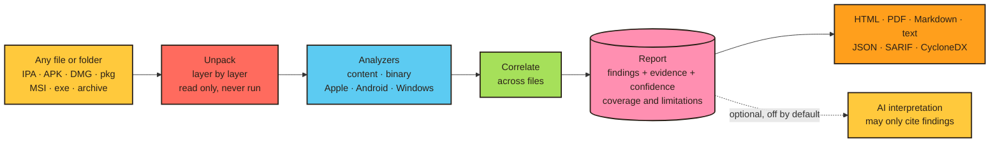
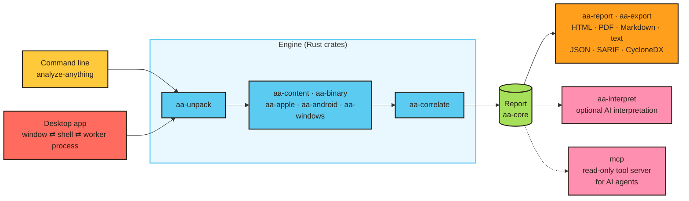

> Translation notice: the English README may be newer; see README.md for current delivery status and milestones.

# Analyze Anything

[English](../../README.md) · [简体中文](../../README.zh-CN.md) · [繁體中文](README_zh-TW.md) · [日本語](README_ja.md) · [한국어](README_ko.md) · [Türkçe](README_tr.md) · [Русский](README_ru.md) · [Tiếng Việt](README_vi.md) · [ไทย](README_th.md) · [Deutsch](README_de.md) · [Español](README_es.md) · [Français](README_fr.md) · [Українська](README_uk.md) · [Polski](README_pl.md) · [Português (Brasil)](README_pt-BR.md) · [العربية](README_ar.md) · [فارسی](README_fa.md) · [Bahasa Indonesia](README_id.md) · [Italiano](README_it.md) · [Ελληνικά](README_el.md) · **മലയാളം** · [Roman Urdu](README_ur-Latn.md) · [Română](README_ro.md) · [Български](README_bg.md)

[Website](https://atomsprout.com/analyze-anything/) · [Examples](https://atomsprout.com/analyze-anything/#examples) · [Roadmap](../ROADMAP.md)

> ഇതൊരു വിവർത്തനമാണ്. [ഇംഗ്ലീഷ് README](../../README.md) ആണ് ആധാരം; അത് ഇതിനേക്കാൾ പുതിയതായിരിക്കാം.

നിങ്ങളുടെ കമ്പ്യൂട്ടറിലുള്ള എന്തും ഇതിന് നൽകാം — ഒരു IPA, ഒരു APK, ഒരു macOS ആപ്പ്, ഒരു DMG അല്ലെങ്കിൽ pkg, ഒരു Windows ഇൻസ്റ്റാളർ അല്ലെങ്കിൽ പ്രോഗ്രാം ഫോൾഡർ, ഒരു ആർക്കൈവ്, ഒരു ഫോൾഡർ, ഏത് ഫയലും — വിശ്വസിക്കാനും പിന്തുടർന്ന് പരിശോധിക്കാനും കഴിയുന്ന ഒരു റിപ്പോർട്ട് ലഭിക്കും: ഓരോ കണ്ടെത്തലിനും അതിന്റെ തെളിവും (ഏത് ഫയൽ, അതിൽ എവിടെ, അവിടെ എന്താണ് വായിച്ചത്) ഒരു വിശ്വാസ്യതാ നിലയും ഉണ്ട്; വിശകലനം ചെയ്യാൻ കഴിയാതിരുന്നതെല്ലാം കവറേജും പരിമിതികളും എന്നതിന് കീഴിൽ പട്ടികപ്പെടുത്തുന്നു.

```
analyze-anything App.ipa
```

ഇത് `App.ipa.report/` എന്ന ഫോൾഡർ എഴുതുന്നു; അതിൽ റിപ്പോർട്ട് HTML, PDF, Markdown, പ്ലെയിൻ ടെക്സ്റ്റ്, JSON എന്നീ രൂപങ്ങളിലുണ്ട്. SARIF, CycloneDX എന്നിവയും ലഭ്യമാണ്.

- **സ്റ്റാറ്റിക് മാത്രം.** ഇൻപുട്ട് വായിക്കുക മാത്രമേ ചെയ്യൂ; ഒരിക്കലും പ്രവർത്തിപ്പിക്കുകയോ ഇൻസ്റ്റാൾ ചെയ്യുകയോ ലോഡ് ചെയ്യുകയോ ഇല്ല.
- **ഓഫ്‌ലൈൻ.** വിശകലനം ഒന്നിലേക്കും കണക്റ്റ് ചെയ്യുന്നില്ല, ഒരു ലാംഗ്വേജ് മോഡലും ഉപയോഗിക്കുന്നില്ല.
- **ഡിറ്റർമിനിസ്റ്റിക്.** ഒരേ ഇൻപുട്ട് ഒരേ റിപ്പോർട്ട് തന്നെ നൽകുന്നു, ബൈറ്റിന് ബൈറ്റ്.
- **Rust-ൽ എഴുതിയത്**, പ്രവർത്തിക്കുമ്പോൾ പുറമേനിന്നുള്ള ടൂളുകളൊന്നും ആവശ്യമില്ല.

ഇത് ഉപയോഗിക്കാൻ രണ്ട് വഴികളുണ്ട്; രണ്ടും ഒരേ എഞ്ചിനിലാണ് പ്രവർത്തിക്കുന്നത്, ഒരേ ഇൻപുട്ടിന് ഒരേ റിപ്പോർട്ട് നൽകുന്നു:

- **കമാൻഡ് ലൈൻ**, `analyze-anything` (ചുരുക്കപ്പേര് `aaaa`);
- macOS-നുള്ള **ഡെസ്ക്ടോപ്പ് ആപ്പ്**: ഒരു ഫയൽ ഡ്രോപ്പ് ചെയ്യുക, പുരോഗതി കാണുക, റിപ്പോർട്ട് വായിക്കുക, ഒരു തെളിവിൽ ക്ലിക്ക് ചെയ്ത് അതിന്റെ ബൈറ്റുകൾ കാണുക, എക്സ്പോർട്ട് ചെയ്യുക, ഹിസ്റ്ററി സൂക്ഷിക്കുക, രണ്ട് പതിപ്പുകൾ താരതമ്യം ചെയ്യുക, നിങ്ങൾ സജ്ജീകരിച്ചിട്ടുണ്ടെങ്കിൽ റിപ്പോർട്ടിനരികിൽ ഒരു മോഡലിനെക്കൊണ്ട് അത് വിശദീകരിപ്പിക്കുക.

## കാണാൻ എങ്ങനെയിരിക്കും

<table>
  <tr>
    <td width="50%"><br><sub>ഡെസ്ക്ടോപ്പ് ആപ്പ്: റിപ്പോർട്ടിന്റെ സംഗ്രഹം</sub></td>
    <td width="50%"><br><sub>കണ്ടെത്തലുകൾ, ഓരോന്നും അതിന്റെ തെളിവോടെ</sub></td>
  </tr>
  <tr>
    <td><br><sub>റിപ്പോർട്ടിനരികിൽ ഓപ്ഷണലായ AI വ്യാഖ്യാനം; ഓരോ പ്രസ്താവനയും കണ്ടെത്തലുകളെ ഉദ്ധരിക്കുന്നു</sub></td>
    <td><br><sub>തുടങ്ങാൻ ഒരു ഫയലോ ഫോൾഡറോ ഡ്രോപ്പ് ചെയ്യുക</sub></td>
  </tr>
</table>

<p align="center"><br><sub>അതേ റിപ്പോർട്ട് PDF ആയി</sub></p>

സ്ക്രീൻഷോട്ടുകളിൽ കാണുന്നത് F-Droid 2.0.3-നെക്കുറിച്ചുള്ള റിപ്പോർട്ടാണ്; അത് [ഉദാഹരണങ്ങളിൽ](https://atomsprout.com/analyze-anything/#examples) ഒന്നാണ്.

## ഇൻസ്റ്റാൾ ചെയ്യൽ

Apple silicon-ലെ macOS, Homebrew ഉപയോഗിച്ച്:

```
brew install atomsprout/tap/analyze-anything                  # കമാൻഡ് ലൈൻ
brew install --cask atomsprout/tap/analyze-anything-desktop   # ഡെസ്ക്ടോപ്പ് ആപ്പ്
```

ഓരോന്നും മറ്റേതില്ലാതെ പ്രവർത്തിക്കും. രണ്ടും Developer ID സർട്ടിഫിക്കറ്റ് കൊണ്ട് സൈൻ ചെയ്തതും Apple നോട്ടറൈസ് ചെയ്തതുമാണ്.

മറ്റ് പ്ലാറ്റ്‌ഫോമുകളിൽ, കമാൻഡ് ലൈൻ സോഴ്സിൽനിന്ന് ബിൽഡ് ചെയ്യുക (Rust 1.90 അല്ലെങ്കിൽ അതിലും പുതിയത്):

```
cargo build --release
target/release/analyze-anything <file or folder>
```

റിലീസ് ചെയ്ത ബിൽഡുകൾ Apple silicon Mac-കൾക്ക് മാത്രമേയുള്ളൂ. Linux-ലും Windows-ലും കോഡ് ബിൽഡ് ആകുന്നുണ്ട്, അതിന്റെ ടെസ്റ്റുകൾ CI-യിൽ പാസാകുന്നുമുണ്ട്; പക്ഷേ അവിടെ ആരും ഇതുവരെ ഇത് നേരിട്ട് ഉപയോഗിച്ചുനോക്കിയിട്ടില്ല.

## ഉപയോഗം

```
analyze-anything <file or folder>                 # വിശകലനം ചെയ്യുക; റിപ്പോർട്ട് <name>.report/ എന്നതിലേക്ക് പോകുന്നു
analyze-anything App.ipa -o out --lang zh         # ഫോൾഡർ തിരഞ്ഞെടുക്കുക; റിപ്പോർട്ട് ചൈനീസിൽ എഴുതുക
analyze-anything diff old/report.json new/report.json    # രണ്ട് പതിപ്പുകൾക്കിടയിൽ എന്താണ് മാറിയത്
analyze-anything explain out/report.json <finding id>    # ഒരു കണ്ടെത്തൽ, അതിന്റെ എല്ലാ തെളിവുകളോടും കൂടി
analyze-anything verify out/                      # ഫയലുകൾ ഇപ്പോഴും എഴുതിയതുപോലെ തന്നെയാണോ?
```

പൂർണ്ണമായ ഗൈഡ് [docs/USAGE.md](../USAGE.md) ആണ്.

## ഉദാഹരണങ്ങൾ

ഓപ്പൺ സോഴ്സ് സോഫ്റ്റ്‌വെയറുകളുടെ പൊതു റിലീസുകളെക്കുറിച്ചുള്ള റിപ്പോർട്ടുകൾ, PDF ആയി, [വെബ്സൈറ്റിൽ](https://atomsprout.com/analyze-anything/#examples) ഉണ്ട്: ഒരു IPA, ഒരു APK, ഒരു DMG, ഒരു macOS pkg, ഒരു NSIS ഇൻസ്റ്റാളറും ഒരു MSI ഇൻസ്റ്റാളറും, ഒരു Linux പ്രോഗ്രാം. `tools/site/examples.py` അതേ ഫയലുകളിൽനിന്ന് അവ വീണ്ടും ഉണ്ടാക്കുന്നു.

## ഇത് എന്തെല്ലാം വായിക്കുന്നു

| | |
|---|---|
| Apple | `.app`-ഉം മറ്റ് ബണ്ടിലുകളും, IPA, DMG (HFS+, APFS), pkg; Info.plist, കോഡ് സിഗ്നേച്ചറുകളും സർട്ടിഫിക്കറ്റ് ചെയിനുകളും, സീൽ ചെയ്ത റിസോഴ്സുകൾ, എൻടൈറ്റിൽമെന്റുകൾ, പ്രൊവിഷനിംഗ് പ്രൊഫൈലുകൾ, പ്രൈവസി മാനിഫെസ്റ്റുകൾ, FairPlay എൻക്രിപ്ഷൻ |
| Android | APK, AAB, XAPK / APKS / APKM; മാനിഫെസ്റ്റ്, റിസോഴ്സുകൾ, സിഗ്നേച്ചർ സ്കീമുകൾ v1–v3.1, DEX, SDK-കളും പാക്കറുകളും |
| Windows | PE, Authenticode, .NET അസംബ്ലികൾ, MSI (അതിന്റെ സ്വന്തം സിഗ്നേച്ചറോടെ), NSIS, Inno Setup, CAB, സെൽഫ്-എക്സ്ട്രാക്ടറുകൾ, Electron (asar), MSIX, ഇൻസ്റ്റാൾ ചെയ്ത പ്രോഗ്രാം ഫോൾഡറുകൾ |
| പൊതുവായത് | Mach-O, ELF, PE എന്നിവയുടെ ഘടനയും ഹാർഡനിംഗും; zip, tar, 7z, gzip, bzip2, xz, zstd, എത്ര ആഴത്തിൽ നെസ്റ്റ് ചെയ്താലും; URL-കൾ, ക്രെഡൻഷ്യലുകളാകാൻ സാധ്യതയുള്ളവ, എൻട്രോപ്പി, ഡ്യൂപ്ലിക്കേറ്റ് ഫയലുകൾ |

## ഇത് എങ്ങനെ പ്രവർത്തിക്കുന്നു

ഒറ്റ പാസ്, വായന മാത്രം: ഇൻപുട്ട് ലെയർ ലെയറായി തുറക്കുന്നു, ഓരോ ഫയലും അതിനെ മനസ്സിലാക്കുന്ന അനലൈസറുകൾ വായിക്കുന്നു, അവസാനത്തെ ഒരു ഘട്ടം ഫയലുകളെ പരസ്പരം ബന്ധിപ്പിക്കുന്നു, കണ്ടെത്തിയതെല്ലാം തെളിവോടെ രേഖപ്പെടുത്തുന്നു. എല്ലാ ഔട്ട്പുട്ട് ഫോർമാറ്റുകളുടെയും ഏക ഉറവിടം റിപ്പോർട്ടാണ്.



കമാൻഡ് ലൈനും ഡെസ്ക്ടോപ്പ് ആപ്പും ഒരേ എഞ്ചിന്റെ രണ്ട് മുഖങ്ങളാണ്; അതിനാൽ ഒരേ ഇൻപുട്ട് രണ്ടിലും ഒരേ റിപ്പോർട്ട് നൽകുന്നു. ഡെസ്ക്ടോപ്പ് ആപ്പ് ഒരിക്കലും സ്വന്തം പ്രോസസ്സിൽ വിശകലനം ചെയ്യുന്നില്ല: ഒരു വർക്കർ ആണ് അത് ചെയ്യുന്നത്, അതിനെ ഉറപ്പായും നിർത്താനും കഴിയും.



## ഓപ്ഷണൽ: റിപ്പോർട്ടിന്റെ ഒരു AI വായന

നിങ്ങൾ ഓൺ ചെയ്യാത്തിടത്തോളം ഇത് ഓഫാണ്. ഒരു റിപ്പോർട്ട് എഴുതിക്കഴിഞ്ഞാൽ, ഒരു ലാംഗ്വേജ് മോഡലിന് അത് ലളിതമായ വാക്കുകളിൽ വിശദീകരിക്കാൻ കഴിയും:

```
analyze-anything ai claude          # ഒരിക്കൽ മാത്രം: ആര് ചെയ്യണമെന്ന് തിരഞ്ഞെടുക്കുക (ഇവിടെ Claude Code, API കീ വേണ്ട)
analyze-anything App.ipa --ai       # വിശകലനം ചെയ്യുക, പിന്നെ റിപ്പോർട്ടിനടുത്ത് ai.md എഴുതുക
```

ആര് ചെയ്യണമെന്ന് നിങ്ങളാണ് തിരഞ്ഞെടുക്കുന്നത്: നിങ്ങളുടെ കൈയിൽ API കീ ഉള്ള ഒരു മോഡൽ സേവനം (Claude, അല്ലെങ്കിൽ OpenAI-യുടെ പ്രോട്ടോക്കോൾ ഉപയോഗിക്കുന്ന എന്തും), Claude Code, Codex, അല്ലെങ്കിൽ Ollama നിങ്ങളുടെ സ്വന്തം മെഷീനിൽ പ്രവർത്തിപ്പിക്കുന്ന ഒരു മോഡൽ. നിങ്ങളുടെ സ്വന്തം പ്രോഗ്രാമും ഉപയോഗിക്കാം. മോഡൽ കാണുന്നത് റിപ്പോർട്ട് മാത്രമാണ്, വിശകലനം ചെയ്ത ഫയലുകൾ ഒരിക്കലും കാണുന്നില്ല; റീഡ്-ഓൺലി ടൂളുകൾ വഴിയാണ് അത് റിപ്പോർട്ടിൽ കാര്യങ്ങൾ നോക്കുന്നത്. അത് പറയുന്ന ഓരോ പ്രസ്താവനയും റിപ്പോർട്ടിലെ കണ്ടെത്തലുകളെ ഉദ്ധരിക്കണം; അങ്ങനെ ചെയ്യാത്തവ ഒഴിവാക്കപ്പെടും. [docs/AI.md](../AI.md) കാണുക.

## നിലവിലെ സ്ഥിതിയും റോഡ്മാപ്പും

0.1.0 ആണ് ആദ്യ റിലീസ്. ഏത് ഫയലിനും ഫോൾഡറിനും ഇന്ന് ഒരു റിപ്പോർട്ട് ലഭിക്കും; Apple, Android, Windows ഫോർമാറ്റുകൾ ആഴത്തിൽ മനസ്സിലാക്കുന്നുണ്ട്. Apple silicon Mac-കൾക്കായാണ് ഇത് റിലീസ് ചെയ്തിരിക്കുന്നത്, അത്തരമൊന്നിൽ നേരിട്ട് ഉപയോഗിച്ചുനോക്കിയിട്ടുമുണ്ട്; Linux-ലും Windows-ലും കോഡ് ബിൽഡ് ആകുകയും അതിന്റെ ടെസ്റ്റുകൾ CI-യിൽ പാസാകുകയും ചെയ്യുന്നു.

"Anything" എന്നത് തറനിരപ്പിനെക്കുറിച്ചുള്ള ഒരു വാഗ്ദാനവും മേൽത്തട്ടിലേക്കുള്ള ഒരു ദിശയുമാണ്: ഒന്നും നിരസിക്കപ്പെടുന്നില്ല, ആഴം ഓരോ ഫോർമാറ്റായി ചേർക്കുന്നു, ഓരോന്നും ഒരു ചെറിയ crate ആയി. അടുത്തത്, ക്രമത്തിൽ:

1. **എല്ലാ സിസ്റ്റത്തിലും ഇതേ കാര്യം**: Linux, Windows എന്നിവയ്ക്കുള്ള റിലീസ് ബിൽഡുകൾ; macOS-ന് പുറത്തേക്കും ഡെസ്ക്ടോപ്പ് ആപ്പ്.
2. **കൂടുതൽ തരം ഇൻപുട്ടുകൾ**: Linux പാക്കേജുകൾ, കണ്ടെയ്നർ ഇമേജുകൾ, പ്രോഗ്രാമിംഗ് ഭാഷാ ഇക്കോസിസ്റ്റങ്ങളുടെ പാക്കേജുകൾ, കൂടുതൽ ആപ്പ് പ്ലാറ്റ്‌ഫോമുകൾ, കോഡ് ഉൾക്കൊള്ളുന്ന ഡോക്യുമെന്റുകൾ, ഫേംവെയർ ഇമേജുകൾ.
3. **പ്രാധാന്യമുള്ളിടത്ത് കൂടുതൽ ആഴം**: ഒരു ഓഫ്‌ലൈൻ ഡാറ്റാബേസിൽനിന്നുള്ള അറിയപ്പെടുന്ന വൾനറബിലിറ്റികൾ, ഫംഗ്ഷൻ തലത്തിലുള്ള വസ്തുതകൾ, റൂളുകളും പോളിസികളും ഡാറ്റയായി.
4. **ഇതിന്മേൽ നിർമ്മിക്കാൻ കൂടുതൽ എളുപ്പം**: ഒരു GitHub Action, റിപ്പോർട്ടിനുള്ളിൽത്തന്നെ AI വായന, ഏജന്റുകൾക്കായി കൂടുതൽ പൂർണ്ണമായ ഒരു ഇന്റർഫേസ്, സ്ഥിരതയുള്ള ഒരു റിപ്പോർട്ട് സ്കീമ.

മാറാത്തവ: സ്റ്റാറ്റിക് മാത്രം, ഓഫ്‌ലൈൻ വിശകലനം, ഒരേ ഇൻപുട്ടിന് ഒരേ റിപ്പോർട്ട്, ഓരോ കണ്ടെത്തലിനും തെളിവ്, വിധിപ്രസ്താവമില്ല. മുഴുവൻ ചിത്രം [docs/ROADMAP.md](../ROADMAP.md)-ൽ ഉണ്ട്; ഇനം തിരിച്ചുള്ള പട്ടിക [docs/TODO.md](../TODO.md) ആണ്.

## അറിഞ്ഞിരിക്കേണ്ടവ

- തീവ്രത (severity) ഓരോ റൂളിന്റെയും സ്ഥിരമായ ഒരു ഗുണമാണ്; നിങ്ങളുടെ വായനയ്ക്ക് ക്രമം നൽകാനാണ് അത്. ഒരു ഇൻപുട്ട് സുരക്ഷിതമാണോ എന്ന് റിപ്പോർട്ട് പറയുന്നില്ല.
- ഹ്യൂറിസ്റ്റിക് എന്ന് അടയാളപ്പെടുത്തിയ കണ്ടെത്തലുകൾ (ക്രെഡൻഷ്യലുകളാകാൻ സാധ്യതയുള്ളവ, പാക്കറുകൾ, SDK കണ്ടെത്തൽ) ഫോൾസ് പോസിറ്റീവുകൾ ആകാം.
- സിഗ്നേച്ചറുകൾ ഫയലുമായിത്തന്നെ ഒത്തുനോക്കിയാണ് പരിശോധിക്കുന്നത്: ഡൈജസ്റ്റുകൾ, സിഗ്നേച്ചർ മൂല്യങ്ങൾ, സർട്ടിഫിക്കറ്റ് ചെയിനുകൾ. റിവൊക്കേഷൻ, സിസ്റ്റത്തിലെ ട്രസ്റ്റ് ക്രമീകരണങ്ങൾ, Apple-ന്റെ നോട്ടറൈസേഷൻ നില എന്നിവ പരിശോധിക്കുന്നില്ല; അതിന് നെറ്റ്‌വർക്ക് വേണ്ടിവരും.
- App Store-ൽനിന്ന് ഡൗൺലോഡ് ചെയ്ത IPA എൻക്രിപ്റ്റ് ചെയ്തതാണ്: ഇത് തിരിച്ചറിയുന്നു, മെറ്റാഡാറ്റയും സിഗ്നേച്ചറും റിസോഴ്സുകളും പതിവുപോലെ വിശകലനം ചെയ്യുന്നു, പക്ഷേ എൻക്രിപ്റ്റ് ചെയ്ത കോഡ് വായിക്കാൻ കഴിയില്ല.
- വിശകലനം ചെയ്യാൻ നിങ്ങൾക്ക് അവകാശമുള്ളവയിൽ മാത്രം ഇത് ഉപയോഗിക്കുക.

കൂടുതൽ [docs/LIMITATIONS.md](../LIMITATIONS.md)-ൽ.

## ഡോക്യുമെന്റേഷൻ

- [docs/USAGE.md](../USAGE.md) — കമാൻഡ് ലൈൻ പൂർണ്ണരൂപത്തിൽ ([中文](../USAGE.zh-CN.md))
- [docs/AI.md](../AI.md) — ഓപ്ഷണലായ AI വ്യാഖ്യാനം
- [docs/DESKTOP.md](../DESKTOP.md) — ഡെസ്ക്ടോപ്പ് ആപ്പ്: ഘടന, ഡെവലപ്മെന്റ്, ടെസ്റ്റിംഗ്, റിലീസ്
- [docs/LIMITATIONS.md](../LIMITATIONS.md) — അറിയപ്പെടുന്ന പരിമിതികൾ
- [docs/ANALYZERS.md](../ANALYZERS.md) — ഒരു ഫോർമാറ്റ് എങ്ങനെ ചേർക്കാം
- [docs/ROADMAP.md](../ROADMAP.md) — ഇപ്പോൾ എവിടെ നിൽക്കുന്നു, എങ്ങോട്ട് പോകുന്നു
- [docs/TODO.md](../TODO.md) — ഇനി ചെയ്യാനുള്ളത്, ഇനം തിരിച്ച്
- [AGENTS.md](../../AGENTS.md) — ഈ റെപ്പോസിറ്ററിയിൽ എങ്ങനെ പ്രവർത്തിക്കണം; സംഭാവന ചെയ്യുന്നവർക്കും കോഡിംഗ് ഏജന്റുകൾക്കും
- [docs/PLAN.md](../PLAN.md), [docs/PLAN-DESKTOP.md](../PLAN-DESKTOP.md), [docs/RESEARCH.md](../RESEARCH.md), [docs/spikes/](../spikes/) — ഇത് എങ്ങനെ ആസൂത്രണം ചെയ്തു, എന്തെല്ലാം പരീക്ഷിച്ചുനോക്കി

## ഡെവലപ്മെന്റ്

```
cargo fmt --all --check
cargo clippy --workspace --all-targets -- -D warnings
cargo test --workspace
```

റെപ്പോസിറ്ററി എങ്ങനെ ക്രമീകരിച്ചിരിക്കുന്നുവെന്നും ഒരു മാറ്റം എന്തെല്ലാം നിലനിർത്തണമെന്നും [AGENTS.md](../../AGENTS.md) പറയുന്നു. ഡെസ്ക്ടോപ്പ് ആപ്പ് `apps/desktop`-ൽ ആണ്; [docs/DESKTOP.md](../DESKTOP.md) കാണുക. ഇഷ്യൂകളും പുൾ റിക്വസ്റ്റുകളും സ്വാഗതം ചെയ്യുന്നു. പങ്കുവെക്കാൻ നിങ്ങൾക്ക് അവകാശമില്ലാത്ത ഫയലുകൾ ദയവായി അറ്റാച്ച് ചെയ്യരുത്: പ്രശ്നം കാണിക്കുന്ന, `report.json`-ൽ നിന്നുള്ള ആ ഒരു കണ്ടെത്തൽ സാധാരണയായി മതിയാകും.

## ലൈസൻസ്

Apache-2.0; [LICENSE](../../LICENSE) കാണുക. മറ്റുള്ളവരിൽനിന്ന് ഉൾപ്പെടുത്തിയവ, റിപ്പോർട്ടുകളിലെ ഫോണ്ടുകൾ ഉൾപ്പെടെ, [NOTICE](../../NOTICE)-ൽ പട്ടികപ്പെടുത്തിയിട്ടുണ്ട്.
