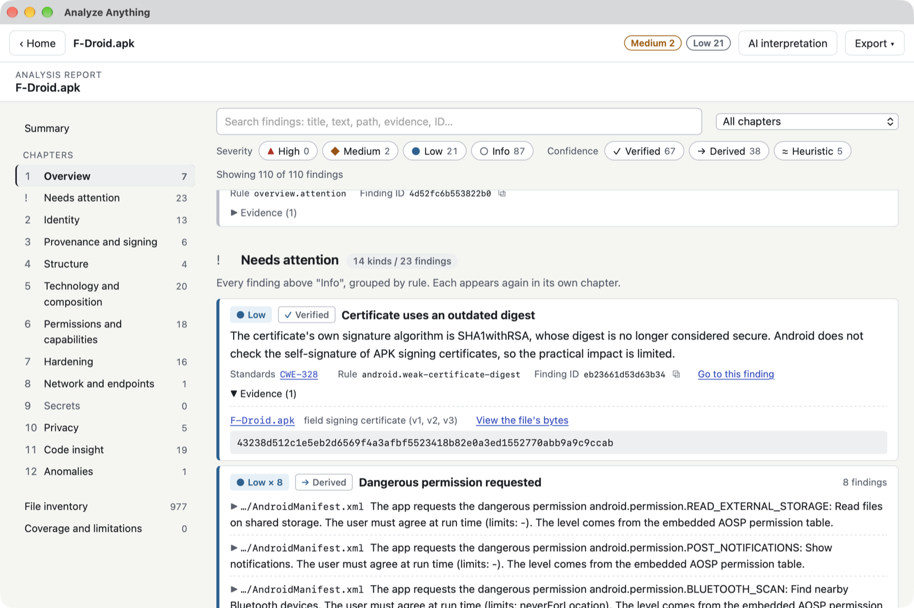
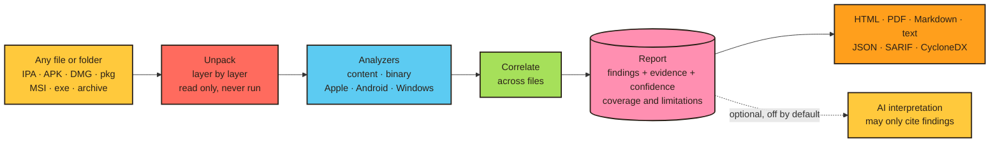
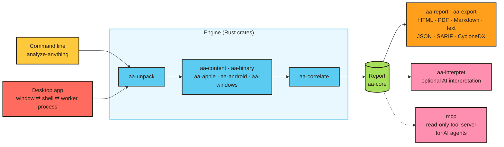

# Analyze Anything

[English](../../README.md) · [简体中文](../../README.zh-CN.md) · [繁體中文](README_zh-TW.md) · [日本語](README_ja.md) · [한국어](README_ko.md) · [Türkçe](README_tr.md) · [Русский](README_ru.md) · [Tiếng Việt](README_vi.md) · [ไทย](README_th.md) · [Deutsch](README_de.md) · [Español](README_es.md) · [Français](README_fr.md) · [Українська](README_uk.md) · **Polski** · [Português (Brasil)](README_pt-BR.md) · [العربية](README_ar.md) · [فارسی](README_fa.md) · [Bahasa Indonesia](README_id.md) · [Italiano](README_it.md) · [Ελληνικά](README_el.md) · [മലയാളം](README_ml.md) · [Roman Urdu](README_ur-Latn.md) · [Română](README_ro.md) · [Български](README_bg.md)

[Website](https://atomsprout.com/analyze-anything/) · [Examples](https://atomsprout.com/analyze-anything/#examples) · [Roadmap](../ROADMAP.md)

> To jest tłumaczenie. Wersją wzorcową jest [README po angielsku](../../README.md), które może być nowsze.

Daj mu dowolny artefakt ze swojego komputera — IPA, APK, aplikację macOS, DMG lub pkg, instalator Windows lub folder z programem, archiwum, folder, dowolny plik — a dostaniesz raport, któremu można ufać i który da się prześledzić: każde ustalenie ma swój dowód (który plik, w którym miejscu, co tam odczytano) i poziom pewności, a wszystko, czego nie udało się przeanalizować, jest wymienione w części o pokryciu i ograniczeniach.

```
analyze-anything App.ipa
```

To polecenie tworzy folder `App.ipa.report/` z raportem w postaci HTML, PDF, Markdown, zwykłego tekstu i JSON. Dostępne są też SARIF i CycloneDX.

- **Tylko analiza statyczna.** Dane wejściowe są odczytywane, nigdy uruchamiane, instalowane ani ładowane.
- **Offline.** Analiza z niczym się nie łączy i nie używa modelu językowego.
- **Deterministycznie.** Te same dane wejściowe dają ten sam raport, bajt w bajt.
- **Napisane w Rust**, bez potrzeby używania zewnętrznych narzędzi w czasie działania.

Można z niego korzystać na dwa sposoby, na tym samym silniku i z tym samym raportem dla tych samych danych wejściowych:

- **wiersz poleceń**, `analyze-anything` (krótka nazwa `aaaa`);
- **aplikacja desktopowa** dla macOS: upuść plik, obserwuj postęp, czytaj raport, kliknij dowód, żeby zobaczyć jego bajty, eksportuj, prowadź historię i porównuj dwie wersje, a jeśli to skonfigurujesz, model objaśni raport obok niego.

## Jak to wygląda

<table>
  <tr>
    <td width="50%"><br><sub>Aplikacja desktopowa: podsumowanie raportu</sub></td>
    <td width="50%"><br><sub>Ustalenia, każde ze swoim dowodem</sub></td>
  </tr>
  <tr>
    <td><br><sub>Opcjonalna interpretacja AI obok raportu; każde stwierdzenie powołuje się na ustalenia</sub></td>
    <td><br><sub>Upuść plik lub folder, żeby zacząć</sub></td>
  </tr>
</table>

<p align="center"><br><sub>Ten sam raport jako PDF</sub></p>

Zrzuty ekranu pokazują raport o F-Droid 2.0.3, jeden z [przykładów](https://atomsprout.com/analyze-anything/#examples).

## Instalacja

macOS na Apple silicon, przez Homebrew:

```
brew install atomsprout/tap/analyze-anything                  # wiersz poleceń
brew install --cask atomsprout/tap/analyze-anything-desktop   # aplikacja desktopowa
```

Każde z nich działa bez drugiego. Oba są podpisane certyfikatem Developer ID i notaryzowane przez Apple.

Na innych platformach zbuduj wiersz poleceń ze źródeł (Rust 1.90 lub nowszy):

```
cargo build --release
target/release/analyze-anything <file or folder>
```

Wydane kompilacje istnieją tylko dla komputerów Mac z Apple silicon. Na Linuksie i Windows kod się buduje, a jego testy przechodzą w CI, ale nikt jeszcze nie używał go tam ręcznie.

## Użycie

```
analyze-anything <file or folder>                 # analiza; raport trafia do <name>.report/
analyze-anything App.ipa -o out --lang zh         # wybór folderu; raport po chińsku
analyze-anything diff old/report.json new/report.json    # co się zmieniło między dwiema wersjami
analyze-anything explain out/report.json <finding id>    # jedno ustalenie ze wszystkimi dowodami
analyze-anything verify out/                      # czy pliki są nadal takie, jak je zapisano?
```

Pełny przewodnik to [docs/USAGE.md](../USAGE.md).

## Przykłady

Raporty o publicznych wydaniach oprogramowania open source, w postaci plików PDF, są na [stronie internetowej](https://atomsprout.com/analyze-anything/#examples): IPA, APK, DMG, pkg dla macOS, instalatory NSIS i MSI oraz program dla Linuksa. `tools/site/examples.py` tworzy je ponownie z tych samych plików.

## Co odczytuje

| | |
|---|---|
| Apple | `.app` i inne pakiety (bundle), IPA, DMG (HFS+ i APFS), pkg; Info.plist, podpisy kodu i łańcuchy certyfikatów, zapieczętowane zasoby, entitlements, profile provisioning, manifesty prywatności, szyfrowanie FairPlay |
| Android | APK, AAB, XAPK / APKS / APKM; manifest, zasoby, schematy podpisu v1–v3.1, DEX, SDK i pakery |
| Windows | PE, Authenticode, zestawy .NET, MSI (z własnym podpisem), NSIS, Inno Setup, CAB, archiwa samorozpakowujące, Electron (asar), MSIX, foldery zainstalowanych programów |
| Ogólne | struktura i zabezpieczenia Mach-O, ELF i PE; zip, tar, 7z, gzip, bzip2, xz, zstd, zagnieżdżone na dowolną głębokość; adresy URL, prawdopodobne dane uwierzytelniające, entropia, zduplikowane pliki |

## Jak to działa

Jeden przebieg, tylko odczyt: dane wejściowe są otwierane warstwa po warstwie, każdy plik czytają analizatory, które go rozumieją, ostatni krok wiąże pliki ze sobą, a wszystko, co znaleziono, zostaje zapisane razem z dowodami. Raport jest jedynym źródłem każdego formatu wyjściowego.



Wiersz poleceń i aplikacja desktopowa to dwa oblicza tego samego silnika, więc te same dane wejściowe dają w obu ten sam raport. Aplikacja desktopowa nigdy nie analizuje we własnym procesie: robi to proces roboczy, który można z całą pewnością zatrzymać.



## Opcjonalnie: odczytanie raportu przez AI

Wyłączone, dopóki tego nie włączysz. Gdy raport jest już zapisany, model językowy może objaśnić go prostymi słowami:

```
analyze-anything ai claude          # raz: wybór, kto to robi (tutaj Claude Code, klucz API nie jest potrzebny)
analyze-anything App.ipa --ai       # analiza, potem zapis ai.md obok raportu
```

To ty wybierasz, kto to robi: usługa modeli, do której masz klucz API (Claude albo cokolwiek, co obsługuje protokół OpenAI), Claude Code, Codex albo model uruchamiany przez Ollama na twoim komputerze. Może to być też twój własny program. Model widzi raport, nigdy analizowane pliki, i wyszukuje w nim informacje za pomocą narzędzi tylko do odczytu. Każde jego stwierdzenie musi powoływać się na ustalenia z raportu; te, które tego nie robią, są odrzucane. Zobacz [docs/AI.md](../AI.md).

## Stan i plany

0.1.0 to pierwsze wydanie. Raport można już dziś uzyskać dla dowolnego pliku lub folderu; formaty Apple, Android i Windows są rozumiane dogłębnie. Wydanie jest przeznaczone dla komputerów Mac z Apple silicon i było używane ręcznie na jednym z nich; na Linuksie i Windows kod się buduje i przechodzi testy w CI.

„Anything” to obietnica co do dolnej granicy i kierunek dla górnej: nic nie jest odrzucane, a głębia jest dodawana po jednym formacie naraz, każdy jako mały crate. Dalej, po kolei:

1. **To samo na każdym systemie**: wydane kompilacje dla Linuksa i Windows; aplikacja desktopowa nie tylko dla macOS.
2. **Więcej rodzajów danych wejściowych**: pakiety Linuksa, obrazy kontenerów, pakiety ekosystemów językowych, kolejne platformy aplikacji, dokumenty zawierające kod, obrazy firmware'u.
3. **Głębiej tam, gdzie to ważne**: znane podatności z bazy offline, fakty na poziomie funkcji, reguły i polityki jako dane.
4. **Łatwiej na tym budować**: GitHub Action, interpretacja AI wewnątrz raportu, pełniejszy interfejs dla agentów, stabilny schemat raportu.

Co się nie zmieni: tylko analiza statyczna, analiza offline, ten sam raport dla tych samych danych wejściowych, dowody dla każdego ustalenia i żadnego werdyktu. Cały obraz jest w [docs/ROADMAP.md](../ROADMAP.md); lista punkt po punkcie to [docs/TODO.md](../TODO.md).

## Warto wiedzieć

- Ważność jest stałą właściwością każdej reguły i służy do uporządkowania lektury. Raport nie mówi, czy dane wejściowe są bezpieczne.
- Ustalenia oznaczone jako heurystyczne (prawdopodobne dane uwierzytelniające, pakery, wykrywanie SDK) mogą być fałszywymi alarmami.
- Podpisy są sprawdzane względem samego pliku: skróty, wartości podpisów, łańcuchy certyfikatów. Unieważnienie certyfikatów, systemowe ustawienia zaufania i status notaryzacji Apple nie są sprawdzane; wymagałoby to sieci.
- IPA pobrane z App Store jest zaszyfrowane: jest to rozpoznawane, a metadane, podpis i zasoby są analizowane jak zwykle, ale zaszyfrowanego kodu nie da się odczytać.
- Używaj go tylko do rzeczy, które masz prawo analizować.

Więcej w [docs/LIMITATIONS.md](../LIMITATIONS.md).

## Dokumentacja

- [docs/USAGE.md](../USAGE.md) — wiersz poleceń w całości ([中文](../USAGE.zh-CN.md))
- [docs/AI.md](../AI.md) — opcjonalna interpretacja AI
- [docs/DESKTOP.md](../DESKTOP.md) — aplikacja desktopowa: budowa, rozwój, testowanie, wydawanie
- [docs/LIMITATIONS.md](../LIMITATIONS.md) — znane ograniczenia
- [docs/ANALYZERS.md](../ANALYZERS.md) — jak dodać format
- [docs/ROADMAP.md](../ROADMAP.md) — gdzie projekt jest i dokąd zmierza
- [docs/TODO.md](../TODO.md) — co zostało do zrobienia, punkt po punkcie
- [AGENTS.md](../../AGENTS.md) — jak pracować w tym repozytorium, dla kontrybutorów i agentów programujących
- [docs/PLAN.md](../PLAN.md), [docs/PLAN-DESKTOP.md](../PLAN-DESKTOP.md), [docs/RESEARCH.md](../RESEARCH.md), [docs/spikes/](../spikes/) — jak to planowano i czego próbowano

## Rozwój

```
cargo fmt --all --check
cargo clippy --workspace --all-targets -- -D warnings
cargo test --workspace
```

[AGENTS.md](../../AGENTS.md) opisuje, jak zorganizowane jest repozytorium i co każda zmiana musi zachować. Aplikacja desktopowa znajduje się w `apps/desktop`; zobacz [docs/DESKTOP.md](../DESKTOP.md). Zgłoszenia (issues) i pull requesty są mile widziane. Prosimy nie załączać plików, których nie masz prawa udostępniać: zwykle wystarcza jedno ustalenie z `report.json`, które pokazuje problem.

## Licencja

Apache-2.0; zobacz [LICENSE](../../LICENSE). To, co dołączono od innych, w tym czcionki w raportach, jest wymienione w [NOTICE](../../NOTICE).
