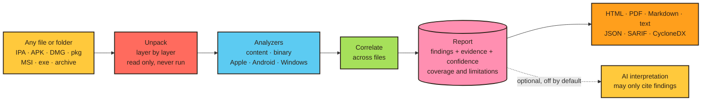
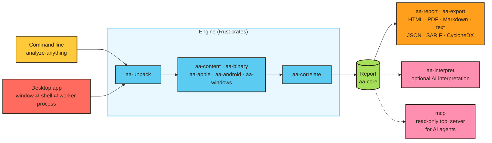

# Analyze Anything

[English](../../README.md) · [简体中文](../../README.zh-CN.md) · [繁體中文](README_zh-TW.md) · [日本語](README_ja.md) · [한국어](README_ko.md) · [Türkçe](README_tr.md) · [Русский](README_ru.md) · [Tiếng Việt](README_vi.md) · [ไทย](README_th.md) · [Deutsch](README_de.md) · [Español](README_es.md) · [Français](README_fr.md) · [Українська](README_uk.md) · [Polski](README_pl.md) · **Português (Brasil)** · [العربية](README_ar.md) · [فارسی](README_fa.md) · [Bahasa Indonesia](README_id.md) · [Italiano](README_it.md) · [Ελληνικά](README_el.md) · [മലയാളം](README_ml.md) · [Roman Urdu](README_ur-Latn.md) · [Română](README_ro.md) · [Български](README_bg.md)

[Website](https://atomsprout.com/analyze-anything/) · [Examples](https://atomsprout.com/analyze-anything/#examples) · [Roadmap](../ROADMAP.md)

> Esta é uma tradução. O [README em inglês](../../README.md) é a referência e pode estar mais atualizado.

Entregue a ele qualquer artefato do seu computador — um IPA, um APK, um app de macOS, um DMG ou pkg, um instalador do Windows ou uma pasta de programa, um arquivo compactado, uma pasta, qualquer arquivo — e receba um relatório confiável e rastreável: cada achado traz sua evidência (qual arquivo, em que ponto dele, o que foi lido ali) e um nível de confiança, e tudo o que não pôde ser analisado é listado em cobertura e limitações.

```
analyze-anything App.ipa
```

Isso grava `App.ipa.report/` com o relatório em HTML, PDF, Markdown, texto puro e JSON. SARIF e CycloneDX também estão disponíveis.

- **Somente estático.** A entrada é lida, nunca executada, instalada ou carregada.
- **Offline.** A análise não se conecta a nada e não usa nenhum modelo de linguagem.
- **Determinístico.** A mesma entrada gera o mesmo relatório, byte a byte.
- **Escrito em Rust**, sem precisar de ferramentas externas em tempo de execução.

Há duas formas de usar, sobre o mesmo motor e com o mesmo relatório para a mesma entrada:

- a **linha de comando**, `analyze-anything` (nome curto `aaaa`);
- o **aplicativo para desktop** para macOS: solte um arquivo, acompanhe o progresso, leia o relatório, clique em uma evidência para ver seus bytes, exporte, mantenha um histórico e compare duas versões e, se você configurar, peça a um modelo que explique o relatório ao lado dele.

## Como ele é

<table>
  <tr>
    <td width="50%"><br><sub>O aplicativo para desktop: o resumo do relatório</sub></td>
    <td width="50%"><br><sub>Achados, cada um com sua evidência</sub></td>
  </tr>
  <tr>
    <td><br><sub>A interpretação opcional por IA ao lado do relatório; toda afirmação cita achados</sub></td>
    <td><br><sub>Solte um arquivo ou uma pasta para começar</sub></td>
  </tr>
</table>

<p align="center"><br><sub>O mesmo relatório em PDF</sub></p>

As capturas de tela mostram o relatório sobre o F-Droid 2.0.3, um dos [exemplos](https://atomsprout.com/analyze-anything/#examples).

## Instalação

macOS em Apple silicon, com Homebrew:

```
brew install atomsprout/tap/analyze-anything                  # a linha de comando
brew install --cask atomsprout/tap/analyze-anything-desktop   # o aplicativo para desktop
```

Cada um funciona sem o outro. Ambos são assinados com um certificado Developer ID e notarizados pela Apple.

Em outras plataformas, compile a linha de comando a partir do código-fonte (Rust 1.90 ou mais recente):

```
cargo build --release
target/release/analyze-anything <file or folder>
```

Só existem builds publicados para Macs com Apple silicon. No Linux e no Windows o código compila e seus testes passam na CI, mas ninguém o usou manualmente nesses sistemas ainda.

## Uso

```
analyze-anything <file or folder>                 # analisa; o relatório vai para <name>.report/
analyze-anything App.ipa -o out --lang zh         # escolhe a pasta; grava o relatório em chinês
analyze-anything diff old/report.json new/report.json    # o que mudou entre duas versões
analyze-anything explain out/report.json <finding id>    # um achado com todas as suas evidências
analyze-anything verify out/                      # os arquivos ainda são o que foi gravado?
```

O guia completo está em [docs/USAGE.md](../USAGE.md).

## Exemplos

Relatórios sobre versões públicas de software de código aberto, em PDF, estão no [site](https://atomsprout.com/analyze-anything/#examples): um IPA, um APK, um DMG, um pkg de macOS, um instalador NSIS e um MSI, e um programa de Linux. `tools/site/examples.py` os gera de novo a partir dos mesmos arquivos.

## O que ele lê

| | |
|---|---|
| Apple | `.app` e outros bundles, IPA, DMG (HFS+ e APFS), pkg; Info.plist, assinaturas de código e cadeias de certificados, recursos selados, entitlements, perfis de provisionamento, manifestos de privacidade, criptografia FairPlay |
| Android | APK, AAB, XAPK / APKS / APKM; manifesto, recursos, esquemas de assinatura v1–v3.1, DEX, SDKs e packers |
| Windows | PE, Authenticode, assemblies .NET, MSI (com assinatura própria), NSIS, Inno Setup, CAB, autoextraíveis, Electron (asar), MSIX, pastas de programas instalados |
| Geral | Estrutura e hardening de Mach-O, ELF e PE; zip, tar, 7z, gzip, bzip2, xz, zstd, aninhados em qualquer profundidade; URLs, prováveis credenciais, entropia, arquivos duplicados |

## Como funciona

Uma única passada, somente leitura: a entrada é aberta camada por camada, cada arquivo é lido pelos analisadores que o entendem, uma última etapa relaciona os arquivos entre si, e tudo o que foi encontrado é registrado com sua evidência. O relatório é a única fonte de todos os formatos de saída.



A linha de comando e o aplicativo para desktop são duas faces do mesmo motor, então uma entrada gera o mesmo relatório nos dois. O aplicativo para desktop nunca analisa em seu próprio processo: quem faz isso é um worker, que pode ser interrompido com certeza.



## Opcional: uma leitura do relatório por IA

Desativada, a menos que você a ative. Depois que um relatório é gravado, um modelo de linguagem pode explicá-lo em palavras simples:

```
analyze-anything ai claude          # uma vez: escolhe quem faz (aqui Claude Code, sem precisar de chave de API)
analyze-anything App.ipa --ai       # analisa e depois grava ai.md ao lado do relatório
```

Você escolhe quem faz isso: um serviço de modelos para o qual você tem uma chave de API (Claude, ou qualquer coisa que fale o protocolo da OpenAI), Claude Code, Codex ou um modelo que o Ollama executa na sua própria máquina. Um programa seu também serve. O modelo vê o relatório, nunca os arquivos analisados, e faz consultas nele por meio de ferramentas somente leitura. Toda afirmação que ele faz precisa citar achados do relatório; as que não citam são descartadas. Veja [docs/AI.md](../AI.md).

## Situação atual e roadmap

0.1.0 é a primeira versão. Hoje qualquer arquivo ou pasta recebe um relatório; os formatos de Apple, Android e Windows são compreendidos em profundidade. Ele é publicado para Macs com Apple silicon e foi usado manualmente em um deles; no Linux e no Windows o código compila e passa nos testes na CI.

"Anything" é uma promessa sobre o piso e uma direção para o teto: nada é recusado, e a profundidade é acrescentada um formato por vez, cada um como um crate pequeno. A seguir, em ordem:

1. **A mesma coisa em todos os sistemas**: builds publicados para Linux e Windows; o aplicativo para desktop além do macOS.
2. **Mais tipos de entrada**: pacotes de Linux, imagens de contêiner, pacotes de ecossistemas de linguagens, mais plataformas de aplicativos, documentos que carregam código, imagens de firmware.
3. **Mais profundidade onde importa**: vulnerabilidades conhecidas a partir de um banco de dados offline, fatos no nível de função, regras e políticas como dados.
4. **Mais fácil de usar como base**: uma GitHub Action, a leitura por IA dentro do relatório, uma interface mais completa para agentes, um esquema de relatório estável.

O que não vai mudar: somente estático, análise offline, o mesmo relatório para a mesma entrada, evidência para cada achado e nenhum veredito. O quadro completo está em [docs/ROADMAP.md](../ROADMAP.md); a lista detalhada é [docs/TODO.md](../TODO.md).

## Bom saber

- A severidade é uma propriedade fixa de cada regra e serve para ordenar a sua leitura. O relatório não diz se uma entrada é segura.
- Achados marcados como heurísticos (prováveis credenciais, packers, detecção de SDK) podem ser falsos positivos.
- As assinaturas são verificadas em relação ao próprio arquivo: digests, valores de assinatura, cadeias de certificados. Revogação, configurações de confiança do sistema e o status de notarização da Apple não são verificados; isso exigiria a rede.
- Um IPA baixado da App Store é criptografado: isso é reconhecido, e metadados, assinatura e recursos são analisados normalmente, mas o código criptografado não pode ser lido.
- Use-o apenas em coisas que você tem o direito de analisar.

Mais em [docs/LIMITATIONS.md](../LIMITATIONS.md).

## Documentação

- [docs/USAGE.md](../USAGE.md) — a linha de comando por completo ([中文](../USAGE.zh-CN.md))
- [docs/AI.md](../AI.md) — a interpretação opcional por IA
- [docs/DESKTOP.md](../DESKTOP.md) — o aplicativo para desktop: estrutura, desenvolvimento, testes, publicação
- [docs/LIMITATIONS.md](../LIMITATIONS.md) — limitações conhecidas
- [docs/ANALYZERS.md](../ANALYZERS.md) — como adicionar um formato
- [docs/ROADMAP.md](../ROADMAP.md) — em que ponto está e para onde vai
- [docs/TODO.md](../TODO.md) — o que falta fazer, item por item
- [AGENTS.md](../../AGENTS.md) — como trabalhar neste repositório, para contribuidores e agentes de programação
- [docs/PLAN.md](../PLAN.md), [docs/PLAN-DESKTOP.md](../PLAN-DESKTOP.md), [docs/RESEARCH.md](../RESEARCH.md), [docs/spikes/](../spikes/) — como foi planejado e o que foi tentado

## Desenvolvimento

```
cargo fmt --all --check
cargo clippy --workspace --all-targets -- -D warnings
cargo test --workspace
```

[AGENTS.md](../../AGENTS.md) explica como o repositório está organizado e o que uma alteração precisa preservar. O aplicativo para desktop fica em `apps/desktop`; veja [docs/DESKTOP.md](../DESKTOP.md). Issues e pull requests são bem-vindos. Por favor, não anexe arquivos que você não tem o direito de compartilhar: o único achado de `report.json` que mostra o problema costuma ser suficiente.

## Licença

Apache-2.0; veja [LICENSE](../../LICENSE). O que é incluído de terceiros, entre eles as fontes dos relatórios, está listado em [NOTICE](../../NOTICE).
