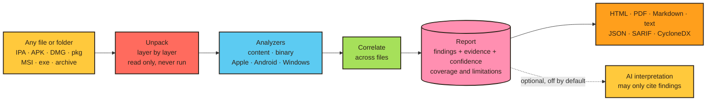
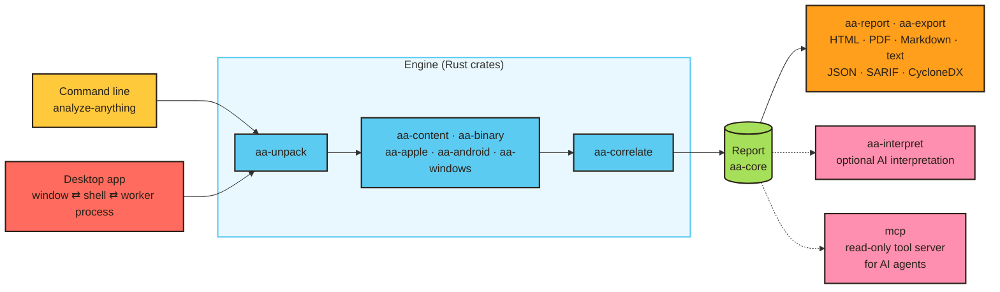

> Translation notice: the English README may be newer; see README.md for current delivery status and milestones.

# Analyze Anything

[English](../../README.md) · [简体中文](../../README.zh-CN.md) · [繁體中文](README_zh-TW.md) · [日本語](README_ja.md) · [한국어](README_ko.md) · [Türkçe](README_tr.md) · [Русский](README_ru.md) · [Tiếng Việt](README_vi.md) · [ไทย](README_th.md) · [Deutsch](README_de.md) · [Español](README_es.md) · [Français](README_fr.md) · [Українська](README_uk.md) · [Polski](README_pl.md) · [Português (Brasil)](README_pt-BR.md) · [العربية](README_ar.md) · [فارسی](README_fa.md) · [Bahasa Indonesia](README_id.md) · [Italiano](README_it.md) · [Ελληνικά](README_el.md) · [മലയാളം](README_ml.md) · [Roman Urdu](README_ur-Latn.md) · **Română** · [Български](README_bg.md)

[Website](https://atomsprout.com/analyze-anything/) · [Examples](https://atomsprout.com/analyze-anything/#examples) · [Roadmap](../ROADMAP.md)

> Aceasta este o traducere. [README-ul în engleză](../../README.md) este referința și poate fi mai nou.

Dă-i orice artefact de pe calculatorul tău — un IPA, un APK, o aplicație macOS, un DMG sau pkg, un program de instalare Windows sau un dosar de program, o arhivă, un dosar, orice fișier — și primești un raport în care poți avea încredere și pe care îl poți urmări până la sursă: fiecare constatare vine cu dovada ei (ce fișier, unde în el, ce s-a citit acolo) și cu un nivel de încredere, iar tot ce nu a putut fi analizat este listat la acoperire și limitări.

```
analyze-anything App.ipa
```

Comanda scrie `App.ipa.report/` cu raportul în HTML, PDF, Markdown, text simplu și JSON. Sunt disponibile și SARIF și CycloneDX.

- **Doar static.** Intrarea este citită, niciodată rulată, instalată sau încărcată.
- **Offline.** Analiza nu se conectează la nimic și nu folosește niciun model lingvistic.
- **Determinist.** Aceeași intrare dă același raport, octet cu octet.
- **Scris în Rust**, fără să aibă nevoie de unelte externe la rulare.

Se poate folosi în două feluri, pe același motor și cu același raport pentru aceeași intrare:

- din **linia de comandă**, `analyze-anything` (nume scurt `aaaa`);
- din **aplicația desktop** pentru macOS: tragi un fișier, urmărești progresul, citești raportul, dai clic pe o dovadă ca să îi vezi octeții, exporți, păstrezi un istoric și compari două versiuni și, dacă o configurezi, lași un model să explice raportul alături de el.

## Cum arată

<table>
  <tr>
    <td width="50%"><br><sub>Aplicația desktop: rezumatul raportului</sub></td>
    <td width="50%"><br><sub>Constatări, fiecare cu dovada ei</sub></td>
  </tr>
  <tr>
    <td><br><sub>Interpretarea opțională prin IA, alături de raport; fiecare afirmație citează constatări</sub></td>
    <td><br><sub>Trage un fișier sau un dosar ca să începi</sub></td>
  </tr>
</table>

<p align="center"><br><sub>Același raport ca PDF</sub></p>

Capturile de ecran arată raportul despre F-Droid 2.0.3, unul dintre [exemple](https://atomsprout.com/analyze-anything/#examples).

## Instalare

macOS pe Apple silicon, cu Homebrew:

```
brew install atomsprout/tap/analyze-anything                  # linia de comandă
brew install --cask atomsprout/tap/analyze-anything-desktop   # aplicația desktop
```

Fiecare funcționează fără cealaltă. Ambele sunt semnate cu un certificat Developer ID și notarizate de Apple.

Pe alte platforme, compilează linia de comandă din surse (Rust 1.90 sau mai nou):

```
cargo build --release
target/release/analyze-anything <file or folder>
```

Build-uri publicate există doar pentru Mac-urile cu Apple silicon. Pe Linux și Windows codul se compilează și testele lui trec în CI, dar nimeni nu l-a folosit încă manual acolo.

## Utilizare

```
analyze-anything <file or folder>                 # analizează; raportul ajunge în <name>.report/
analyze-anything App.ipa -o out --lang zh         # alege dosarul; scrie raportul în chineză
analyze-anything diff old/report.json new/report.json    # ce s-a schimbat între două versiuni
analyze-anything explain out/report.json <finding id>    # o constatare cu toate dovezile ei
analyze-anything verify out/                      # mai sunt fișierele așa cum au fost scrise?
```

Ghidul complet este [docs/USAGE.md](../USAGE.md).

## Exemple

Rapoarte despre versiuni publice de software open-source, în format PDF, se găsesc pe [site](https://atomsprout.com/analyze-anything/#examples): un IPA, un APK, un DMG, un pkg de macOS, un program de instalare NSIS și unul MSI și un program de Linux. `tools/site/examples.py` le generează din nou din aceleași fișiere.

## Ce citește

| | |
|---|---|
| Apple | `.app` și alte bundle-uri, IPA, DMG (HFS+ și APFS), pkg; Info.plist, semnături de cod și lanțuri de certificate, resurse sigilate, entitlements, profiluri de provizionare, manifeste de confidențialitate, criptare FairPlay |
| Android | APK, AAB, XAPK / APKS / APKM; manifest, resurse, scheme de semnare v1–v3.1, DEX, SDK-uri și packere |
| Windows | PE, Authenticode, assembly-uri .NET, MSI (cu propria semnătură), NSIS, Inno Setup, CAB, arhive autoextractibile, Electron (asar), MSIX, dosare de programe instalate |
| General | Structura și măsurile de hardening pentru Mach-O, ELF și PE; zip, tar, 7z, gzip, bzip2, xz, zstd, imbricate la orice adâncime; URL-uri, posibile credențiale, entropie, fișiere duplicate |

## Cum funcționează

O singură trecere, doar citire: intrarea este deschisă strat cu strat, fiecare fișier este citit de analizoarele care îl înțeleg, un ultim pas pune fișierele în relație unele cu altele, iar tot ce s-a găsit este notat împreună cu dovada. Raportul este sursa unică a fiecărui format de ieșire.



Linia de comandă și aplicația desktop sunt două fețe ale aceluiași motor, așa că o intrare dă același raport în amândouă. Aplicația desktop nu analizează niciodată în propriul proces: o face un worker, care poate fi oprit cu certitudine.



## Opțional: o lectură a raportului făcută de IA

Dezactivată dacă nu o activezi tu. După ce un raport a fost scris, un model lingvistic îl poate explica în cuvinte simple:

```
analyze-anything ai claude          # o singură dată: alege cine o face (aici Claude Code, fără cheie API)
analyze-anything App.ipa --ai       # analizează, apoi scrie ai.md lângă raport
```

Tu alegi cine o face: un serviciu de modele pentru care ai o cheie API (Claude sau orice vorbește protocolul OpenAI), Claude Code, Codex sau un model pe care Ollama îl rulează pe propria ta mașină. Merge și un program al tău. Modelul vede raportul, niciodată fișierele analizate, și caută în el prin unelte doar pentru citire. Fiecare afirmație pe care o face trebuie să citeze constatări din raport; cele care nu o fac sunt eliminate. Vezi [docs/AI.md](../AI.md).

## Stadiu și foaie de parcurs

0.1.0 este prima versiune. Orice fișier sau dosar primește un raport încă de azi; formatele Apple, Android și Windows sunt înțelese în profunzime. Este publicat pentru Mac-urile cu Apple silicon și a fost folosit manual pe unul; pe Linux și Windows codul se compilează și își trece testele în CI.

„Anything” este o promisiune despre podea și o direcție pentru tavan: nimic nu este refuzat, iar profunzimea se adaugă format cu format, fiecare ca un crate mic. Urmează, în ordine:

1. **Același lucru pe orice sistem**: build-uri publicate pentru Linux și Windows; aplicația desktop dincolo de macOS.
2. **Mai multe tipuri de intrare**: pachete Linux, imagini de container, pachete ale ecosistemelor de limbaje, mai multe platforme de aplicații, documente care conțin cod, imagini de firmware.
3. **Mai multă profunzime acolo unde contează**: vulnerabilități cunoscute dintr-o bază de date offline, fapte la nivel de funcție, reguli și politici ca date.
4. **Mai ușor de construit pe el**: un GitHub Action, lectura făcută de IA în interiorul raportului, o interfață mai completă pentru agenți, o schemă stabilă a raportului.

Ce nu se va schimba: doar static, analiză offline, același raport pentru aceeași intrare, dovadă pentru fiecare constatare și niciun verdict. Imaginea de ansamblu este în [docs/ROADMAP.md](../ROADMAP.md); lista detaliată este [docs/TODO.md](../TODO.md).

## Bine de știut

- Severitatea este o proprietate fixă a fiecărei reguli, menită să îți ordoneze lectura. Raportul nu spune dacă o intrare este sigură.
- Constatările marcate ca euristice (posibile credențiale, packere, detectarea SDK-urilor) pot fi fals pozitive.
- Semnăturile sunt verificate față de fișierul însuși: digesturi, valori de semnătură, lanțuri de certificate. Revocarea, setările de încredere ale sistemului și starea notarizării la Apple nu sunt verificate; pentru asta ar fi nevoie de rețea.
- Un IPA descărcat din App Store este criptat: acest lucru este recunoscut, iar metadatele, semnătura și resursele sunt analizate ca de obicei, dar codul criptat nu poate fi citit.
- Folosește-l doar pe lucruri pe care ai dreptul să le analizezi.

Mai multe în [docs/LIMITATIONS.md](../LIMITATIONS.md).

## Documentație

- [docs/USAGE.md](../USAGE.md) — linia de comandă în întregime ([中文](../USAGE.zh-CN.md))
- [docs/AI.md](../AI.md) — interpretarea opțională prin IA
- [docs/DESKTOP.md](../DESKTOP.md) — aplicația desktop: structură, dezvoltare, testare, publicare
- [docs/LIMITATIONS.md](../LIMITATIONS.md) — limitări cunoscute
- [docs/ANALYZERS.md](../ANALYZERS.md) — cum se adaugă un format
- [docs/ROADMAP.md](../ROADMAP.md) — unde se află și încotro merge
- [docs/TODO.md](../TODO.md) — ce a mai rămas de făcut, punct cu punct
- [AGENTS.md](../../AGENTS.md) — cum se lucrează în acest repository, pentru contribuitori și agenți de programare
- [docs/PLAN.md](../PLAN.md), [docs/PLAN-DESKTOP.md](../PLAN-DESKTOP.md), [docs/RESEARCH.md](../RESEARCH.md), [docs/spikes/](../spikes/) — cum a fost planificat și ce s-a încercat

## Dezvoltare

```
cargo fmt --all --check
cargo clippy --workspace --all-targets -- -D warnings
cargo test --workspace
```

[AGENTS.md](../../AGENTS.md) explică cum este organizat repository-ul și ce trebuie să păstreze o modificare. Aplicația desktop se află în `apps/desktop`; vezi [docs/DESKTOP.md](../DESKTOP.md). Issue-urile și pull request-urile sunt binevenite. Te rugăm să nu atașezi fișiere pe care nu ai dreptul să le distribui: de obicei este de ajuns acea constatare din `report.json` care arată problema.

## Licență

Apache-2.0; vezi [LICENSE](../../LICENSE). Ce este inclus de la alții, printre care fonturile din rapoarte, este listat în [NOTICE](../../NOTICE).
