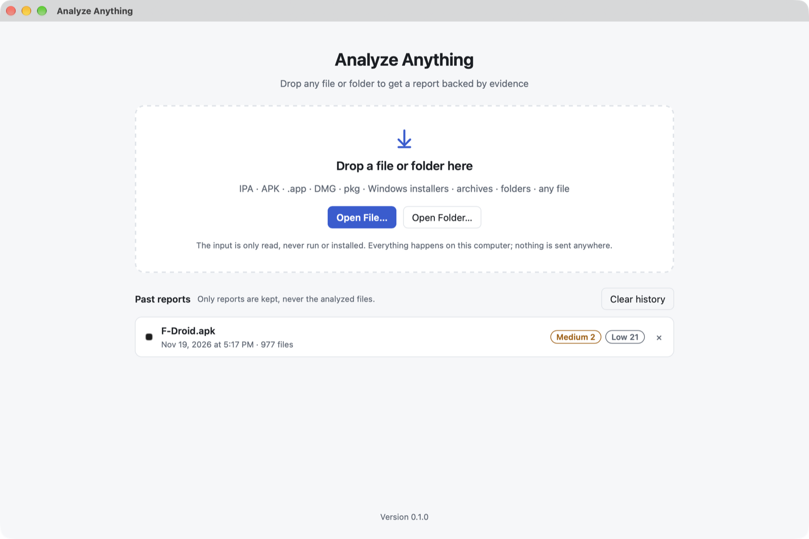
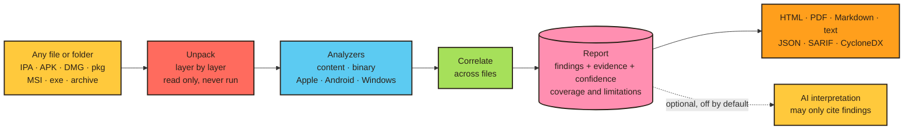
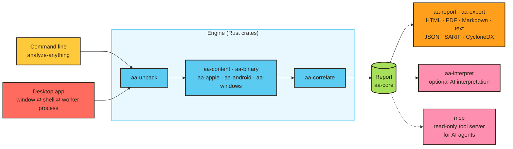

# Analyze Anything

[English](../../README.md) · [简体中文](../../README.zh-CN.md) · [繁體中文](README_zh-TW.md) · [日本語](README_ja.md) · [한국어](README_ko.md) · [Türkçe](README_tr.md) · **Русский** · [Tiếng Việt](README_vi.md) · [ไทย](README_th.md) · [Deutsch](README_de.md) · [Español](README_es.md) · [Français](README_fr.md) · [Українська](README_uk.md) · [Polski](README_pl.md) · [Português (Brasil)](README_pt-BR.md) · [العربية](README_ar.md) · [فارسی](README_fa.md) · [Bahasa Indonesia](README_id.md) · [Italiano](README_it.md) · [Ελληνικά](README_el.md) · [മലയാളം](README_ml.md) · [Roman Urdu](README_ur-Latn.md) · [Română](README_ro.md) · [Български](README_bg.md)

[Website](https://atomsprout.com/analyze-anything/) · [Examples](https://atomsprout.com/analyze-anything/#examples) · [Roadmap](../ROADMAP.md)

> Это перевод. Эталоном служит [английский README](../../README.md); он может быть новее.

Дайте ему любой артефакт со своего компьютера — IPA, APK, приложение macOS, DMG или pkg, установщик Windows или папку с программой, архив, папку, любой файл — и получите отчёт, которому можно доверять и который можно проверить: у каждой находки есть свидетельство (какой файл, какое место в нём, что там прочитано) и степень уверенности, а всё, что проанализировать не удалось, перечислено в разделе о покрытии и ограничениях.

```
analyze-anything App.ipa
```

Команда создаёт папку `App.ipa.report/` с отчётом в виде HTML, PDF, Markdown, обычного текста и JSON. Доступны также SARIF и CycloneDX.

- **Только статический анализ.** Входные данные читаются, но никогда не запускаются, не устанавливаются и не загружаются.
- **Офлайн.** Анализ никуда не подключается и не использует языковую модель.
- **Детерминированность.** Один и тот же вход даёт один и тот же отчёт, байт в байт.
- **Написан на Rust**, во время работы внешние инструменты не нужны.

Пользоваться им можно двумя способами; оба работают на одном движке и для одного и того же входа дают один и тот же отчёт:

- **командная строка**, `analyze-anything` (короткое имя `aaaa`);
- **настольное приложение** для macOS: перетащите файл, следите за ходом анализа, читайте отчёт, щёлкните по свидетельству, чтобы увидеть его байты, экспортируйте, ведите историю и сравнивайте две версии, а если настроите, модель объяснит отчёт рядом с ним.

## Как это выглядит

<table>
  <tr>
    <td width="50%"><br><sub>Настольное приложение: сводка отчёта</sub></td>
    <td width="50%"><br><sub>Находки, каждая со своим свидетельством</sub></td>
  </tr>
  <tr>
    <td><br><sub>Необязательная интерпретация ИИ рядом с отчётом; каждое утверждение ссылается на находки</sub></td>
    <td><br><sub>Перетащите файл или папку, чтобы начать</sub></td>
  </tr>
</table>

<p align="center"><br><sub>Тот же отчёт в виде PDF</sub></p>

На снимках экрана показан отчёт о F-Droid 2.0.3, один из [примеров](https://atomsprout.com/analyze-anything/#examples).

## Установка

macOS на Apple silicon, через Homebrew:

```
brew install atomsprout/tap/analyze-anything                  # командная строка
brew install --cask atomsprout/tap/analyze-anything-desktop   # настольное приложение
```

Каждое работает без другого. Оба подписаны сертификатом Developer ID и нотаризованы Apple.

На других платформах соберите командную строку из исходного кода (Rust 1.90 или новее):

```
cargo build --release
target/release/analyze-anything <file or folder>
```

Готовые сборки выпускаются только для компьютеров Mac на Apple silicon. На Linux и Windows код собирается и его тесты проходят в CI, но вручную им там ещё никто не пользовался.

## Использование

```
analyze-anything <file or folder>                 # анализ; отчёт попадает в <name>.report/
analyze-anything App.ipa -o out --lang zh         # выбрать папку; написать отчёт на китайском
analyze-anything diff old/report.json new/report.json    # что изменилось между двумя версиями
analyze-anything explain out/report.json <finding id>    # одна находка со всеми её свидетельствами
analyze-anything verify out/                      # файлы всё ещё те, что были записаны?
```

Полное руководство — [docs/USAGE.md](../USAGE.md).

## Примеры

Отчёты о публичных выпусках программ с открытым исходным кодом в виде PDF выложены на [сайте](https://atomsprout.com/analyze-anything/#examples): IPA, APK, DMG, pkg для macOS, установщики NSIS и MSI и программа для Linux. `tools/site/examples.py` создаёт их заново из тех же файлов.

## Что он читает

| | |
|---|---|
| Apple | `.app` и другие бандлы, IPA, DMG (HFS+ и APFS), pkg; Info.plist, подписи кода и цепочки сертификатов, запечатанные ресурсы, entitlements, provisioning-профили, манифесты приватности, шифрование FairPlay |
| Android | APK, AAB, XAPK / APKS / APKM; манифест, ресурсы, схемы подписи v1–v3.1, DEX, SDK и упаковщики |
| Windows | PE, Authenticode, сборки .NET, MSI (с собственной подписью), NSIS, Inno Setup, CAB, самораспаковывающиеся архивы, Electron (asar), MSIX, папки установленных программ |
| Общее | структура и защитные механизмы Mach-O, ELF и PE; zip, tar, 7z, gzip, bzip2, xz, zstd с любой глубиной вложенности; URL, вероятные учётные данные, энтропия, дубликаты файлов |

## Как это работает

Один проход, только чтение: вход открывается слой за слоем, каждый файл читают анализаторы, которые его понимают, последний шаг связывает файлы друг с другом, и всё найденное записывается вместе со свидетельствами. Отчёт — единственный источник для всех выходных форматов.



Командная строка и настольное приложение — два лица одного движка, поэтому один и тот же вход даёт в обоих один и тот же отчёт. Настольное приложение никогда не анализирует в собственном процессе: это делает рабочий процесс, который можно гарантированно остановить.



## По желанию: интерпретация отчёта с помощью ИИ

Выключено, пока вы сами не включите. Когда отчёт записан, языковая модель может объяснить его простыми словами:

```
analyze-anything ai claude          # один раз: выбрать, кто это делает (здесь Claude Code, ключ API не нужен)
analyze-anything App.ipa --ai       # анализ, затем запись ai.md рядом с отчётом
```

Кто это делает, выбираете вы: сервис моделей, для которого у вас есть ключ API (Claude или любой сервис, работающий по протоколу OpenAI), Claude Code, Codex или модель, которую Ollama запускает на вашей машине. Подойдёт и ваша собственная программа. Модель видит отчёт, но не анализируемые файлы, и ищет в нём сведения через инструменты, работающие только на чтение. Каждое её утверждение должно ссылаться на находки отчёта; утверждения без ссылок отбрасываются. См. [docs/AI.md](../AI.md).

## Состояние и планы

0.1.0 — первый выпуск. Отчёт уже сейчас можно получить для любого файла или папки; форматы Apple, Android и Windows разбираются глубоко. Выпуск собран для компьютеров Mac на Apple silicon, и вручную им пользовались на одном таком; на Linux и Windows код собирается и проходит тесты в CI.

«Anything» — это обещание насчёт нижней планки и направление для верхней: ни один вход не отвергается, а глубина добавляется по одному формату за раз, каждый в виде небольшого крейта. Дальше, по порядку:

1. **То же самое на каждой системе**: готовые сборки для Linux, Windows и компьютеров Mac на Intel; настольное приложение не только для macOS.
2. **Больше видов входных данных**: пакеты Linux, образы контейнеров, пакеты языковых экосистем, другие платформы приложений, документы с кодом внутри, образы прошивок.
3. **Глубже там, где это важно**: известные уязвимости из офлайн-базы, факты на уровне функций, правила и политики в виде данных.
4. **Проще использовать как основу**: GitHub Action, интерпретация ИИ внутри отчёта, более полный интерфейс для агентов, стабильная схема отчёта.

Что не изменится: только статический анализ, офлайн-анализ, один и тот же отчёт для одного и того же входа, свидетельства для каждой находки и никакого вердикта. Общая картина — в [docs/ROADMAP.md](../ROADMAP.md); список по пунктам — [docs/TODO.md](../TODO.md).

## Полезно знать

- Серьёзность — фиксированное свойство каждого правила; она нужна, чтобы упорядочить чтение. Отчёт не говорит, безопасен ли вход.
- Находки, помеченные как эвристические (вероятные учётные данные, упаковщики, обнаружение SDK), могут быть ложными срабатываниями.
- Подписи проверяются по самому файлу: дайджесты, значения подписей, цепочки сертификатов. Отзыв сертификатов, системные настройки доверия и статус нотаризации Apple не проверяются: для этого нужна сеть.
- IPA, загруженный из App Store, зашифрован: это распознаётся, метаданные, подпись и ресурсы анализируются как обычно, но зашифрованный код прочитать нельзя.
- Используйте его только для того, что вы вправе анализировать.

Подробнее — в [docs/LIMITATIONS.md](../LIMITATIONS.md).

## Документация

- [docs/USAGE.md](../USAGE.md) — командная строка полностью ([中文](../USAGE.zh-CN.md))
- [docs/AI.md](../AI.md) — необязательная интерпретация ИИ
- [docs/DESKTOP.md](../DESKTOP.md) — настольное приложение: устройство, разработка, тестирование, выпуск
- [docs/LIMITATIONS.md](../LIMITATIONS.md) — известные ограничения
- [docs/ANALYZERS.md](../ANALYZERS.md) — как добавить формат
- [docs/ROADMAP.md](../ROADMAP.md) — текущее состояние и направление развития
- [docs/TODO.md](../TODO.md) — что осталось сделать, пункт за пунктом
- [AGENTS.md](../../AGENTS.md) — как работать в этом репозитории, для участников и агентов-программистов
- [docs/PLAN.md](../PLAN.md), [docs/PLAN-DESKTOP.md](../PLAN-DESKTOP.md), [docs/RESEARCH.md](../RESEARCH.md), [docs/spikes/](../spikes/) — как это планировалось и что было опробовано

## Разработка

```
cargo fmt --all --check
cargo clippy --workspace --all-targets -- -D warnings
cargo test --workspace
```

В [AGENTS.md](../../AGENTS.md) описано, как устроен репозиторий и что должно сохранять любое изменение. Настольное приложение находится в `apps/desktop`; см. [docs/DESKTOP.md](../DESKTOP.md). Issues и pull requests приветствуются. Пожалуйста, не прикладывайте файлы, которыми вы не вправе делиться: обычно достаточно одной находки из `report.json`, показывающей проблему.

## Лицензия

Apache-2.0; см. [LICENSE](../../LICENSE). Всё, что включено из чужих работ, в том числе шрифты в отчётах, перечислено в [NOTICE](../../NOTICE).
