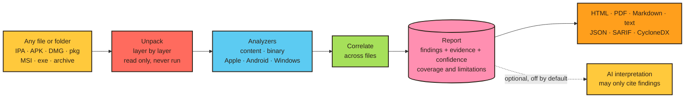
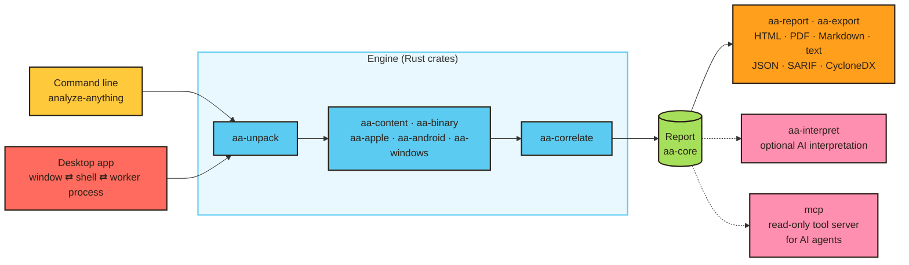

# Analyze Anything

[English](../../README.md) · [简体中文](../../README.zh-CN.md) · [繁體中文](README_zh-TW.md) · [日本語](README_ja.md) · [한국어](README_ko.md) · [Türkçe](README_tr.md) · [Русский](README_ru.md) · [Tiếng Việt](README_vi.md) · **ไทย** · [Deutsch](README_de.md) · [Español](README_es.md) · [Français](README_fr.md) · [Українська](README_uk.md) · [Polski](README_pl.md) · [Português (Brasil)](README_pt-BR.md) · [العربية](README_ar.md) · [فارسی](README_fa.md) · [Bahasa Indonesia](README_id.md) · [Italiano](README_it.md) · [Ελληνικά](README_el.md) · [മലയാളം](README_ml.md) · [Roman Urdu](README_ur-Latn.md) · [Română](README_ro.md) · [Български](README_bg.md)

[Website](https://atomsprout.com/analyze-anything/) · [Examples](https://atomsprout.com/analyze-anything/#examples) · [Roadmap](../ROADMAP.md)

> เอกสารนี้เป็นฉบับแปล [README ภาษาอังกฤษ](../../README.md) เป็นฉบับอ้างอิงและอาจใหม่กว่า

ส่งอะไรก็ได้ที่อยู่ในเครื่องของคุณให้มัน ไม่ว่าจะเป็น IPA, APK, แอป macOS, DMG หรือ pkg, ตัวติดตั้งของ Windows หรือโฟลเดอร์โปรแกรม, ไฟล์บีบอัด, โฟลเดอร์ หรือไฟล์ใดก็ตาม แล้วคุณจะได้รายงานที่เชื่อถือได้และตรวจสอบย้อนกลับได้ ข้อค้นพบทุกข้อมีหลักฐานกำกับ (ไฟล์ไหน ตำแหน่งใดในไฟล์ และอ่านเจออะไรตรงนั้น) พร้อมระดับความเชื่อมั่น ส่วนสิ่งที่วิเคราะห์ไม่ได้จะถูกระบุไว้ในหัวข้อขอบเขตการวิเคราะห์และข้อจำกัด

```
analyze-anything App.ipa
```

คำสั่งนี้จะเขียน `App.ipa.report/` ซึ่งมีรายงานในรูปแบบ HTML, PDF, Markdown, ข้อความธรรมดา และ JSON นอกจากนี้ยังมี SARIF และ CycloneDX ให้ใช้ด้วย

- **วิเคราะห์แบบสแตติกเท่านั้น** อินพุตถูกอ่านอย่างเดียว ไม่มีการรัน ติดตั้ง หรือโหลด
- **ออฟไลน์** การวิเคราะห์ไม่เชื่อมต่อไปที่ใดเลย และไม่ใช้โมเดลภาษา
- **ผลลัพธ์แน่นอนตายตัว** อินพุตเดียวกันให้รายงานเดียวกัน ตรงกันทุกไบต์
- **เขียนด้วย Rust** ไม่ต้องใช้เครื่องมือภายนอกใด ๆ ขณะทำงาน

ใช้งานได้สองทาง บนเอนจินเดียวกัน และให้รายงานเดียวกันสำหรับอินพุตเดียวกัน

- **บรรทัดคำสั่ง** `analyze-anything` (ชื่อย่อ `aaaa`)
- **แอปเดสก์ท็อป** สำหรับ macOS: ลากไฟล์มาวาง ดูความคืบหน้า อ่านรายงาน คลิกหลักฐานเพื่อดูไบต์ของมัน ส่งออก เก็บประวัติและเปรียบเทียบสองเวอร์ชัน และถ้าคุณตั้งค่าไว้ ก็ให้โมเดลอธิบายรายงานอยู่ข้าง ๆ ได้

## หน้าตาของมัน

<table>
  <tr>
    <td width="50%"><br><sub>แอปเดสก์ท็อป: สรุปของรายงาน</sub></td>
    <td width="50%"><br><sub>ข้อค้นพบ แต่ละข้อมีหลักฐานกำกับ</sub></td>
  </tr>
  <tr>
    <td><br><sub>การตีความโดย AI (เลือกใช้ได้) ข้างรายงาน ทุกข้อความอ้างอิงข้อค้นพบ</sub></td>
    <td><br><sub>ลากไฟล์หรือโฟลเดอร์มาวางเพื่อเริ่ม</sub></td>
  </tr>
</table>

<p align="center"><br><sub>รายงานเดียวกันในรูปแบบ PDF</sub></p>

ภาพหน้าจอแสดงรายงานของ F-Droid 2.0.3 ซึ่งเป็นหนึ่งใน[ตัวอย่าง](https://atomsprout.com/analyze-anything/#examples)

## การติดตั้ง

macOS บน Apple silicon ติดตั้งด้วย Homebrew:

```
brew install atomsprout/tap/analyze-anything                  # บรรทัดคำสั่ง
brew install --cask atomsprout/tap/analyze-anything-desktop   # แอปเดสก์ท็อป
```

แต่ละตัวทำงานได้โดยไม่ต้องมีอีกตัว ทั้งสองลงนามด้วยใบรับรอง Developer ID และผ่านการ notarize จาก Apple แล้ว

บนแพลตฟอร์มอื่น ให้ build บรรทัดคำสั่งจากซอร์สโค้ด (Rust 1.90 ขึ้นไป):

```
cargo build --release
target/release/analyze-anything <file or folder>
```

build ที่ปล่อยออกมามีเฉพาะสำหรับ Mac ที่ใช้ Apple silicon เท่านั้น บน Linux และ Windows โค้ด build ได้และเทสต์ผ่านใน CI แต่ยังไม่มีใครลองใช้งานด้วยมือจริง ๆ บนระบบเหล่านั้น

## การใช้งาน

```
analyze-anything <file or folder>                 # วิเคราะห์ รายงานจะอยู่ที่ <name>.report/
analyze-anything App.ipa -o out --lang zh         # เลือกโฟลเดอร์ และเขียนรายงานเป็นภาษาจีน
analyze-anything diff old/report.json new/report.json    # มีอะไรเปลี่ยนไประหว่างสองเวอร์ชัน
analyze-anything explain out/report.json <finding id>    # ข้อค้นพบหนึ่งข้อพร้อมหลักฐานทั้งหมด
analyze-anything verify out/                      # ไฟล์ยังตรงกับที่เขียนไว้หรือไม่
```

คู่มือฉบับเต็มอยู่ที่ [docs/USAGE.md](../USAGE.md)

## ตัวอย่าง

รายงานของซอฟต์แวร์โอเพนซอร์สรุ่นที่เผยแพร่สู่สาธารณะ ในรูปแบบ PDF มีอยู่บน[เว็บไซต์](https://atomsprout.com/analyze-anything/#examples) ได้แก่ IPA, APK, DMG, pkg ของ macOS, ตัวติดตั้ง NSIS และ MSI และโปรแกรม Linux อย่างละหนึ่งรายการ `tools/site/examples.py` ใช้สร้างรายงานเหล่านี้ขึ้นใหม่จากไฟล์ชุดเดียวกัน

## สิ่งที่อ่านได้

| | |
|---|---|
| Apple | `.app` และ bundle อื่น ๆ, IPA, DMG (HFS+ และ APFS), pkg; Info.plist, ลายเซ็นโค้ดและสายใบรับรอง, sealed resources, entitlements, provisioning profile, privacy manifest, การเข้ารหัส FairPlay |
| Android | APK, AAB, XAPK / APKS / APKM; manifest, ทรัพยากร, รูปแบบลายเซ็น v1–v3.1, DEX, SDK และ packer |
| Windows | PE, Authenticode, แอสเซมบลี .NET, MSI (พร้อมลายเซ็นของตัวมันเอง), NSIS, Inno Setup, CAB, ไฟล์ที่แตกตัวเองได้, Electron (asar), MSIX, โฟลเดอร์โปรแกรมที่ติดตั้งแล้ว |
| ทั่วไป | โครงสร้างและ hardening ของ Mach-O, ELF และ PE; zip, tar, 7z, gzip, bzip2, xz, zstd ซ้อนกันได้ไม่จำกัดชั้น; URL, ข้อความที่น่าจะเป็นข้อมูลรับรอง (credentials), เอนโทรปี, ไฟล์ซ้ำ |

## หลักการทำงาน

ทำงานรอบเดียว แบบอ่านอย่างเดียว: อินพุตถูกเปิดทีละชั้น แต่ละไฟล์ถูกอ่านโดยตัววิเคราะห์ที่เข้าใจไฟล์นั้น ขั้นตอนสุดท้ายเชื่อมโยงไฟล์ต่าง ๆ เข้าด้วยกัน และทุกสิ่งที่พบจะถูกบันทึกไว้พร้อมหลักฐาน รายงานเป็นแหล่งข้อมูลเพียงแหล่งเดียวของรูปแบบเอาต์พุตทุกแบบ



บรรทัดคำสั่งและแอปเดสก์ท็อปเป็นสองหน้าของเอนจินเดียวกัน อินพุตหนึ่งจึงให้รายงานเดียวกันในทั้งสองทาง แอปเดสก์ท็อปไม่เคยวิเคราะห์ในโปรเซสของตัวเอง แต่ให้ worker เป็นผู้ทำ และสั่งหยุดได้แน่นอน



## ทางเลือกเสริม: ให้ AI อ่านและอธิบายรายงาน

ปิดอยู่จนกว่าคุณจะเปิดใช้ เมื่อเขียนรายงานเสร็จแล้ว โมเดลภาษาสามารถอธิบายรายงานด้วยภาษาที่เข้าใจง่ายได้:

```
analyze-anything ai claude          # ทำครั้งเดียว: เลือกว่าใครเป็นผู้ทำ (ในที่นี้คือ Claude Code ไม่ต้องใช้ API key)
analyze-anything App.ipa --ai       # วิเคราะห์ แล้วเขียน ai.md ไว้ข้างรายงาน
```

คุณเป็นผู้เลือกว่าใครจะทำ: บริการโมเดลที่คุณมี API key (Claude หรือบริการใดก็ตามที่ใช้โปรโตคอลของ OpenAI), Claude Code, Codex หรือโมเดลที่ Ollama รันบนเครื่องของคุณเอง โปรแกรมที่คุณเขียนเองก็ใช้ได้เช่นกัน โมเดลจะเห็นเฉพาะรายงาน ไม่เห็นไฟล์ที่ถูกวิเคราะห์ และค้นข้อมูลในรายงานผ่านเครื่องมือแบบอ่านอย่างเดียว ทุกข้อความที่โมเดลเขียนต้องอ้างอิงข้อค้นพบในรายงาน ข้อความใดไม่อ้างอิงจะถูกตัดทิ้ง ดู [docs/AI.md](../AI.md)

## สถานะและแผนงาน

0.1.0 เป็นรุ่นแรก ตอนนี้ไฟล์หรือโฟลเดอร์ใดก็ได้รายงาน และเข้าใจรูปแบบของ Apple, Android และ Windows ในเชิงลึก รุ่นนี้ปล่อยสำหรับ Mac ที่ใช้ Apple silicon และมีการใช้งานด้วยมือจริงบนเครื่องดังกล่าวหนึ่งเครื่อง ส่วนบน Linux และ Windows โค้ด build ได้และผ่านเทสต์ใน CI

"Anything" คือคำมั่นเรื่องขั้นต่ำ และเป็นทิศทางของเพดาน: ไม่ปฏิเสธอินพุตใดเลย ส่วนความลึกจะเพิ่มทีละรูปแบบ แต่ละรูปแบบเป็น crate เล็ก ๆ หนึ่งตัว ลำดับถัดไปมีดังนี้

1. **สิ่งเดียวกันบนทุกระบบ**: build ที่ปล่อยสำหรับ Linux และ Windows; แอปเดสก์ท็อปนอกเหนือจาก macOS
2. **อินพุตหลากหลายชนิดขึ้น**: แพ็กเกจของ Linux, container image, แพ็กเกจของระบบนิเวศภาษาต่าง ๆ, แพลตฟอร์มแอปเพิ่มเติม, เอกสารที่มีโค้ดฝังอยู่, firmware image
3. **ลึกขึ้นในจุดที่สำคัญ**: ช่องโหว่ที่รู้จักแล้วจากฐานข้อมูลออฟไลน์, ข้อเท็จจริงระดับฟังก์ชัน, กฎและนโยบายในรูปของข้อมูล
4. **นำไปต่อยอดได้ง่ายขึ้น**: GitHub Action, การอ่านของ AI ที่อยู่ในตัวรายงาน, อินเทอร์เฟซที่ครบถ้วนขึ้นสำหรับ agent, schema ของรายงานที่เสถียร

สิ่งที่จะไม่เปลี่ยน: วิเคราะห์แบบสแตติกเท่านั้น, วิเคราะห์แบบออฟไลน์, รายงานเดียวกันสำหรับอินพุตเดียวกัน, หลักฐานสำหรับทุกข้อค้นพบ และไม่มีการตัดสินชี้ขาด ภาพรวมทั้งหมดอยู่ใน [docs/ROADMAP.md](../ROADMAP.md) ส่วนรายการแยกทีละข้ออยู่ใน [docs/TODO.md](../TODO.md)

## ข้อควรรู้

- ระดับความรุนแรงเป็นคุณสมบัติคงที่ของกฎแต่ละข้อ มีไว้เพื่อจัดลำดับการอ่านของคุณ รายงานไม่ได้บอกว่าอินพุตปลอดภัยหรือไม่
- ข้อค้นพบที่ระบุว่าเป็น heuristic (ข้อความที่น่าจะเป็นข้อมูลรับรอง, packer, การตรวจจับ SDK) อาจเป็นผลบวกลวงได้
- ลายเซ็นถูกตรวจสอบกับตัวไฟล์เอง ได้แก่ digest, ค่าลายเซ็น และสายใบรับรอง ไม่มีการตรวจสอบการเพิกถอน การตั้งค่าความเชื่อถือของระบบ และสถานะ notarization ของ Apple เพราะต้องใช้เครือข่าย
- IPA ที่ดาวน์โหลดจาก App Store ถูกเข้ารหัสไว้ เครื่องมือรับรู้เรื่องนี้ และยังวิเคราะห์เมทาดาทา ลายเซ็น และทรัพยากรตามปกติ แต่อ่านโค้ดที่เข้ารหัสไม่ได้
- ใช้กับสิ่งที่คุณมีสิทธิ์วิเคราะห์เท่านั้น

อ่านเพิ่มเติมได้ที่ [docs/LIMITATIONS.md](../LIMITATIONS.md)

## เอกสาร

- [docs/USAGE.md](../USAGE.md) — บรรทัดคำสั่งฉบับเต็ม ([中文](../USAGE.zh-CN.md))
- [docs/AI.md](../AI.md) — การตีความโดย AI ซึ่งเลือกใช้ได้
- [docs/DESKTOP.md](../DESKTOP.md) — แอปเดสก์ท็อป: โครงสร้าง การพัฒนา การทดสอบ การปล่อยรุ่น
- [docs/LIMITATIONS.md](../LIMITATIONS.md) — ข้อจำกัดที่ทราบแล้ว
- [docs/ANALYZERS.md](../ANALYZERS.md) — วิธีเพิ่มรูปแบบใหม่
- [docs/ROADMAP.md](../ROADMAP.md) — ตอนนี้อยู่ตรงไหนและกำลังจะไปทางใด
- [docs/TODO.md](../TODO.md) — สิ่งที่ยังต้องทำ แยกทีละรายการ
- [AGENTS.md](../../AGENTS.md) — วิธีทำงานใน repository นี้ สำหรับผู้ร่วมพัฒนาและ coding agent
- [docs/PLAN.md](../PLAN.md), [docs/PLAN-DESKTOP.md](../PLAN-DESKTOP.md), [docs/RESEARCH.md](../RESEARCH.md), [docs/spikes/](../spikes/) — วางแผนกันมาอย่างไรและเคยลองอะไรไปบ้าง

## การพัฒนา

```
cargo fmt --all --check
cargo clippy --workspace --all-targets -- -D warnings
cargo test --workspace
```

[AGENTS.md](../../AGENTS.md) อธิบายว่า repository จัดวางโครงสร้างอย่างไร และการแก้ไขแต่ละครั้งต้องรักษาอะไรไว้ แอปเดสก์ท็อปอยู่ใน `apps/desktop` ดู [docs/DESKTOP.md](../DESKTOP.md) ยินดีรับ issue และ pull request กรุณาอย่าแนบไฟล์ที่คุณไม่มีสิทธิ์เผยแพร่ โดยทั่วไปข้อค้นพบเพียงข้อเดียวจาก `report.json` ที่แสดงปัญหาก็เพียงพอแล้ว

## สัญญาอนุญาต

Apache-2.0 ดู [LICENSE](../../LICENSE) สิ่งที่รวมมาจากผู้อื่น ซึ่งรวมถึงฟอนต์ในรายงาน ระบุไว้ใน [NOTICE](../../NOTICE)
