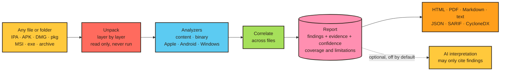
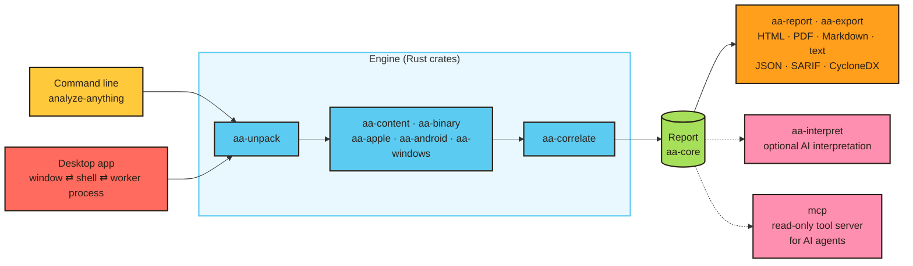

> Translation notice: the English README may be newer; see README.md for current delivery status and milestones.

# Analyze Anything

[English](../../README.md) · [简体中文](../../README.zh-CN.md) · [繁體中文](README_zh-TW.md) · [日本語](README_ja.md) · [한국어](README_ko.md) · **Türkçe** · [Русский](README_ru.md) · [Tiếng Việt](README_vi.md) · [ไทย](README_th.md) · [Deutsch](README_de.md) · [Español](README_es.md) · [Français](README_fr.md) · [Українська](README_uk.md) · [Polski](README_pl.md) · [Português (Brasil)](README_pt-BR.md) · [العربية](README_ar.md) · [فارسی](README_fa.md) · [Bahasa Indonesia](README_id.md) · [Italiano](README_it.md) · [Ελληνικά](README_el.md) · [മലയാളം](README_ml.md) · [Roman Urdu](README_ur-Latn.md) · [Română](README_ro.md) · [Български](README_bg.md)

[Website](https://atomsprout.com/analyze-anything/) · [Examples](https://atomsprout.com/analyze-anything/#examples) · [Roadmap](../ROADMAP.md)

> Bu bir çeviridir. Esas alınan metin [İngilizce README](../../README.md) dosyasıdır ve daha güncel olabilir.

Bilgisayarınızdaki herhangi bir yapıtı verin — bir IPA, bir APK, bir macOS uygulaması, bir DMG veya pkg, bir Windows yükleyicisi veya program klasörü, bir arşiv, bir klasör, herhangi bir dosya — ve güvenebileceğiniz, izini sürebileceğiniz bir rapor alın: her bulgu kanıtını (hangi dosya, dosyanın neresi, orada ne okundu) ve bir güven düzeyini taşır; analiz edilemeyen her şey de kapsam ve sınırlamalar bölümünde listelenir.

```
analyze-anything App.ipa
```

Bu komut, raporu HTML, PDF, Markdown, düz metin ve JSON olarak içeren `App.ipa.report/` klasörünü yazar. SARIF ve CycloneDX de kullanılabilir.

- **Yalnızca statik.** Girdi okunur; asla çalıştırılmaz, kurulmaz veya yüklenmez.
- **Çevrimdışı.** Analiz hiçbir yere bağlanmaz ve dil modeli kullanmaz.
- **Deterministik.** Aynı girdi, baytı baytına aynı raporu verir.
- **Rust ile yazıldı**; çalışma zamanında dış araç gerektirmez.

Aynı motor üzerinde, aynı girdi için aynı raporu veren iki kullanım yolu vardır:

- **komut satırı**, `analyze-anything` (kısa adı `aaaa`);
- macOS için **masaüstü uygulaması**: bir dosya bırakın, ilerlemeyi izleyin, raporu okuyun, baytlarını görmek için bir kanıta tıklayın, dışa aktarın, geçmiş tutun ve iki sürümü karşılaştırın; ayarlarsanız bir model de raporu yanında açıklar.

## Nasıl görünüyor

<table>
  <tr>
    <td width="50%"><br><sub>Masaüstü uygulaması: raporun özeti</sub></td>
    <td width="50%"><br><sub>Bulgular, her biri kendi kanıtıyla</sub></td>
  </tr>
  <tr>
    <td><br><sub>Raporun yanında isteğe bağlı yapay zekâ yorumu; her ifade bulgulara atıf yapar</sub></td>
    <td><br><sub>Başlamak için bir dosya veya klasör bırakın</sub></td>
  </tr>
</table>

<p align="center"><br><sub>Aynı rapor PDF olarak</sub></p>

Ekran görüntüleri, [örneklerden](https://atomsprout.com/analyze-anything/#examples) biri olan F-Droid 2.0.3 raporunu gösterir.

## Kurulum

Apple silicon üzerinde macOS, Homebrew ile:

```
brew install atomsprout/tap/analyze-anything                  # komut satırı
brew install --cask atomsprout/tap/analyze-anything-desktop   # masaüstü uygulaması
```

Her biri diğeri olmadan çalışır. İkisi de bir Developer ID sertifikasıyla imzalanmış ve Apple tarafından noter onayından (notarization) geçirilmiştir.

Diğer platformlarda komut satırını kaynaktan derleyin (Rust 1.90 veya daha yenisi):

```
cargo build --release
target/release/analyze-anything <file or folder>
```

Yayımlanmış derlemeler yalnızca Apple silicon Mac'ler için vardır. Linux ve Windows'ta kod derlenir ve testleri CI'da geçer, ancak orada henüz kimse elle kullanmadı.

## Kullanım

```
analyze-anything <file or folder>                 # analiz et; rapor <name>.report/ klasörüne yazılır
analyze-anything App.ipa -o out --lang zh         # klasörü seç; raporu Çince yaz
analyze-anything diff old/report.json new/report.json    # iki sürüm arasında ne değişti
analyze-anything explain out/report.json <finding id>    # tüm kanıtlarıyla tek bir bulgu
analyze-anything verify out/                      # dosyalar hâlâ yazıldıkları gibi mi?
```

Tam kılavuz: [docs/USAGE.md](../USAGE.md).

## Örnekler

Açık kaynaklı yazılımların herkese açık sürümlerine ait raporlar, PDF olarak [web sitesinde](https://atomsprout.com/analyze-anything/#examples) yer alır: bir IPA, bir APK, bir DMG, bir macOS pkg'si, bir NSIS ve bir MSI yükleyicisi ve bir Linux programı. `tools/site/examples.py` bunları aynı dosyalardan yeniden üretir.

## Neleri okur

| | |
|---|---|
| Apple | `.app` ve diğer bundle'lar, IPA, DMG (HFS+ ve APFS), pkg; Info.plist, kod imzaları ve sertifika zincirleri, mühürlü kaynaklar, entitlements, provisioning profilleri, gizlilik manifestleri, FairPlay şifrelemesi |
| Android | APK, AAB, XAPK / APKS / APKM; manifest, kaynaklar, v1–v3.1 imza şemaları, DEX, SDK'lar ve packer'lar |
| Windows | PE, Authenticode, .NET assembly'leri, MSI (kendi imzasıyla), NSIS, Inno Setup, CAB, kendi kendini açan arşivler, Electron (asar), MSIX, kurulu program klasörleri |
| Genel | Mach-O, ELF ve PE yapısı ve sıkılaştırma (hardening) önlemleri; zip, tar, 7z, gzip, bzip2, xz, zstd, her derinlikte iç içe; URL'ler, olası kimlik bilgileri, entropi, yinelenen dosyalar |

## Nasıl çalışır

Tek geçiş, salt okunur: girdi katman katman açılır, her dosya onu anlayan analizciler tarafından okunur, son bir adım dosyaları birbiriyle ilişkilendirir ve bulunan her şey kanıtıyla birlikte yazılır. Rapor, bütün çıktı biçimlerinin tek kaynağıdır.



Komut satırı ve masaüstü uygulaması aynı motorun iki yüzüdür; bu yüzden bir girdi ikisinde de aynı raporu verir. Masaüstü uygulaması asla kendi sürecinde analiz yapmaz: bunu bir işçi süreç yapar ve bu süreç kesin olarak durdurulabilir.



## İsteğe bağlı: raporun yapay zekâ tarafından okunması

Siz açmadıkça kapalıdır. Rapor yazıldıktan sonra bir dil modeli onu sade bir dille açıklayabilir:

```
analyze-anything ai claude          # bir kez: bunu kimin yapacağını seç (burada Claude Code, API anahtarı gerekmez)
analyze-anything App.ipa --ai       # analiz et, sonra raporun yanına ai.md yaz
```

Bunu kimin yapacağını siz seçersiniz: API anahtarınız olan bir model hizmeti (Claude veya OpenAI protokolünü konuşan herhangi bir şey), Claude Code, Codex ya da Ollama'nın kendi makinenizde çalıştırdığı bir model. Kendi yazdığınız bir program da olur. Model raporu görür, analiz edilen dosyaları asla görmez; rapordaki bilgilere salt okunur araçlarla bakar. Yaptığı her ifade raporun bulgularına atıf yapmak zorundadır; yapmayanlar atılır. Bkz. [docs/AI.md](../AI.md).

## Durum ve yol haritası

0.1.0 ilk sürümdür. Bugün herhangi bir dosya veya klasör için rapor alınır; Apple, Android ve Windows biçimleri derinlemesine anlaşılır. Apple silicon Mac'ler için yayımlanmıştır ve bunlardan birinde elle kullanılmıştır; Linux ve Windows'ta kod derlenir ve testlerini CI'da geçer.

"Anything", taban için bir söz, tavan için bir yöndür: hiçbir şey reddedilmez ve derinlik, her biri küçük bir crate olarak, biçim biçim eklenir. Sırada, sırasıyla:

1. **Her sistemde aynı şey**: Linux ve Windows için yayımlanmış derlemeler; macOS dışında da masaüstü uygulaması.
2. **Daha fazla girdi türü**: Linux paketleri, konteyner imajları, dil ekosistemlerinin paketleri, daha fazla uygulama platformu, kod taşıyan belgeler, firmware imajları.
3. **Önemli olan yerde daha derin**: çevrimdışı bir veritabanından bilinen güvenlik açıkları, işlev düzeyinde bilgiler, veri olarak kurallar ve politikalar.
4. **Üzerine inşa etmesi daha kolay**: bir GitHub Action, raporun içinde yapay zekâ yorumu, ajanlar için daha kapsamlı bir arayüz, kararlı bir rapor şeması.

Değişmeyecek olanlar: yalnızca statik, çevrimdışı analiz, aynı girdi için aynı rapor, her bulgu için kanıt ve hüküm yok. Bütün resim [docs/ROADMAP.md](../ROADMAP.md) dosyasındadır; madde madde liste ise [docs/TODO.md](../TODO.md) dosyasıdır.

## Bilmekte fayda var

- Önem derecesi her kuralın sabit bir özelliğidir ve okumanızı sıralamak için vardır. Rapor bir girdinin güvenli olup olmadığını söylemez.
- Sezgisel olarak işaretlenen bulgular (olası kimlik bilgileri, packer'lar, SDK tespiti) yanlış pozitif olabilir.
- İmzalar dosyanın kendisine göre denetlenir: özetler, imza değerleri, sertifika zincirleri. Sertifika iptali, sistemin güven ayarları ve Apple'ın notarization durumu denetlenmez; bunun için ağ gerekirdi.
- App Store'dan indirilen bir IPA şifrelidir: bu tanınır; meta veriler, imza ve kaynaklar her zamanki gibi analiz edilir, ancak şifreli kod okunamaz.
- Yalnızca analiz etme hakkınız olan şeylerde kullanın.

Daha fazlası: [docs/LIMITATIONS.md](../LIMITATIONS.md).

## Belgeler

- [docs/USAGE.md](../USAGE.md) — komut satırının tamamı ([中文](../USAGE.zh-CN.md))
- [docs/AI.md](../AI.md) — isteğe bağlı yapay zekâ yorumu
- [docs/DESKTOP.md](../DESKTOP.md) — masaüstü uygulaması: yapı, geliştirme, test, yayımlama
- [docs/LIMITATIONS.md](../LIMITATIONS.md) — bilinen sınırlamalar
- [docs/ANALYZERS.md](../ANALYZERS.md) — yeni bir biçim nasıl eklenir
- [docs/ROADMAP.md](../ROADMAP.md) — nerede duruyor ve nereye gidiyor
- [docs/TODO.md](../TODO.md) — yapılacak ne kaldı, madde madde
- [AGENTS.md](../../AGENTS.md) — bu depoda nasıl çalışılır; katkıda bulunanlar ve kod yazan ajanlar için
- [docs/PLAN.md](../PLAN.md), [docs/PLAN-DESKTOP.md](../PLAN-DESKTOP.md), [docs/RESEARCH.md](../RESEARCH.md), [docs/spikes/](../spikes/) — nasıl planlandı ve neler denendi

## Geliştirme

```
cargo fmt --all --check
cargo clippy --workspace --all-targets -- -D warnings
cargo test --workspace
```

[AGENTS.md](../../AGENTS.md), deponun nasıl düzenlendiğini ve bir değişikliğin neleri koruması gerektiğini anlatır. Masaüstü uygulaması `apps/desktop` içindedir; bkz. [docs/DESKTOP.md](../DESKTOP.md). Issue'lar ve pull request'ler memnuniyetle karşılanır. Lütfen paylaşma hakkınız olmayan dosyaları eklemeyin: sorunu gösteren, `report.json` içindeki tek bulgu genellikle yeterlidir.

## Lisans

Apache-2.0; bkz. [LICENSE](../../LICENSE). Başkalarından alınıp pakete dahil edilenler, raporlardaki yazı tipleri de dahil, [NOTICE](../../NOTICE) dosyasında listelenmiştir.
