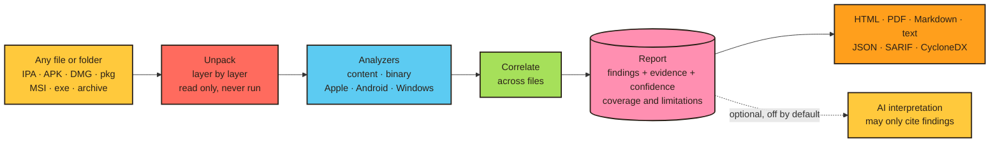
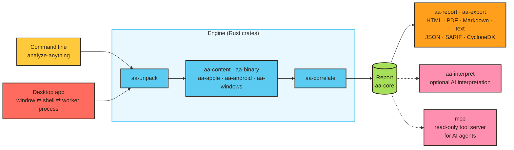

> Translation notice: the English README may be newer; see README.md for current delivery status and milestones.

# Analyze Anything

[English](../../README.md) · [简体中文](../../README.zh-CN.md) · [繁體中文](README_zh-TW.md) · [日本語](README_ja.md) · [한국어](README_ko.md) · [Türkçe](README_tr.md) · [Русский](README_ru.md) · [Tiếng Việt](README_vi.md) · [ไทย](README_th.md) · [Deutsch](README_de.md) · [Español](README_es.md) · [Français](README_fr.md) · **Українська** · [Polski](README_pl.md) · [Português (Brasil)](README_pt-BR.md) · [العربية](README_ar.md) · [فارسی](README_fa.md) · [Bahasa Indonesia](README_id.md) · [Italiano](README_it.md) · [Ελληνικά](README_el.md) · [മലയാളം](README_ml.md) · [Roman Urdu](README_ur-Latn.md) · [Română](README_ro.md) · [Български](README_bg.md)

[Website](https://atomsprout.com/analyze-anything/) · [Examples](https://atomsprout.com/analyze-anything/#examples) · [Roadmap](../ROADMAP.md)

> Це переклад. Еталоном є [англійський README](../../README.md); він може бути новішим.

Дайте йому будь-який артефакт зі свого комп'ютера — IPA, APK, застосунок macOS, DMG або pkg, інсталятор Windows або теку з програмою, архів, теку, будь-який файл — і отримайте звіт, якому можна довіряти і який можна перевірити: кожна знахідка має доказ (який файл, яке місце в ньому, що там прочитано) і рівень упевненості, а все, що проаналізувати не вдалося, перелічено в розділі про покриття та обмеження.

```
analyze-anything App.ipa
```

Команда створює теку `App.ipa.report/` зі звітом у вигляді HTML, PDF, Markdown, звичайного тексту та JSON. Доступні також SARIF і CycloneDX.

- **Лише статичний аналіз.** Вхідні дані читаються, але ніколи не запускаються, не встановлюються і не завантажуються.
- **Офлайн.** Аналіз нікуди не підключається і не використовує мовну модель.
- **Детермінованість.** Той самий вхід дає той самий звіт, байт у байт.
- **Написаний на Rust**, під час роботи зовнішні інструменти не потрібні.

Користуватися ним можна двома способами; обидва працюють на одному рушії і для того самого входу дають той самий звіт:

- **командний рядок**, `analyze-anything` (коротке ім'я `aaaa`);
- **настільний застосунок** для macOS: перетягніть файл, стежте за перебігом аналізу, читайте звіт, клацніть доказ, щоб побачити його байти, експортуйте, ведіть історію та порівнюйте дві версії, а якщо налаштуєте, модель пояснить звіт поруч із ним.

## Який це має вигляд

<table>
  <tr>
    <td width="50%"><br><sub>Настільний застосунок: зведення звіту</sub></td>
    <td width="50%"><br><sub>Знахідки, кожна зі своїм доказом</sub></td>
  </tr>
  <tr>
    <td><br><sub>Необов'язкова інтерпретація ШІ поруч зі звітом; кожне твердження посилається на знахідки</sub></td>
    <td><br><sub>Перетягніть файл або теку, щоб почати</sub></td>
  </tr>
</table>

<p align="center"><br><sub>Той самий звіт у вигляді PDF</sub></p>

На знімках екрана показано звіт про F-Droid 2.0.3, один із [прикладів](https://atomsprout.com/analyze-anything/#examples).

## Встановлення

macOS на Apple silicon, через Homebrew:

```
brew install atomsprout/tap/analyze-anything                  # командний рядок
brew install --cask atomsprout/tap/analyze-anything-desktop   # настільний застосунок
```

Кожен працює без іншого. Обидва підписані сертифікатом Developer ID і нотаризовані Apple.

На інших платформах зберіть командний рядок із вихідного коду (Rust 1.90 або новіший):

```
cargo build --release
target/release/analyze-anything <file or folder>
```

Готові збірки випускаються лише для комп'ютерів Mac на Apple silicon. На Linux і Windows код збирається і його тести проходять у CI, але вручну ним там ще ніхто не користувався.

## Використання

```
analyze-anything <file or folder>                 # аналіз; звіт потрапляє до <name>.report/
analyze-anything App.ipa -o out --lang zh         # вибрати теку; написати звіт китайською
analyze-anything diff old/report.json new/report.json    # що змінилося між двома версіями
analyze-anything explain out/report.json <finding id>    # одна знахідка з усіма її доказами
analyze-anything verify out/                      # файли досі ті самі, що були записані?
```

Повний посібник — [docs/USAGE.md](../USAGE.md).

## Приклади

Звіти про публічні випуски програм із відкритим кодом у вигляді PDF викладено на [сайті](https://atomsprout.com/analyze-anything/#examples): IPA, APK, DMG, pkg для macOS, інсталятори NSIS і MSI та програма для Linux. `tools/site/examples.py` створює їх заново з тих самих файлів.

## Що він читає

| | |
|---|---|
| Apple | `.app` та інші бандли, IPA, DMG (HFS+ і APFS), pkg; Info.plist, підписи коду та ланцюжки сертифікатів, запечатані ресурси, entitlements, provisioning-профілі, маніфести приватності, шифрування FairPlay |
| Android | APK, AAB, XAPK / APKS / APKM; маніфест, ресурси, схеми підпису v1–v3.1, DEX, SDK і пакувальники |
| Windows | PE, Authenticode, збірки .NET, MSI (із власним підписом), NSIS, Inno Setup, CAB, саморозпаковувані архіви, Electron (asar), MSIX, теки встановлених програм |
| Загальне | структура та захисні механізми Mach-O, ELF і PE; zip, tar, 7z, gzip, bzip2, xz, zstd із будь-якою глибиною вкладеності; URL, імовірні облікові дані, ентропія, дублікати файлів |

## Як це працює

Один прохід, лише читання: вхід відкривається шар за шаром, кожен файл читають аналізатори, які його розуміють, останній крок пов'язує файли між собою, і все знайдене записується разом із доказами. Звіт — єдине джерело для всіх вихідних форматів.



Командний рядок і настільний застосунок — два обличчя одного рушія, тому той самий вхід дає в обох той самий звіт. Настільний застосунок ніколи не аналізує у власному процесі: це робить робочий процес, який можна гарантовано зупинити.



## За бажанням: інтерпретація звіту за допомогою ШІ

Вимкнено, доки ви самі не ввімкнете. Коли звіт записано, мовна модель може пояснити його простими словами:

```
analyze-anything ai claude          # один раз: вибрати, хто це робить (тут Claude Code, ключ API не потрібен)
analyze-anything App.ipa --ai       # аналіз, потім запис ai.md поруч зі звітом
```

Хто це робить, обираєте ви: сервіс моделей, для якого у вас є ключ API (Claude або будь-який сервіс, що працює за протоколом OpenAI), Claude Code, Codex або модель, яку Ollama запускає на вашій машині. Підійде і ваша власна програма. Модель бачить звіт, але не аналізовані файли, і шукає в ньому відомості через інструменти, що працюють лише на читання. Кожне її твердження має посилатися на знахідки звіту; твердження без посилань відкидаються. Див. [docs/AI.md](../AI.md).

## Стан і плани

0.1.0 — перший випуск. Звіт уже зараз можна отримати для будь-якого файлу чи теки; формати Apple, Android і Windows розбираються глибоко. Випуск зібрано для комп'ютерів Mac на Apple silicon, і вручну ним користувалися на одному такому; на Linux і Windows код збирається і проходить тести в CI.

«Anything» — це обіцянка щодо нижньої межі та напрямок для верхньої: жоден вхід не відкидається, а глибина додається по одному формату за раз, кожен у вигляді невеликого крейта. Далі, по порядку:

1. **Те саме на кожній системі**: готові збірки для Linux і Windows; настільний застосунок не лише для macOS.
2. **Більше видів вхідних даних**: пакунки Linux, образи контейнерів, пакунки мовних екосистем, інші платформи застосунків, документи з кодом усередині, образи прошивок.
3. **Глибше там, де це важливо**: відомі вразливості з офлайн-бази, факти на рівні функцій, правила та політики у вигляді даних.
4. **Простіше використовувати як основу**: GitHub Action, інтерпретація ШІ всередині звіту, повніший інтерфейс для агентів, стабільна схема звіту.

Що не зміниться: лише статичний аналіз, офлайн-аналіз, той самий звіт для того самого входу, докази для кожної знахідки і жодного вердикту. Загальна картина — у [docs/ROADMAP.md](../ROADMAP.md); перелік за пунктами — [docs/TODO.md](../TODO.md).

## Варто знати

- Серйозність — фіксована властивість кожного правила; вона потрібна, щоб упорядкувати читання. Звіт не каже, чи безпечний вхід.
- Знахідки, позначені як евристичні (імовірні облікові дані, пакувальники, виявлення SDK), можуть бути хибними спрацюваннями.
- Підписи перевіряються за самим файлом: дайджести, значення підписів, ланцюжки сертифікатів. Відкликання сертифікатів, системні налаштування довіри та статус нотаризації Apple не перевіряються: для цього потрібна мережа.
- IPA, завантажений з App Store, зашифрований: це розпізнається, метадані, підпис і ресурси аналізуються як зазвичай, але зашифрований код прочитати неможливо.
- Використовуйте його лише для того, що ви маєте право аналізувати.

Докладніше — у [docs/LIMITATIONS.md](../LIMITATIONS.md).

## Документація

- [docs/USAGE.md](../USAGE.md) — командний рядок повністю ([中文](../USAGE.zh-CN.md))
- [docs/AI.md](../AI.md) — необов'язкова інтерпретація ШІ
- [docs/DESKTOP.md](../DESKTOP.md) — настільний застосунок: будова, розробка, тестування, випуск
- [docs/LIMITATIONS.md](../LIMITATIONS.md) — відомі обмеження
- [docs/ANALYZERS.md](../ANALYZERS.md) — як додати формат
- [docs/ROADMAP.md](../ROADMAP.md) — поточний стан і напрямок розвитку
- [docs/TODO.md](../TODO.md) — що залишилося зробити, пункт за пунктом
- [AGENTS.md](../../AGENTS.md) — як працювати в цьому репозиторії, для учасників і агентів-програмістів
- [docs/PLAN.md](../PLAN.md), [docs/PLAN-DESKTOP.md](../PLAN-DESKTOP.md), [docs/RESEARCH.md](../RESEARCH.md), [docs/spikes/](../spikes/) — як це планувалося і що було випробувано

## Розробка

```
cargo fmt --all --check
cargo clippy --workspace --all-targets -- -D warnings
cargo test --workspace
```

У [AGENTS.md](../../AGENTS.md) описано, як влаштований репозиторій і що має зберігати будь-яка зміна. Настільний застосунок розташований у `apps/desktop`; див. [docs/DESKTOP.md](../DESKTOP.md). Issues і pull requests вітаються. Будь ласка, не додавайте файли, якими ви не маєте права ділитися: зазвичай достатньо однієї знахідки з `report.json`, що показує проблему.

## Ліцензія

Apache-2.0; див. [LICENSE](../../LICENSE). Усе, що включено з чужих робіт, зокрема шрифти у звітах, перелічено в [NOTICE](../../NOTICE).
