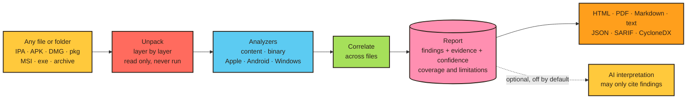
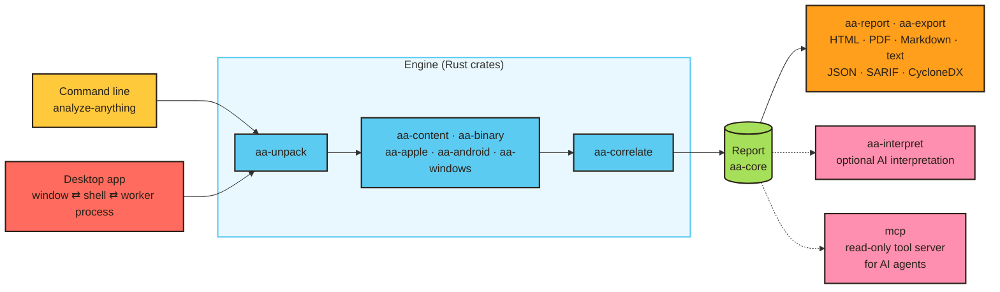

# Analyze Anything

[English](../../README.md) · [简体中文](../../README.zh-CN.md) · [繁體中文](README_zh-TW.md) · [日本語](README_ja.md) · [한국어](README_ko.md) · [Türkçe](README_tr.md) · [Русский](README_ru.md) · [Tiếng Việt](README_vi.md) · [ไทย](README_th.md) · [Deutsch](README_de.md) · [Español](README_es.md) · [Français](README_fr.md) · [Українська](README_uk.md) · [Polski](README_pl.md) · [Português (Brasil)](README_pt-BR.md) · [العربية](README_ar.md) · [فارسی](README_fa.md) · [Bahasa Indonesia](README_id.md) · [Italiano](README_it.md) · [Ελληνικά](README_el.md) · [മലയാളം](README_ml.md) · **Roman Urdu** · [Română](README_ro.md) · [Български](README_bg.md)

[Website](https://atomsprout.com/analyze-anything/) · [Examples](https://atomsprout.com/analyze-anything/#examples) · [Roadmap](../ROADMAP.md)

> Yeh ek tarjuma hai. [English README](../../README.md) asal hawala hai aur mumkin hai us mein is se nayi maloomat hon.

Apne computer par maujood koi bhi cheez ise dein — IPA, APK, macOS app, DMG ya pkg, Windows installer ya program folder, archive, folder, koi bhi file — aur aisi report hasil karein jis par aap bharosa kar saken aur jise aap trace kar saken: har finding ke sath us ka saboot hota hai (kaun si file, us mein kahan, aur wahan kya parha gaya) aur ek confidence level, aur jis cheez ka tajziya nahin ho saka woh coverage aur limitations ke tehat darj hoti hai.

```
analyze-anything App.ipa
```

Yeh command `App.ipa.report/` likhti hai, jis mein report HTML, PDF, Markdown, saada text aur JSON ki shakal mein hoti hai. SARIF aur CycloneDX bhi dastiyab hain.

- **Sirf static.** Input ko sirf parha jata hai; use kabhi chalaya, install ya load nahin kiya jata.
- **Offline.** Tajziya kisi cheez se connect nahin hota aur koi language model istemal nahin karta.
- **Deterministic.** Ek hi input se wohi report milti hai, byte ba byte.
- **Rust mein likha gaya**, aur chalte waqt kisi bahar ke tool ki zaroorat nahin.

Ise istemal karne ke do tareeqe hain; dono ek hi engine par chalte hain aur ek hi input ke liye wohi report dete hain:

- **command line**, `analyze-anything` (mukhtasar naam `aaaa`);
- macOS ke liye **desktop app**: file drop karein, progress dekhein, report parhein, kisi saboot par click kar ke us ke bytes dekhein, export karein, history rakhein aur do versions ka muqabla karein, aur agar aap ne set up kiya ho to report ke sath hi ek model se us ki wazahat karwayein.

## Yeh kaisa dikhta hai

<table>
  <tr>
    <td width="50%"><br><sub>Desktop app: report ka khulasa</sub></td>
    <td width="50%"><br><sub>Findings, har ek apne saboot ke sath</sub></td>
  </tr>
  <tr>
    <td><br><sub>Report ke sath ikhtiyari AI tashreeh; har bayan findings ka hawala deta hai</sub></td>
    <td><br><sub>Shuru karne ke liye koi file ya folder drop karein</sub></td>
  </tr>
</table>

<p align="center"><br><sub>Wohi report PDF ki shakal mein</sub></p>

Screenshots mein F-Droid 2.0.3 ki report dikhayi gayi hai, jo [misalon](https://atomsprout.com/analyze-anything/#examples) mein se ek hai.

## Install karna

Apple silicon par macOS, Homebrew ke sath:

```
brew install atomsprout/tap/analyze-anything                  # command line
brew install --cask atomsprout/tap/analyze-anything-desktop   # desktop app
```

Dono ek doosre ke baghair kaam karte hain. Dono Developer ID certificate se signed hain aur Apple se notarized hain.

Doosre platforms par command line ko source se build karein (Rust 1.90 ya us se naya):

```
cargo build --release
target/release/analyze-anything <file or folder>
```

Release shuda builds sirf Apple silicon Macs ke liye maujood hain. Linux aur Windows par code build hota hai aur us ke tests CI mein pass hote hain, lekin wahan abhi tak kisi ne ise khud chala kar istemal nahin kiya.

## Istemal

```
analyze-anything <file or folder>                 # tajziya karein; report <name>.report/ mein jati hai
analyze-anything App.ipa -o out --lang zh         # folder chunein; report Chinese mein likhein
analyze-anything diff old/report.json new/report.json    # do versions ke darmiyan kya badla
analyze-anything explain out/report.json <finding id>    # ek finding, us ke tamam saboot ke sath
analyze-anything verify out/                      # kya files ab bhi waisi hi hain jaisi likhi gayi thin?
```

Mukammal guide [docs/USAGE.md](../USAGE.md) hai.

## Misalein

Open-source software ki public releases ke bare mein reports, PDF ki shakal mein, [website](https://atomsprout.com/analyze-anything/#examples) par maujood hain: ek IPA, ek APK, ek DMG, ek macOS pkg, ek NSIS aur ek MSI installer, aur ek Linux program. `tools/site/examples.py` inhein unhi files se dobara banata hai.

## Yeh kya kya parhta hai

| | |
|---|---|
| Apple | `.app` aur doosre bundles, IPA, DMG (HFS+ aur APFS), pkg; Info.plist, code signatures aur certificate chains, sealed resources, entitlements, provisioning profiles, privacy manifests, FairPlay encryption |
| Android | APK, AAB, XAPK / APKS / APKM; manifest, resources, signature schemes v1–v3.1, DEX, SDKs aur packers |
| Windows | PE, Authenticode, .NET assemblies, MSI (apne signature ke sath), NSIS, Inno Setup, CAB, self-extractors, Electron (asar), MSIX, install shuda program folders |
| Aam | Mach-O, ELF aur PE ka structure aur hardening; zip, tar, 7z, gzip, bzip2, xz, zstd, kisi bhi gehrai tak nested; URLs, mumkina credentials, entropy, duplicate files |

## Yeh kaise kaam karta hai

Ek hi pass, sirf parhna: input ko teh ba teh khola jata hai, har file ko woh analyzers parhte hain jo use samajhte hain, aakhri marhala files ko ek doosre se jorta hai, aur jo kuch mila woh apne saboot ke sath likh diya jata hai. Report hi har output format ka wahid maakhaz hai.



Command line aur desktop app ek hi engine ke do rukh hain, is liye ek input dono mein wohi report deta hai. Desktop app kabhi apne process mein tajziya nahin karta: yeh kaam ek worker karta hai, jise yaqeeni taur par roka ja sakta hai.



## Ikhtiyari: report ki AI se tashreeh

Jab tak aap ise on na karein, yeh band rehta hai. Report likhe jane ke baad ek language model use saada alfaz mein samjha sakta hai:

```
analyze-anything ai claude          # ek baar: chunein ke yeh kaam kaun karega (yahan Claude Code, API key ki zaroorat nahin)
analyze-anything App.ipa --ai       # tajziya karein, phir report ke sath ai.md likhein
```

Yeh kaam kaun karega, aap chunte hain: koi model service jis ki API key aap ke paas ho (Claude, ya koi bhi jo OpenAI ka protocol bolta ho), Claude Code, Codex, ya koi model jise Ollama aap ki apni machine par chalata ho. Aap ka apna program bhi chal sakta hai. Model sirf report dekhta hai, tajziya shuda files kabhi nahin, aur us mein cheezein read-only tools ke zariye dhoondta hai. Us ke har bayan ko report ki findings ka hawala dena lazmi hai; jo bayan aisa nahin karte woh nikal diye jate hain. Dekhein [docs/AI.md](../AI.md).

## Maujooda haalat aur roadmap

0.1.0 pehli release hai. Aaj kisi bhi file ya folder ki report ban jati hai; Apple, Android aur Windows ke formats gehrai se samjhe jate hain. Yeh Apple silicon Macs ke liye release hua hai aur aise ek Mac par khud chala kar istemal kiya gaya hai; Linux aur Windows par code build hota hai aur CI mein apne tests pass karta hai.

"Anything" farsh ke bare mein ek wada hai aur chhat ke liye ek simt: kisi cheez ko radd nahin kiya jata, aur gehrai ek ek format kar ke barhayi jati hai, har ek chhote se crate ki shakal mein. Aage, tarteeb se:

1. **Har system par yahi cheez**: Linux, Windows aur Intel Macs ke liye release shuda builds; macOS se aage desktop app.
2. **Input ki mazeed qismein**: Linux packages, container images, language ecosystems ke packages, mazeed app platforms, aise documents jin mein code ho, firmware images.
3. **Jahan zaroori ho wahan zyada gehrai**: ek offline database se maloom vulnerabilities, function ki satah ke haqaiq, rules aur policies data ki shakal mein.
4. **Is par kuch banana aasan**: ek GitHub Action, report ke andar AI tashreeh, agents ke liye zyada mukammal interface, ek stable report schema.

Jo nahin badlega: sirf static, offline tajziya, ek hi input ke liye wohi report, har finding ka saboot, aur koi faisla nahin. Poori tasveer [docs/ROADMAP.md](../ROADMAP.md) mein hai; ek ek item ki fehrist [docs/TODO.md](../TODO.md) hai.

## Jaan'na mufeed hai

- Severity har rule ki ek muqarrar khasiyat hai, jo is liye hai ke aap ke parhne ki tarteeb ban sake. Report yeh nahin batati ke koi input mehfooz hai ya nahin.
- Heuristic ke taur par nishan zad findings (mumkina credentials, packers, SDK ki shanakht) false positives ho sakti hain.
- Signatures ko khud file ke muqable mein check kiya jata hai: digests, signature values, certificate chains. Revocation, system ki trust settings aur Apple ka notarization status check nahin kiye jate; is ke liye network darkar hoga.
- App Store se download kiya gaya IPA encrypted hota hai: yeh pehchan liya jata hai, aur metadata, signature aur resources ka tajziya mamool ke mutabiq hota hai, lekin encrypted code parha nahin ja sakta.
- Ise sirf un cheezon par istemal karein jin ka tajziya karne ka aap ko haq ho.

Mazeed [docs/LIMITATIONS.md](../LIMITATIONS.md) mein.

## Dastaveezat

- [docs/USAGE.md](../USAGE.md) — command line mukammal tafseel ke sath ([中文](../USAGE.zh-CN.md))
- [docs/AI.md](../AI.md) — ikhtiyari AI tashreeh
- [docs/DESKTOP.md](../DESKTOP.md) — desktop app: structure, development, testing, release
- [docs/LIMITATIONS.md](../LIMITATIONS.md) — maloom limitations
- [docs/ANALYZERS.md](../ANALYZERS.md) — naya format kaise shamil karein
- [docs/ROADMAP.md](../ROADMAP.md) — yeh ab kahan khara hai aur kahan ja raha hai
- [docs/TODO.md](../TODO.md) — kya karna baqi hai, ek ek item kar ke
- [AGENTS.md](../../AGENTS.md) — is repository mein kaise kaam karna hai, contributors aur coding agents ke liye
- [docs/PLAN.md](../PLAN.md), [docs/PLAN-DESKTOP.md](../PLAN-DESKTOP.md), [docs/RESEARCH.md](../RESEARCH.md), [docs/spikes/](../spikes/) — is ki mansooba bandi kaise hui aur kya kya aazmaya gaya

## Development

```
cargo fmt --all --check
cargo clippy --workspace --all-targets -- -D warnings
cargo test --workspace
```

[AGENTS.md](../../AGENTS.md) batata hai ke repository ki tarteeb kya hai aur kisi tabdeeli ko kya barqarar rakhna zaroori hai. Desktop app `apps/desktop` mein hai; dekhein [docs/DESKTOP.md](../DESKTOP.md). Issues aur pull requests ka khair maqdam hai. Barah-e-karam aisi files attach na karein jinhein share karne ka aap ko haq nahin: `report.json` ki woh ek finding jo masla dikhati ho, aam taur par kaafi hoti hai.

## License

Apache-2.0; dekhein [LICENSE](../../LICENSE). Doosron se jo kuch sath shamil kiya gaya hai, jin mein reports ke fonts bhi hain, woh [NOTICE](../../NOTICE) mein darj hai.
