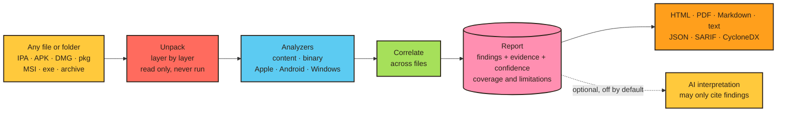
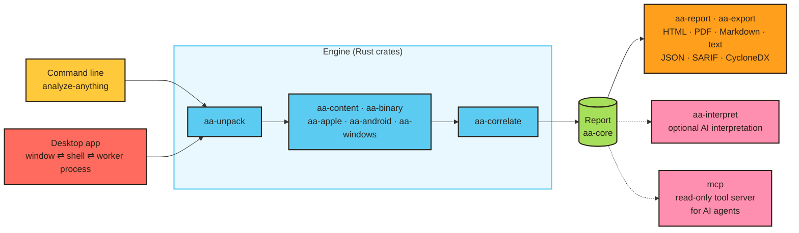

# Analyze Anything

[English](../../README.md) · [简体中文](../../README.zh-CN.md) · [繁體中文](README_zh-TW.md) · [日本語](README_ja.md) · [한국어](README_ko.md) · [Türkçe](README_tr.md) · [Русский](README_ru.md) · **Tiếng Việt** · [ไทย](README_th.md) · [Deutsch](README_de.md) · [Español](README_es.md) · [Français](README_fr.md) · [Українська](README_uk.md) · [Polski](README_pl.md) · [Português (Brasil)](README_pt-BR.md) · [العربية](README_ar.md) · [فارسی](README_fa.md) · [Bahasa Indonesia](README_id.md) · [Italiano](README_it.md) · [Ελληνικά](README_el.md) · [മലയാളം](README_ml.md) · [Roman Urdu](README_ur-Latn.md) · [Română](README_ro.md) · [Български](README_bg.md)

[Website](https://atomsprout.com/analyze-anything/) · [Examples](https://atomsprout.com/analyze-anything/#examples) · [Roadmap](../ROADMAP.md)

> Đây là bản dịch. [README tiếng Anh](../../README.md) là bản gốc để đối chiếu và có thể mới hơn.

Đưa cho nó bất kỳ thứ gì trên máy tính của bạn — một IPA, một APK, một ứng dụng macOS, một DMG hoặc pkg, một trình cài đặt Windows hoặc thư mục chương trình, một tệp nén, một thư mục, bất kỳ tệp nào — và nhận về một báo cáo mà bạn có thể tin cậy và truy ngược: mỗi phát hiện đều kèm bằng chứng (tệp nào, ở vị trí nào trong tệp, đã đọc được gì ở đó) và độ tin cậy, còn những gì không phân tích được thì được liệt kê trong phần phạm vi bao phủ và giới hạn.

```
analyze-anything App.ipa
```

Lệnh này ghi ra `App.ipa.report/` chứa báo cáo ở dạng HTML, PDF, Markdown, văn bản thuần và JSON. Cũng có thể xuất SARIF và CycloneDX.

- **Chỉ phân tích tĩnh.** Đầu vào chỉ được đọc, không bao giờ được chạy, cài đặt hay nạp.
- **Ngoại tuyến.** Quá trình phân tích không kết nối tới đâu cả và không dùng mô hình ngôn ngữ.
- **Tất định.** Cùng một đầu vào cho ra cùng một báo cáo, giống nhau đến từng byte.
- **Viết bằng Rust**, không cần công cụ bên ngoài nào khi chạy.

Có hai cách dùng, trên cùng một engine, cho cùng một báo cáo với cùng một đầu vào:

- **dòng lệnh**, `analyze-anything` (tên ngắn `aaaa`);
- **ứng dụng desktop** cho macOS: thả một tệp vào, theo dõi tiến độ, đọc báo cáo, bấm vào một bằng chứng để xem các byte của nó, xuất báo cáo, lưu lịch sử và so sánh hai phiên bản, và nếu bạn thiết lập, để một mô hình giải thích báo cáo ngay bên cạnh.

## Giao diện

<table>
  <tr>
    <td width="50%"><br><sub>Ứng dụng desktop: phần tóm tắt của báo cáo</sub></td>
    <td width="50%"><br><sub>Các phát hiện, mỗi phát hiện kèm bằng chứng</sub></td>
  </tr>
  <tr>
    <td><br><sub>Phần diễn giải bằng AI (tùy chọn) bên cạnh báo cáo; mọi nhận định đều trích dẫn phát hiện</sub></td>
    <td><br><sub>Thả một tệp hoặc thư mục vào để bắt đầu</sub></td>
  </tr>
</table>

<p align="center"><br><sub>Cùng báo cáo đó ở dạng PDF</sub></p>

Các ảnh chụp màn hình cho thấy báo cáo về F-Droid 2.0.3, một trong các [ví dụ](https://atomsprout.com/analyze-anything/#examples).

## Cài đặt

macOS trên Apple silicon, dùng Homebrew:

```
brew install atomsprout/tap/analyze-anything                  # dòng lệnh
brew install --cask atomsprout/tap/analyze-anything-desktop   # ứng dụng desktop
```

Mỗi thứ hoạt động độc lập, không cần thứ kia. Cả hai đều được ký bằng chứng chỉ Developer ID và được Apple công chứng (notarize).

Trên các nền tảng khác, hãy build công cụ dòng lệnh từ mã nguồn (Rust 1.90 trở lên):

```
cargo build --release
target/release/analyze-anything <file or folder>
```

Bản build phát hành hiện chỉ có cho máy Mac dùng Apple silicon. Trên Linux và Windows, mã nguồn build được và các bài test chạy qua trên CI, nhưng chưa ai dùng thử trực tiếp trên đó.

## Sử dụng

```
analyze-anything <file or folder>                 # phân tích; báo cáo được ghi vào <name>.report/
analyze-anything App.ipa -o out --lang zh         # chọn thư mục; viết báo cáo bằng tiếng Trung
analyze-anything diff old/report.json new/report.json    # những gì thay đổi giữa hai phiên bản
analyze-anything explain out/report.json <finding id>    # một phát hiện cùng toàn bộ bằng chứng của nó
analyze-anything verify out/                      # các tệp có còn đúng như lúc được ghi ra không?
```

Hướng dẫn đầy đủ nằm ở [docs/USAGE.md](../USAGE.md).

## Ví dụ

Các báo cáo về những bản phát hành công khai của phần mềm mã nguồn mở, ở dạng PDF, có trên [trang web](https://atomsprout.com/analyze-anything/#examples): một IPA, một APK, một DMG, một pkg của macOS, một trình cài đặt NSIS và một trình cài đặt MSI, và một chương trình Linux. `tools/site/examples.py` tạo lại chúng từ chính các tệp đó.

## Những gì nó đọc được

| | |
|---|---|
| Apple | `.app` và các bundle khác, IPA, DMG (HFS+ và APFS), pkg; Info.plist, chữ ký mã và chuỗi chứng chỉ, tài nguyên được niêm phong (sealed resources), entitlements, provisioning profile, privacy manifest, mã hóa FairPlay |
| Android | APK, AAB, XAPK / APKS / APKM; manifest, tài nguyên, các lược đồ chữ ký v1–v3.1, DEX, SDK và packer |
| Windows | PE, Authenticode, assembly .NET, MSI (kèm chữ ký riêng của nó), NSIS, Inno Setup, CAB, tệp tự giải nén, Electron (asar), MSIX, thư mục chương trình đã cài đặt |
| Chung | Cấu trúc và các biện pháp hardening của Mach-O, ELF và PE; zip, tar, 7z, gzip, bzip2, xz, zstd, lồng nhau ở độ sâu bất kỳ; URL, chuỗi có khả năng là thông tin xác thực, entropy, tệp trùng lặp |

## Cách hoạt động

Một lượt duy nhất, chỉ đọc: đầu vào được mở từng lớp một, mỗi tệp được đọc bởi các analyzer hiểu được nó, bước cuối cùng liên hệ các tệp với nhau, và mọi thứ tìm thấy đều được ghi lại kèm bằng chứng. Báo cáo là nguồn duy nhất của mọi định dạng đầu ra.



Dòng lệnh và ứng dụng desktop là hai mặt của cùng một engine, nên một đầu vào cho ra cùng một báo cáo ở cả hai. Ứng dụng desktop không bao giờ phân tích trong tiến trình của chính nó: một worker làm việc đó, và chắc chắn có thể dừng được.



## Tùy chọn: để AI diễn giải báo cáo

Tắt, trừ khi bạn bật lên. Khi báo cáo đã được ghi ra, một mô hình ngôn ngữ có thể giải thích nó bằng lời lẽ dễ hiểu:

```
analyze-anything ai claude          # một lần: chọn bên thực hiện (ở đây là Claude Code, không cần API key)
analyze-anything App.ipa --ai       # phân tích, rồi ghi ai.md bên cạnh báo cáo
```

Bạn chọn bên thực hiện: một dịch vụ mô hình mà bạn có API key (Claude, hoặc bất kỳ dịch vụ nào dùng giao thức của OpenAI), Claude Code, Codex, hoặc một mô hình mà Ollama chạy trên chính máy của bạn. Một chương trình của riêng bạn cũng được. Mô hình chỉ thấy báo cáo, không bao giờ thấy các tệp được phân tích, và tra cứu trong báo cáo thông qua các công cụ chỉ đọc. Mọi nhận định nó đưa ra đều phải trích dẫn các phát hiện trong báo cáo; những nhận định không trích dẫn sẽ bị loại bỏ. Xem [docs/AI.md](../AI.md).

## Hiện trạng và lộ trình

0.1.0 là bản phát hành đầu tiên. Hiện nay bất kỳ tệp hay thư mục nào cũng nhận được báo cáo; các định dạng của Apple, Android và Windows được hiểu sâu. Nó được phát hành cho máy Mac dùng Apple silicon và đã được dùng trực tiếp trên một máy như vậy; trên Linux và Windows, mã nguồn build được và chạy qua các bài test trên CI.

"Anything" là một lời hứa về mức sàn và một định hướng cho mức trần: không từ chối thứ gì, còn độ sâu được bổ sung từng định dạng một, mỗi định dạng là một crate nhỏ. Tiếp theo, theo thứ tự:

1. **Giống nhau trên mọi hệ thống**: bản build phát hành cho Linux, Windows và máy Mac Intel; ứng dụng desktop ngoài macOS.
2. **Thêm nhiều loại đầu vào**: gói Linux, container image, gói của các hệ sinh thái ngôn ngữ, thêm các nền tảng ứng dụng, tài liệu có chứa mã, firmware image.
3. **Sâu hơn ở những chỗ quan trọng**: lỗ hổng đã biết từ một cơ sở dữ liệu ngoại tuyến, thông tin ở mức hàm, quy tắc và chính sách dưới dạng dữ liệu.
4. **Dễ xây dựng dựa trên nó hơn**: một GitHub Action, phần diễn giải của AI nằm ngay trong báo cáo, giao diện đầy đủ hơn cho các agent, một schema báo cáo ổn định.

Những điều sẽ không thay đổi: chỉ phân tích tĩnh, phân tích ngoại tuyến, cùng một báo cáo cho cùng một đầu vào, bằng chứng cho mọi phát hiện, và không đưa ra phán quyết. Bức tranh toàn cảnh nằm ở [docs/ROADMAP.md](../ROADMAP.md); danh sách chi tiết từng mục là [docs/TODO.md](../TODO.md).

## Điều nên biết

- Mức độ nghiêm trọng là thuộc tính cố định của từng quy tắc, dùng để sắp xếp thứ tự đọc của bạn. Báo cáo không nói một đầu vào có an toàn hay không.
- Các phát hiện được đánh dấu là heuristic (chuỗi có khả năng là thông tin xác thực, packer, nhận diện SDK) có thể là dương tính giả.
- Chữ ký được kiểm tra dựa trên chính tệp đó: digest, giá trị chữ ký, chuỗi chứng chỉ. Việc thu hồi chứng chỉ, thiết lập tin cậy của hệ thống và trạng thái notarize của Apple không được kiểm tra; việc đó cần đến mạng.
- Một IPA tải về từ App Store đã được mã hóa: điều này được nhận biết, và metadata, chữ ký cùng tài nguyên vẫn được phân tích như thường lệ, nhưng phần mã đã mã hóa thì không đọc được.
- Chỉ dùng nó với những thứ bạn có quyền phân tích.

Xem thêm ở [docs/LIMITATIONS.md](../LIMITATIONS.md).

## Tài liệu

- [docs/USAGE.md](../USAGE.md) — hướng dẫn đầy đủ về dòng lệnh ([中文](../USAGE.zh-CN.md))
- [docs/AI.md](../AI.md) — phần diễn giải bằng AI (tùy chọn)
- [docs/DESKTOP.md](../DESKTOP.md) — ứng dụng desktop: cấu trúc, phát triển, kiểm thử, phát hành
- [docs/LIMITATIONS.md](../LIMITATIONS.md) — các giới hạn đã biết
- [docs/ANALYZERS.md](../ANALYZERS.md) — cách thêm một định dạng
- [docs/ROADMAP.md](../ROADMAP.md) — dự án đang ở đâu và sẽ đi đến đâu
- [docs/TODO.md](../TODO.md) — những việc còn phải làm, từng mục một
- [AGENTS.md](../../AGENTS.md) — cách làm việc trong repository này, dành cho người đóng góp và các coding agent
- [docs/PLAN.md](../PLAN.md), [docs/PLAN-DESKTOP.md](../PLAN-DESKTOP.md), [docs/RESEARCH.md](../RESEARCH.md), [docs/spikes/](../spikes/) — dự án đã được lên kế hoạch thế nào và đã thử những gì

## Phát triển

```
cargo fmt --all --check
cargo clippy --workspace --all-targets -- -D warnings
cargo test --workspace
```

[AGENTS.md](../../AGENTS.md) cho biết repository được tổ chức thế nào và một thay đổi phải giữ nguyên những gì. Ứng dụng desktop nằm trong `apps/desktop`; xem [docs/DESKTOP.md](../DESKTOP.md). Issue và pull request đều được hoan nghênh. Vui lòng không đính kèm những tệp bạn không có quyền chia sẻ: thường chỉ cần một phát hiện trong `report.json` cho thấy vấn đề là đủ.

## Giấy phép

Apache-2.0; xem [LICENSE](../../LICENSE). Những thành phần của bên khác được đóng gói kèm, trong đó có các phông chữ dùng trong báo cáo, được liệt kê trong [NOTICE](../../NOTICE).
