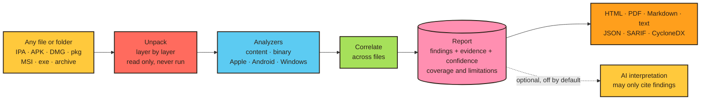
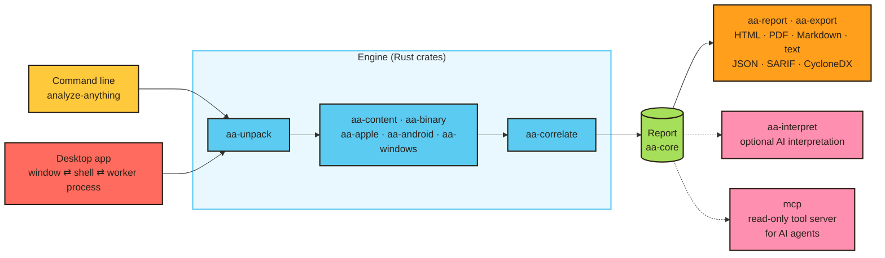

> Translation notice: the English README may be newer; see README.md for current delivery status and milestones.

# Analyze Anything

[English](../../README.md) · [简体中文](../../README.zh-CN.md) · **繁體中文** · [日本語](README_ja.md) · [한국어](README_ko.md) · [Türkçe](README_tr.md) · [Русский](README_ru.md) · [Tiếng Việt](README_vi.md) · [ไทย](README_th.md) · [Deutsch](README_de.md) · [Español](README_es.md) · [Français](README_fr.md) · [Українська](README_uk.md) · [Polski](README_pl.md) · [Português (Brasil)](README_pt-BR.md) · [العربية](README_ar.md) · [فارسی](README_fa.md) · [Bahasa Indonesia](README_id.md) · [Italiano](README_it.md) · [Ελληνικά](README_el.md) · [മലയാളം](README_ml.md) · [Roman Urdu](README_ur-Latn.md) · [Română](README_ro.md) · [Български](README_bg.md)

[Website](https://atomsprout.com/analyze-anything/) · [Examples](https://atomsprout.com/analyze-anything/#examples) · [Roadmap](../ROADMAP.md)

> 這是翻譯版本。請以[英文 README](../../README.md) 為準，其內容可能較新。

把電腦上的任何東西交給它：IPA、APK、macOS 應用程式、DMG 或 pkg、Windows 安裝程式或程式資料夾、壓縮檔、資料夾、任何檔案，就能得到一份可以信任、可以追溯的報告：每項發現都附有證據（哪個檔案、檔案中的哪個位置、在那裡讀到了什麼）與可信度，無法分析的部分則列在「涵蓋範圍與限制」之下。

```
analyze-anything App.ipa
```

這會寫出 `App.ipa.report/`，其中的報告有 HTML、PDF、Markdown、純文字與 JSON 等格式。也可以輸出 SARIF 與 CycloneDX。

- **僅靜態分析**。輸入只會被讀取，絕不執行、安裝或載入。
- **離線**。分析過程不連線到任何地方，也不使用語言模型。
- **確定性**。相同的輸入產生相同的報告，每個位元組都一樣。
- **以 Rust 撰寫**，執行時不需要任何外部工具。

使用方式有兩種，背後是同一個引擎，相同的輸入會得到相同的報告：

- **命令列**：`analyze-anything`（簡稱 `aaaa`）；
- macOS 的**桌面應用程式**：拖入檔案、觀看進度、閱讀報告、點選一項證據以檢視其位元組、匯出、保留歷史紀錄並比較兩個版本；如果你完成設定，還可以讓模型在報告旁邊加以解說。

## 外觀

<table>
  <tr>
    <td width="50%"><br><sub>桌面應用程式：報告摘要</sub></td>
    <td width="50%"><br><sub>發現項目，每項都附有證據</sub></td>
  </tr>
  <tr>
    <td><br><sub>報告旁的選用 AI 解讀；每句陳述都引用發現項目</sub></td>
    <td><br><sub>拖入檔案或資料夾即可開始</sub></td>
  </tr>
</table>

<p align="center"><br><sub>同一份報告的 PDF 版本</sub></p>

這些螢幕截圖顯示的是 F-Droid 2.0.3 的報告，它是[範例](https://atomsprout.com/analyze-anything/#examples)之一。

## 安裝

搭載 Apple 晶片的 macOS，使用 Homebrew：

```
brew install atomsprout/tap/analyze-anything                  # 命令列
brew install --cask atomsprout/tap/analyze-anything-desktop   # 桌面應用程式
```

兩者可各自獨立使用，皆以 Developer ID 憑證簽署，並經 Apple 公證。

在其他平台上，請從原始碼建置命令列工具（需要 Rust 1.90 或更新版本）：

```
cargo build --release
target/release/analyze-anything <file or folder>
```

目前只為搭載 Apple 晶片的 Mac 發布建置版本。在 Linux 與 Windows 上，程式碼可以建置，測試也在 CI 中通過，但還沒有人在這些平台上實際手動使用過。

## 使用

```
analyze-anything <file or folder>                 # 分析；報告寫到 <name>.report/
analyze-anything App.ipa -o out --lang zh         # 指定資料夾；以中文撰寫報告
analyze-anything diff old/report.json new/report.json    # 兩個版本之間有哪些變動
analyze-anything explain out/report.json <finding id>    # 單一發現項目及其全部證據
analyze-anything verify out/                      # 檔案是否仍與當初寫出的一致？
```

完整指南見 [docs/USAGE.md](../USAGE.md)。

## 範例

[網站](https://atomsprout.com/analyze-anything/#examples)上有針對開放原始碼軟體公開發行版本所產生的 PDF 報告：一個 IPA、一個 APK、一個 DMG、一個 macOS pkg、NSIS 與 MSI 安裝程式各一個，以及一個 Linux 程式。`tools/site/examples.py` 可以用相同的檔案重新產生這些報告。

## 讀取的內容

| | |
|---|---|
| Apple | `.app` 與其他 bundle、IPA、DMG（HFS+ 與 APFS）、pkg；Info.plist、程式碼簽章與憑證鏈、密封資源、entitlements、佈建描述檔、隱私權清單、FairPlay 加密 |
| Android | APK、AAB、XAPK / APKS / APKM；manifest、資源、簽章方案 v1–v3.1、DEX、SDK 與加殼工具 |
| Windows | PE、Authenticode、.NET 組件、MSI（含其自身的簽章）、NSIS、Inno Setup、CAB、自解壓縮檔、Electron（asar）、MSIX、已安裝的程式資料夾 |
| 通用 | Mach-O、ELF 與 PE 的結構與安全強化措施；zip、tar、7z、gzip、bzip2、xz、zstd，巢狀深度不限；URL、疑似認證資訊、熵、重複檔案 |

## 運作方式

單次處理、唯讀：輸入被逐層打開，每個檔案由能理解它的分析器讀取，最後一個步驟把各個檔案彼此關聯起來，所有發現連同證據一併記錄下來。報告是所有輸出格式的唯一來源。



命令列與桌面應用程式是同一個引擎的兩個介面，因此同一個輸入在兩者中會得到相同的報告。桌面應用程式絕不在自己的行程中進行分析：分析由 worker 行程負責，而且一定能被停止。



## 選用功能：由 AI 解讀報告

除非你自行開啟，否則此功能為關閉。報告寫出之後，語言模型可以用淺白的文字加以解說：

```
analyze-anything ai claude          # 只需一次：選擇由誰來做（這裡是 Claude Code，不需要 API 金鑰）
analyze-anything App.ipa --ai       # 分析，然後在報告旁寫出 ai.md
```

由誰來做由你決定：你擁有 API 金鑰的模型服務（Claude，或任何支援 OpenAI 協定的服務）、Claude Code、Codex，或由 Ollama 在你自己機器上執行的模型。你自己寫的程式也可以。模型看到的是報告，絕不是被分析的檔案，並透過唯讀工具在報告中查找內容。它的每句陳述都必須引用報告中的發現項目；沒有引用的會被捨棄。詳見 [docs/AI.md](../AI.md)。

## 現況與藍圖

0.1.0 是第一個發行版本。目前任何檔案或資料夾都能得到報告；對 Apple、Android 與 Windows 的格式有深入的理解。它針對搭載 Apple 晶片的 Mac 發行，並已在一台這樣的 Mac 上實際手動使用過；在 Linux 與 Windows 上，程式碼可以建置並在 CI 中通過測試。

「Anything」是對下限的承諾，也是上限的方向：不拒絕任何輸入，深度則一次增加一種格式，每種格式是一個小型 crate。接下來依序是：

1. **在每個系統上都一樣**：為 Linux 與 Windows 發布建置版本；macOS 以外的桌面應用程式。
2. **更多種類的輸入**：Linux 套件、容器映像檔、各語言生態系的套件、更多應用程式平台、內含程式碼的文件、韌體映像檔。
3. **在重要之處更深入**：來自離線資料庫的已知漏洞、函式層級的事實、以資料形式表達的規則與政策。
4. **更容易在其上建構**：GitHub Action、把 AI 解讀放進報告、更完整的 agent 介面、穩定的報告 schema。

不會改變的是：僅靜態分析、離線分析、相同輸入得到相同報告、每項發現都有證據，以及不下判定。全貌見 [docs/ROADMAP.md](../ROADMAP.md)；逐項清單見 [docs/TODO.md](../TODO.md)。

## 須知

- 嚴重程度是每條規則的固定屬性，用來安排你的閱讀順序。報告不會說某個輸入是否安全。
- 標示為啟發式的發現項目（疑似認證資訊、加殼工具、SDK 偵測）可能是誤判。
- 簽章是針對檔案本身檢查的：摘要、簽章值、憑證鏈。不會檢查撤銷狀態、系統信任設定與 Apple 的公證狀態；那需要網路。
- 從 App Store 下載的 IPA 是加密的：這一點會被辨識出來，中繼資料、簽章與資源照常分析，但加密的程式碼無法讀取。
- 只用在你有權分析的東西上。

更多內容見 [docs/LIMITATIONS.md](../LIMITATIONS.md)。

## 文件

- [docs/USAGE.md](../USAGE.md) — 命令列完整說明（[中文](../USAGE.zh-CN.md)）
- [docs/AI.md](../AI.md) — 選用的 AI 解讀
- [docs/DESKTOP.md](../DESKTOP.md) — 桌面應用程式：結構、開發、測試、發行
- [docs/LIMITATIONS.md](../LIMITATIONS.md) — 已知限制
- [docs/ANALYZERS.md](../ANALYZERS.md) — 如何新增一種格式
- [docs/ROADMAP.md](../ROADMAP.md) — 目前的狀況與未來的方向
- [docs/TODO.md](../TODO.md) — 尚待完成的事項，逐項列出
- [AGENTS.md](../../AGENTS.md) — 如何在這個儲存庫中工作，寫給貢獻者與程式開發 agent
- [docs/PLAN.md](../PLAN.md)、[docs/PLAN-DESKTOP.md](../PLAN-DESKTOP.md)、[docs/RESEARCH.md](../RESEARCH.md)、[docs/spikes/](../spikes/) — 當初如何規劃，以及嘗試過什麼

## 開發

```
cargo fmt --all --check
cargo clippy --workspace --all-targets -- -D warnings
cargo test --workspace
```

[AGENTS.md](../../AGENTS.md) 說明了儲存庫的配置方式，以及任何變更都必須維持的事項。桌面應用程式位於 `apps/desktop`；見 [docs/DESKTOP.md](../DESKTOP.md)。歡迎提出 issue 與 pull request。請勿附上你無權分享的檔案：通常只要附上 `report.json` 中能呈現問題的那一項發現就夠了。

## 授權條款

Apache-2.0；見 [LICENSE](../../LICENSE)。隨附的第三方內容（包括報告中使用的字型）列於 [NOTICE](../../NOTICE)。
